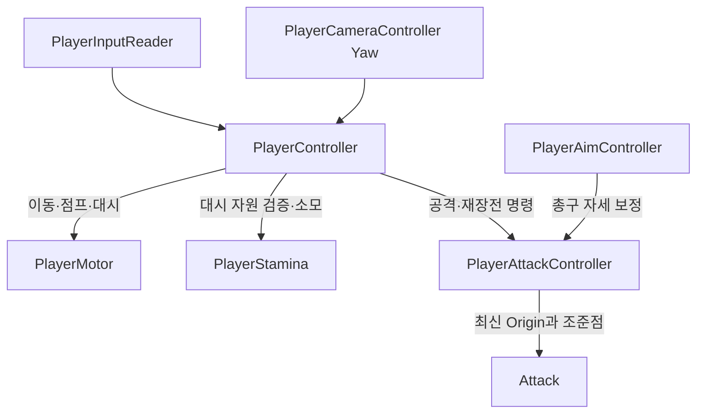

# 플레이어 입력·선입력 설계

기준 날짜: **2026-10-30**. `PlayerController` 하나가 이동 명령과 전투 행동 선택을 담당한다. 별도 `PlayerActionController`를 추가하거나 기존 클래스명을 변경하지 않는다.

## 1. 클래스의 역할과 책임

| 클래스 | 책임 | 보유하는 상태 |
|---|---|---|
| `ButtonInputState` | 한 프레임의 Pressed·Held·Released를 읽기 전용 스냅샷으로 전달 | 해당 프레임의 버튼 상태 |
| `PlayerInputReader` | Input System 액션과 입력 수집, 커서·포커스·일시정지 처리. `IsGameplayInputEnabled`로 조작 가능 여부 제공 | 이동·시점·8개 버튼 스냅샷, 커서 재잠금 사격 억제 |
| `PlayerController` | 카메라 Yaw 기준 이동·점프 명령, 다음 행동 한 개의 예약·만료·교체, 대시 최우선 선택, 홀딩 반복·자동 장전 요청 | `maxInputBufferTime`, 예약 행동·만료 시각, 대시 소모량·입력 로그 |
| `PlayerMotor` | 이동·회전·중력·점프·충돌·대시 이동과 후딜 실행. 행동 가능 상태 제공 | 실제 속도·접지·대시 방향·남은 이동/후딜 시간 |
| `PlayerStamina` | 스태미나 검증·소모·회복·회복 지연과 변경 이벤트 | 현재 스태미나·회복 대기 |
| `PlayerAttackController` | Controller의 한 프레임 공격/장전 명령 수신. 최신 조준·배율 준비, 바인딩의 Attack 호출, 탄약·장전·취소·이벤트 관리 | 한 프레임 실행 명령, 탄창·장전 상태 |
| `PlayerAttackBinding` | 슬롯과 실제 Attack·Origin 연결 | 프리팹/씬의 참조. 반복 정책은 Attack.Data에서 조회 |
| `Attack` / `Combatant` | 공격 수락·선딜·실제 실행·후딜·쿨타임, 같은 캐릭터의 공격 잠금과 생존 확인 | 공격별 실행 상태와 공유 행동 제한 |
| `PlayerAimController` / `PlayerCameraController` | 조준점·상체·총구·양팔 IK와 카메라 갱신 | 시각 자세·시점 |
| `PlayerAnimationController` | 실제 이동 상태와 공격·대시·장전 이벤트에 반응 | Animator 상태. 입력 예약·행동 잠금의 원본이 아님 |
| `PlayerStat` | 이동·대시 거리·공격 배율·탄창·장전 시간/속도·최대 스태미나 원본 | 강화·Inspector 능력치 |

입력의 우선순위와 예약 여부는 Controller 한 곳에서 결정한다. AttackController는 버튼을 직접 읽거나 별도의 선입력을 저장하지 않는다. 기존 공개 `TryReload`·`CancelReload`와 공통 `Attack.TryAttack` API는 유지한다.

## 2. 선입력 규칙

1. **다음 행동은 한 개만 저장한다.** 큐로 여러 행동을 이어서 실행하지 않는다.
2. **공격 선딜·후딜 또는 대시 이동·후딜이 끝나는 첫 행동 선택 시점까지 기다린다.** 단, 최대 선입력 시간이 먼저 지나면 버린다. 이미 시작한 공격이나 대시의 딜레이는 취소하지 않는다.
3. **대시가 최우선이다.** 새 Dash.Pressed는 일반 예약을 교체하며, 예약된 대시는 다른 행동으로 교체할 수 없다. 낮은 우선순위 입력이나 Held는 대시의 만료 시각도 늘리지 못한다. 새 대시 누름은 새 예약으로 갱신한다.
4. **실행 직전에 조건을 다시 검사한다.** 첫 실행 기회에도 스태미나 부족·쿨타임·탄약·장전·미연결/비활성 공격·잘못된 Origin 등으로 실패하면 요청을 버린다. 자원 회복이나 쿨타임 종료를 기다리지 않는다.
5. **한 번 시도한 예약은 지운다.** 공격/장전은 Controller가 그 프레임 실행 명령을 넘길 때 예약을 소비하고, AttackController가 LateUpdate에서 최종 수락 여부를 검사한다. 대시는 Controller에서 즉시 검사·실행한다. 조작 중단 시에도 예약과 미처리 명령을 지운다.

일반 예약은 더 나중 프레임의 새 Pressed로 교체한다. 동일 프레임의 우선순위는 **Dash → 비기본 공격의 바인딩 순서 → Reload → PrimaryFire**다. 현재 SampleScene의 비기본 공격 순서는 SecondaryFire → Skill1이며, 미연결 Skill2·Ultimate는 기존 입력 로그만 유지한다. 실제 바인딩이 추가되면 같은 규칙에 참여한다.

유효한 예약을 시도한 프레임에는 다른 홀딩 행동을 추가 실행하지 않는다. 실패한 예약 다음 프레임부터 홀딩 반복·빈 탄창 자동 장전은 다시 시도할 수 있다. 같은 누름의 예약이 남아서 재시도되는 것은 아니다.

## 3. 최대 선입력 시간

- 설정 위치: SampleScene의 Player → `PlayerController` → **Max Input Buffer Time** (`maxInputBufferTime`).
- 코드·씬 초기값: **1초**. 최종 조작감에 따라 Inspector에서 조절한다.
- `Time.timeAsDouble` 기준 게임 시간으로 만료 시각을 정한다. 경과 시간이 한도 이상이면 만료한다.
- **0초**는 딜레이 중 예약을 비활성화한다. 실행 가능한 프레임의 새 누름은 즉시 처리한다.
- 음수·NaN·Infinity는 Inspector 검증에서 0으로 보정한다. 진행 중 예약은 누른 시점에 정한 만료 시각을 사용한다.
- `BufferedAction`과 `BufferRemaining`은 외부 읽기 전용 진단 값이다.

현재 수류탄 후딜은 1초다. 한도를 그보다 짧게 설정하면 후딜 초반의 입력이 끝나기 전에 만료될 수 있다. 만료된 대시는 이후 입력을 보호하지 않으며 다른 가능한 행동을 선택할 수 있다.

## 4. 이동·점프·홀딩·장전

| 대상 | 정책 |
|---|---|
| WASD·시점 | 현재 프레임 입력을 사용. 예약하지 않음 |
| Jump.Pressed | 기존 CanJump·접지 규칙으로 즉시 처리. 실제 대시 이동 중·공중 입력은 예약하지 않음 |
| Dash·공격·스킬·수동 Reload.Pressed | 행동 제한 중에는 한 개 예약, 제한이 없으면 즉시 한 번 시도 |
| RepeatWhileHeld 공격 | 예약이 없는 경우에만 현재 Held와 CanAttack(slot)으로 실행 가능한 공격을 골라 반복 요청. 반복 요청은 버퍼에 넣지 않음 |
| 0발 자동 장전 | 예약·비기본 홀딩 공격 다음에 매 프레임 요청. 실제 장전 시작 가능 여부는 AttackController에서 확인 |
| 장전 중 기본·보조 발사 | 기존처럼 거절. 장전 완료까지 짧은 발사 누름을 추가 예약하지 않음 |
| 장전 중 대시·스킬 | 대시 시작 성공·스킬 요청 수락 때 기존 장전을 보충 없이 취소 |

예약 대시의 방향은 **실행하는 프레임의 이동 입력**, 무입력이면 그 프레임의 카메라 Yaw 전방이다. 대시가 시작된 뒤에는 방향을 고정한다. 공격도 예약 시점의 조준점이나 총구 좌표를 복사하지 않으며 기존 조준·Origin 처리를 사용한다.

좌클릭을 누른 채 Shift를 공격 딜레이 중 눌렀다면: 현재 공격 완료 → 예약 대시 → 대시 후딜 완료 → 계속 Held인 기본 발사 재개. Shift를 계속 누르는 것만으로 대시를 반복하지 않는다.

## 5. 조작 중단과 실행 순서

일시정지, 포커스 상실, 커서 해제, Reader 비활성화, Controller 비활성화, 사망은 예약을 지운다. 조작 재개 후 이전 예약을 실행하지 않는다. 공격·장전의 기존 일시정지 규칙은 유지한다. 사망 후 이동 중단·연출은 여전히 후속 작업이다.

| 순서 | 실행 |
|---|---|
| Update -200 | Reader가 스냅샷과 조작 가능 여부 제공 |
| Update -100 / -75 | Camera Yaw / Stamina 회복 갱신 |
| Update -50 | Controller가 예약 만료·새 누름 교체·다음 행동 선택. 대시 실행 또는 공격/장전 명령 전달, 이동·점프 명령 전달 |
| Update 0 / 50 | Motor 이동 / Animation 상태 갱신 |
| LateUpdate -100 / 75 | Camera 최종 배치 / Aim 상체·총구·IK 보정 |
| LateUpdate 100 | AttackController가 한 프레임 명령 소비, 최신 조준·배율과 장전 상태 검사 |
| LateUpdate 110 | Attack이 선딜 완료 후 최신 Origin·벽 보정·피해·후딜·쿨타임 처리 |

AttackController의 명령은 전달 프레임에만 유효하고 한 번 소비한다. 실행 순서를 바꾸거나 공격 잠금을 우회하지 않는다. 기존 바인딩·AttackData.RepeatWhileHeld·피해·공격/대시 시간·스태미나·Muzzle·GUID는 유지한다.

## 6. 검증

새 검증 진입점은 `ProjectU.Editor.EnhancedInputValidation.Run()` / 메뉴 **ProjectU → Validation → Validate Enhanced Input**이다. 저장된 SampleScene을 열어 합성 스냅샷으로 실제 Controller·Motor·AttackController·Attack·장전을 검사하며 씬·공유 에셋을 저장하지 않는다.

검사 대상: 선딜 중 대시 예약과 홀딩 사격 우선권, 동시 입력, 다섯 공격 슬롯의 한 번 실행, 일반 예약 교체·R, 대시 이동/후딜 중 입력, 시간 만료·0초, 실행 시점 자원/쿨타임 실패 후 폐기, Held 비예약, 이동·점프 유지, 정지·커서·비활성·포커스·사망 시 폐기.

기존 PlayerActionDelayValidation·PlayerDashValidation·PlayerReloadValidation은 maxInputBufferTime을 0으로 설정해 즉시 차단·기존 실행 기능을 독립 검증한다. PlayerAttackValidation·애니메이션·스태미나 검증도 선입력 시간을 0으로 두고 기존 기능을 검사한다. 다른 캐릭터 검증에는 입력 선택을 담당하는 Controller를 연결한다. 배치 모드의 창 포커스·커서와 분리해 검사하기 위해 버튼과 IsGameplayInputEnabled 스냅샷을 함께 주입한다.

**2026-10-30 이번에 직접 실행한 결과:** Unity `6000.3.25f1`로 `Logs/EnhancedInput_20261030/Project` 복사본에서 아래 7개 검증을 실행했고 모두 종료 코드 0을 확인했다.

| 최종 로그 | 결과 |
|---|---|
| `EnhancedInputValidation.Final.log` | 새 선입력 51개 통과 |
| `PlayerActionDelayValidation.Final.log` | 기존 행동 제한·이동·점프·직접 API 110개 통과 |
| `PlayerDashValidation.Final.log` | 대시 방향·거리·충돌·자원·후딜·취소 63개 통과 |
| `PlayerReloadValidation.Final.log` | 탄약·장전·배속·취소·자동 재시도 40개 통과 |
| `PlayerAttackValidation.Final.log` | 피해 30/50/100·입력·바인딩·다른 캐릭터·반복 정책 50개 통과 |
| `PlayerAnimationValidation.Final.log` | 17발·이동·점프·상체·양팔 IK·장전·투척·정지 통과. 총구 최대 방향 오차 약 0.028도 |
| `PlayerStaminaValidation.Final.log` | 능력치·Shift·소모·회복·정지·이벤트·이동/대시 원본 통과 |

종료 코드는 같은 폴더의 `Results.Final.json`, 원본/복사본 Assets 191개 SHA256 일치는 `AssetHashes.Final.json`에 기록했다. `DotnetBuild.Final.log`에서 최종 런타임·에디터 C# 빌드 경고 0·오류 0을 확인했다. 씬 변경은 Controller의 maxInputBufferTime: 1 저장만이며 기존 공격 데이터·Muzzle·프리팹·GUID는 유지했다.

배치 모드의 포커스·커서로 인해 입력 활성 스냅샷을 함께 주입하도록 검증기를 보완했고, 개발 중 Reader의 중복 OnDisable 컴파일 오류를 수정했다. 기존 공격 검증에서 발견한 쿨타임 중 보조 홀딩의 기본 발사 차단은 CanAttack(slot)으로 실행 가능한 반복 후보를 선택하도록 수정했다. Initial~Fourth 및 `BeforeHeldEligibility/`의 중간 실패·통과는 최종 결과와 구분해 보존한다.

Unity 시작 시 SearchDatabase 인덱스 예외와 라이선스 access-token 갱신 메시지는 검증 통과·종료 코드와 구분한다. 이번에는 실제 키·마우스 수동 플레이, 이미지 렌더링, 공통 Attack·투사체·Mortal 독립 검증을 실행하지 않았다. 최대 선입력 시간의 최종 조작감, Skill2·궁극기 효과·남은 애니메이션·적 AI·사망 행동·반복 전투 흐름은 후속 작업이다.
