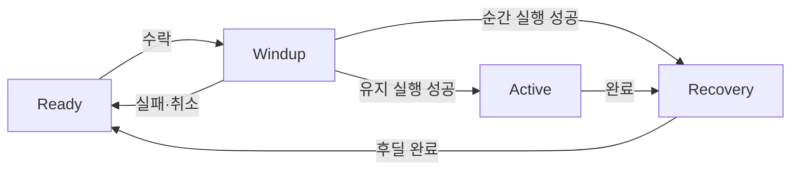

# PlayerAction 및 공통 ActionBase 구현 설계

## 2026-11-11 ADS 전환 중 PrimaryFire 제한

이번 직접 검증은 Unity 6000.3.25f1에서 ADS 88개·공통 액션/홀딩 60개·선입력 85개·행동 딜레이 110개·공격 59개·장전 40개·재시작 56개, 총 498개를 7종 모두 종료 코드 0으로 통과했다. C# 오류·경고 0이며 시작 파일 354개 중 런타임 2개·기존 검증기 1개만 변경하고 351개와 씬·meta·데이터·패키지를 보존했다. 전체 Assets와 검증 복사본 해시가 같고 문서 링크 90개·git diff --check를 확인했다. 로그는 `Logs/ADSTransitionFireLock_20261111/`이며 이전 작업과 합산하지 않는다. 새 렌더·수동 플레이·전체 실행 파일 빌드는 수행하지 않았다.

PlayerCamera에 읽기 전용 IsAimTransitioning을 추가해 실제 카메라 보간 여부를 제공한다. 카메라 LateUpdate 전에 바뀐 논리 ADS 요청도 확인하므로 진입·해제 첫 입력 프레임부터 차단하며 도중 반전에도 적용한다. SoilderPrimaryFireAction.CheckRequirements가 기존 Combat.AimCamera에서 PlayerCamera를 캐시해 조회한다. 공용 Controller·Combat·홀딩 처리에는 캐릭터별 분기를 추가하지 않고 새 Inspector 참조나 별도 전환 타이머를 만들지 않는다.

카메라 전환 중에는 일반 입력/예약 수신·직접 시작·선딜 완료 시 실제 발사를 같은 자격 검사로 거절한다. 전환 중 짧은 누름은 나중에 실행하지 않고 계속 누르면 완료 후 반복 사격한다. 이미 수락한 발사 선딜이 전환 중 끝나면 기존 실행 실패 경로로 탄약·새 후딜·쿨타임·성공 이벤트 없이 종료한다. 이미 실행한 발사와 진행 중 후딜은 유지한다. 0초 전환은 추가 발사 제한 없이 같은 프레임에 카메라를 옮긴다. 기존 이동/탄퍼짐 배율은 논리 ADS 진입·해제 즉시 적용/복구하고, 탄약·장전·기본 공격 딜레이의 제한도 유지한다. 이번 기록은 `Logs/ADSTransitionFireLock_20261111/`이다.

## 2026-11-11 홀딩 액션 공통 처리

이번 직접 검증은 Unity 6000.3.25f1에서 공통 액션/홀딩 60개·ADS 73개·선입력 85개·딜레이 110개·조건 39개·공격 59개·장전 40개·대시 70개·진행 132개·저장 씬 22개·재시작 56개, 총 746개와 11종 모두 종료 코드 0이다. C# 오류·경고 0이며 기존 354개 중 런타임 3개와 검증기 2개만 수정하고 349개·씬·meta·데이터·패키지를 보존했다. 최종 소스와 전체 검증 Assets의 해시가 같고 문서 링크 90개·git diff --check를 확인했다. 로그는 `Logs/HeldInput_20261111/`이며 이전 결과와 합산하지 않는다. 공통 액션의 안내 문자열 정리 후 최종 실행은 ActionsFinal.log다. `-nographics`로 새 렌더·수동 플레이·전체 실행 파일 빌드는 수행하지 않았다.

Selected/IndependentHold 분류 enum과 InputMode를 제거하고 기존 RequiresHeldInput으로 모든 홀딩 입력을 통일했다. 기본값은 false이며 홀딩 액션만 true를 오버라이드한다. Inspector 필드·씬 직렬화는 추가하지 않는다.

```csharp
// PlayerAction의 기본 입력 수명
public virtual bool RequiresHeldInput => false;

// SoilderSecondaryFireAction의 선언
public override bool RequiresHeldInput => true;
```

RequiresHeldInput=false인 일반 액션은 기존 Pressed 선택·우선순위·한 개 예약·RepeatWhileHeld·자동 장전 경로를 따른다. true인 모든 홀딩 액션은 Controller.ProcessHeldActions가 바인딩 순서로 현재 Held를 읽어 일반 선택 전에 시작을 시도한다. 실행 중에는 중복 시작하지 않고 일반 선택·예약·반복·자동 장전에서는 제외한다. 해제·Held 소실·입력 중단은 기존 Release/InterruptInput으로 취소한다.

시작이 거절되어도 계속 누르면 매 프레임 재시도하므로 예약 만료 시간의 영향을 받지 않는다. 잠금이 풀리기 전에 놓으면 나중에 실행하지 않는다. 다른 일반 입력은 실행 중 홀딩을 자동 취소하지 않는다. 홀딩이 완료·취소되어 비실행 상태가 된 뒤에도 Held가 유지되면 기존 자격에 따라 다시 시작할 수 있다.

실행 단계(Stage)는 입력 처리와 별개다. ADS는 BeforeMotor를 유지하고 홀딩도 기존 CanStart·선딜/후딜/쿨타임·생존/구성/자원 검사를 그대로 따른다. 병행·행동 제한은 BlocksCore, 이동·새 점프 제한은 CanMove로 정한다. RepeatWhileHeld는 일반 액션의 반복 요청이며 홀딩에는 추가 요청을 만들지 않는다. PlayerCombat.IsBufferBlocked는 일반 딜레이 대기 중인 유효한 예약을 보존하고 지속 제한이 금지한 슬롯만 폐기한다.

Controller의 홀딩 처리는 Soilder·SecondaryFire·IPlayerAimAction 구체 분기에 의존하지 않는다. 공통 슬롯 입력 매핑과 combat.IsAiming 상호작용 조회는 유지하며 캐릭터별 Controller 상속은 추가하지 않는다. 중앙 트리거 계획은 계속 미구현이다. 이번 검증은 `Logs/HeldInput_20261111/`에 기록하며 이전 분류 정책의 2026-11-10 검증(746개, `Logs/ActionInputPolicy_20261110/`)과 합산하지 않는다.

2026-11-10 확정 후속 상호작용 계획(아직 미구현): G는 범용 `Interact` 입력을 유지한다. 추후 BeforeStage의 씬 중앙 트리거가 상호작용을 받아 GameManager를 참조하고 TryStartStage를 요청한다. 플레이어 입력 측의 상호작용 요청 전달과 대상 트리거의 스테이지 시작 책임을 분리할 예정이며, 기존 단계 이벤트 구독 수명과는 구분한다. 현재 Controller의 G 직접 호출은 유지하고 이번에는 문서만 반영했다. 트리거·인터페이스·탐색/범위 구현은 후속 작업이며 상세 계획은 [스테이지 진행 가이드.md](스테이지%20진행%20가이드.md) 11절을 따른다.

2026-11-10 G 입력 이관: StageFlowUI가 조회하던 ADS 차단 조건을 PlayerController의 G 처리로 옮겼다. Controller는 기존 PlayerCombat 참조로 같은 프레임의 ADS 확정 후 G를 판단하고, 기존 단계 구독으로 연결된 GameManager에 요청한다. StageFlowUI의 입력/전투 의존성과 G Update를 제거했으며 액션 슬롯·타이밍·단계 구독/취소·보상 UI 버튼은 유지한다. G는 별도 PlayerAction이나 예약으로 추가하지 않는다. 이번 검증은 `Logs/InteractionController_20261110/`에 기록한다.

2026-11-10 ADS: `SoilderSecondaryFireAction : PlayerAction, IPlayerAimAction`은 Attack 없는 유지형 자세다. `UsesDelayLock=false`로 ADS 중 금지 행동은 CanBuffer에서도 제외하며 PrimaryFire만 허용한다. Controller는 우클릭 Held를 일반 단일 선택보다 먼저 처리하고 기본 발사는 기존 선택 경로에서 병행한다. 전환 시간·이동속도/탄퍼짐 배율은 ADS 액션에, 카메라 위치/진행값은 PlayerCamera에, 소총 정렬은 PlayerAim에 둔다. PlayerCombat·Motor·Camera는 구체 Soilder 타입 대신 IPlayerAimAction의 읽기 전용 상태를 사용한다. ADS는 기존 PlayerAction의 Release·InterruptInput·단계 구독·사망·비활성화 취소를 그대로 따른다. 상세 편집은 [플레이어 조작 가이드.md](플레이어%20조작%20가이드.md)의 ADS 절, 검증 기록은 `Logs/ADS_20261110/`에 있다.

2026-11-06 스테이지 초기화 갱신: `PlayerStageReset`이 입력·이동·진행 중 액션·후딜을 정리한 뒤 `ActionBase.ResetForStage()`로 쿨타임을 초기화한다. 일반 Cancel·비활성화는 기존처럼 쿨타임을 유지한다. `Combatant.IsGameplayBlocked`는 보상 대기·종료 중 직접 액션 수락과 효과 실행도 막는다. `ActionCancelReason.StageTransition`은 기존 enum 끝에 추가했다. 상세 호출 순서·API·보상 계약은 [스테이지 진행 가이드.md](스테이지%20진행%20가이드.md)를 참고한다.

최신 공통화 기준: **2026-11-01**. PlayerAction의 타이밍·접지/이동 조건·생명주기·이벤트를 새 `ActionBase`로 이관했다. PlayerAction과 EnemyAction은 ActionBase를 직접 상속하며, 슬롯·홀딩·선입력 자격·플레이어 실행 단계는 PlayerAction에 남는다. 공통 타입은 `ActionContext / ActionPhase / ActionResult / ActionCancelReason`이고 `PlayerActionSlot / PlayerActionStage`는 유지한다. Attack.TryExecute는 ActionBase를 받으며 Combatant는 모든 ActionBase의 제한을 집계한다. 상세한 적 계열·확장 방법은 [Enemy.md](Enemy.md)를 참고한다. 이번 로그는 `Logs/Enemy_20261101/`이다. 아래 2026-10-30~31의 검증과 이관 기록은 해당 날짜의 결과다.

기준 날짜: **2026-11-01**. 공통 부모는 `ActionBase`, 플레이어 전용 부모는 `PlayerAction`, 캐릭터별 클래스 접두사는 **Soilder**다. 공통 접지 조건·이동 허용과 Skill2/Ultimate 검증용 동작은 유지한다. 2026-10-31의 결과는 11절, 앞선 리팩토링은 9절, 이번 적·공통화 결과는 12절과 `Logs/Enemy_20261101/`에 기록한다.

같은 날 후속 변경으로 기본 Origin의 저장 위치를 Attack으로 옮겼다. 현재 구조는 아래 본문에 반영했으며, 이번 Origin 이관의 직접 검증은 10절과 `Logs/AttackOrigin_20261030/`에 기록한다. 9절의 466개 검사는 앞선 PlayerAction 리팩토링 당시의 결과다.

## 1. 책임과 실제 파일

| 구성 | 책임 |
|---|---|
| PlayerInputReader | 현재 프레임 입력·조작 가능 여부 수집 |
| PlayerController | 이동·점프 명령, 공통 홀딩 처리·일반 전투 선택·우선순위·한 개 예약·만료·반복·빈 탄창 자동 장전, ADS 확인 후 G 상호작용 요청 |
| PlayerCombat | 슬롯/액션 바인딩, 명령 전달·배율/조준 준비, 슬롯별 실행 가능 조회·탄창·외부 이벤트 |
| ActionBase | 공통 설정과 생명주기. 접지 자격·이동 허용·선딜·실행·유지·후딜·쿨타임·취소 |
| PlayerAction | 플레이어 슬롯·RequiresHeldInput·홀딩/해제·선입력 자격·실행 단계와 Motor/Combat 연결 |
| PlayerAttackAction | Attack을 사용하는 액션의 공통 어댑터. Attack 연결·기본 Origin 조회와 요청별 최신 공격 정보 전달 |
| Soilder…Action | 행동별 슬롯·조건·자원·효과 실행과 유지 갱신 |
| Attack 계열 | 기본 Origin Transform 보관과 호출받은 시점의 원점 보정·판정·피해·투사체 생성·결과 반환 |
| AttackData 계열 | 피해·치명타·대상 규칙·마스크·탄퍼짐·사거리·투사체·근접 범위 |
| PlayerMotor | 이동·회전·중력·접지·충돌과 실제 대시 이동 |
| PlayerStamina / PlayerStat | 자원·능력치 원본 |
| PlayerAim / PlayerCamera / PlayerAnimation | 조준·시점·시각 자세·이벤트 기반 애니메이션 |

공통 부모·컨텍스트·생명주기 타입은 `Assets/Scripts/Combat/ActionBase.cs`와 `ActionTypes.cs`, 플레이어 슬롯·실행 단계는 `Assets/Scripts/Player/PlayerAction.cs`, 공격 어댑터는 `PlayerAttackAction.cs`, 직렬화 연결은 `PlayerActionBinding.cs`에 있다. 캐릭터별 일곱 클래스는 `Assets/Scripts/Player/Actions/`에 있다. 별도 PlayerActionController와 두 번째 입력 버퍼는 없다.

```text
PlayerAction
├─ PlayerAttackAction
│  ├─ SoilderPrimaryFireAction
│  └─ SoilderSkill1Action
├─ SoilderSecondaryFireAction (IPlayerAimAction, 홀드형 ADS)
├─ SoilderSkill2Action
├─ SoilderUltimateAction
├─ SoilderDashAction
└─ SoilderReloadAction
```

현재 세 공격의 중복 연결·실행 코드를 PlayerAttackAction에 모았다. 이후 공격 없는 스킬·줌은 PlayerAction을 직접 상속하거나 해당 슬롯의 액션 구현을 교체할 수 있다.

SampleScene은 일곱 액션을 연결한다. Skill2·Ultimate는 PlayerAction을 직접 상속하며 Attack 없이 선딜·후딜과 실행 로그를 사용한다. Skill2는 지면 전용·이동 허용, Ultimate는 공중 사용 가능·이동 금지로 설정했다. 실제 스킬 피해·효과·궁극기 자원과 애니메이션은 후속 작업이다.

## 2. 설정과 상태의 단일 원본

| 내용 | 원본 |
|---|---|
| damage / canCritical / criticalMultiplier / targetRule / hitMask | AttackData 유지 |
| spreadAngle / spreadStartShot / spreadResetDelay / enemyPenetrationCount / maxDistance | HitscanAttackData 유지 |
| 투사체·관통·크기·폭발 배율·발사각, 근접 범위·모양·오프셋 | 각 전용 AttackData 유지 |
| windupTime / recoveryTime / cooldown | ActionBase의 직렬화 필드 |
| repeatWhileHeld | PlayerAction의 직렬화 필드 |
| requiresGrounded / canMove | ActionBase의 직렬화 필드. 기본 false / true |
| pending / Active / 실행 시각 / 후딜·쿨타임 종료 시각 / 실행 프레임 잠금 | ActionBase 인스턴스 |
| 연속 발사 수·마지막 발사 시각 | HitscanAttack 인스턴스 |
| 대시 소모량 staminaCost | SoilderDashAction |
| 대시 거리 / 실제 이동 시간·남은 이동량 | PlayerStat / PlayerMotor |
| 대시 후딜 | SoilderDashAction의 상속 recoveryTime |
| 장전 시간·배속 / 남은 기본 작업량 | PlayerStat / SoilderReloadAction |
| 탄창 현재량 | PlayerCombat |
| 기본 origin Transform | Attack의 직렬화 필드. 액션·바인딩의 Origin은 이 참조를 조회 |

같은 AttackData를 사용해도 액션별 시간·반복 설정과 쿨타임 상태는 독립적이다. 별도 PlayerActionData SO는 추가하지 않았다. `spreadResetDelay`는 탄퍼짐 초기화 규칙이며, 수류탄의 비행·폭발 대기·연출은 투사체 생명주기로 유지한다.

## 3. 슬롯과 연결

이전 PlayerAction enum과 AttackSlot을 `PlayerActionSlot`으로 통합했다. 기존 직렬화된 공격 슬롯 값 0~4를 유지한다.

```csharp
public enum PlayerActionSlot
{
    None = -1, PrimaryFire = 0, SecondaryFire = 1, Skill1 = 2,
    Skill2 = 3, Ultimate = 4, Dash = 5, Reload = 6
}
```

PlayerActionBinding의 저장 필드는 `slot + action`이다. Attack 프로퍼티는 공격 액션의 참조를, Origin 프로퍼티는 연결된 Attack.Origin을 조회하는 편의 API이며 바인딩에 중복 저장하지 않는다. PlayerAttackAction.Origin도 Attack.Origin을 조회한다. Inspector에서는 액션에 Attack을, Attack 컴포넌트에 Origin을 연결한다. 같은 슬롯·같은 액션 인스턴스·다른 액션의 동일 Attack 실행기 공유는 바인딩 검증에서 거절한다. 같은 AttackData 공유는 허용한다.

슬롯의 정수 값으로 우선순위를 판단하지 않는다. 동일 프레임 선택은 기존 **Dash → 비기본 공격의 바인딩 순서 → Reload → PrimaryFire**를 유지한다.

## 4. 공통 API와 단계

| 멤버 | 의미 |
|---|---|
| WindupTime / RecoveryTime / Cooldown / RepeatWhileHeld | 읽기 전용 설정 |
| RequiresGrounded / CanMove | 읽기 전용 접지 필요·일반 이동/점프 허용 설정 |
| BlocksMovement | 이동 금지 설정이며 선딜·Active·후딜 또는 실행 프레임 잠금이 남았는지 |
| RequiresHeldInput | 기본 false. true이면 공통 홀딩 처리·해제 수명을 사용하고 일반 선택·예약에서 제외 |
| Phase | Ready / Windup / Active / Recovery |
| CooldownRemaining / RecoveryRemaining | 게임 시간 기준 잔여 시간 |
| CanBuffer | 현재 공격·대시 딜레이만 제외한 예약 자격. 상태 변경·소모 없음 |
| CanStart / CanStartWithContext(context) | 현재 제한과 자기 진행 상태까지 포함한 시작 자격 |
| TryStart() / TryStart(context) | 최종 검증 후 선딜 수락 |
| Release() / Cancel(reason) | 유지 입력 해제 / 허용된 실행 중단과 정리 |
| Blocks(slot) | 해당 슬롯의 새 시작을 막는지 |
| CheckRequirements(context) | 파생 클래스의 구성·탄약·장전·스태미나 등 검사. 공통 접지는 부모에서 검사 |
| OnAccepted(context) | 수락 직후 처리. 현재 스킬의 장전 취소 |
| ExecuteCore(context) | Failed / Completed / Running 반환 |
| TickActive(deltaTime) / FinishActive() | 지속 동작 진행과 완료 |
| OnExecutionSucceeded() / Cleanup(reason) | 성공 상태 확정 후 자원·외부 알림 / 중단 정리 |

공통 검증·타이머·단계 전환은 부모가 담당한다. TryStart는 파생 클래스에서 재정의하지 않는다. PlayerActionContext는 필요할 때 Origin Transform·고정 월드 위치·조준점·이동 방향을 전달하는 값이다. 입력 버퍼에는 이 컨텍스트를 저장하지 않는다.

RequiresGrounded가 true이면 부모가 Motor.IsGrounded를 CanBuffer·CanStart와 선딜 완료 시점에 검사한다. Motor는 접지 상태를 제공하며 대시의 접지 자격을 따로 결정하지 않는다. 이 조건은 행동 시작·효과 실행의 자격이고 이미 실행된 행동을 공중에서 계속 취소하는 규칙은 아니다.



Cooldown은 별도 Phase가 아니며 실행 성공부터 Active·Recovery와 동시에 흐른다. 순간 공격의 후딜·쿨타임은 기존처럼 동시에 시작한다. Ready라도 자기 쿨타임이 남으면 시작할 수 없다.

선딜 완료 시 실행 조건을 자기 잠금을 제외하고 재검사한다. 실패하면 새 후딜·쿨타임·탄약 소모·실행 성공 이벤트가 없다. 효과를 호출하기 전에 실행 프레임 잠금을 확정해 0초 설정과 이벤트 재진입도 같은 프레임의 중복 실행을 만들지 못한다.

발사·현재 공격 스킬만 PlayerStat.AttackSpeed를 시간 배율로 사용한다. 선딜은 수락 시, 후딜·쿨타임은 실행 성공 시의 배율로 확정한다. 대시 이동 값은 시작 시 고정하고 장전은 ReloadSpeedMultiplier를 매 프레임 기본 작업량에 반영한다. 일시정지 중 시간과 작업 진행은 멈춘다.

## 5. 공존·제한·유지 입력

여러 액션이 동시에 Active일 수 있다. Combatant가 같은 오브젝트의 PlayerAction을 모아 슬롯별 제한을 조회하므로 바인딩 없이 직접 요청한 액션도 같은 제한을 받는다. Controller도 예약 슬롯을 실제로 막는 딜레이가 있는지 확인한다.

| 현재 행동 | 새 행동 제한 |
|---|---|
| 현재 공격의 선딜·후딜·실행 프레임 | ADS를 포함한 다른 전투 액션의 새 진입을 차단. 이동·지상 점프·시점 유지 |
| 대시 이동·후딜 | 다른 전투 액션. 일반 이동·점프는 이동 구간만 거절 |
| 장전 Active | 기본 사격·ADS·중복 장전. 대시·스킬은 취소 규칙으로 허용 |
| ADS Active | PrimaryFire 외 전투 액션·예약 차단. PrimaryFire는 카메라 전환 완료 후 허용. 이동·시점·점프 허용, G도 차단 |
| ADS 카메라 진입·해제·반전 | SoilderPrimaryFireAction의 수신·직접 시작·실행 자격 차단. 전환 중 PrimaryFire 예약 없음 |
| 다른 유지형 행동 | 파생 클래스에서 비차단 또는 슬롯별 차단 지정 |

비차단 유지형 액션은 RequiresHeldInput=true, UsesDelayLock=false, BlocksCore=false를 사용하고 ExecuteCore에서 Running을 반환한다. Release와 조작 중단은 Cleanup을 통해 자기 유지 효과를 정리한다. 같은 유지형 액션의 중복 시작은 CanStart에서 거절한다.

CanMove=false인 액션은 선딜·Active·후딜 동안 일반 이동과 새 점프를 막는다. Combatant.IsMovementLocked가 바인딩 없는 액션까지 집계하고 Motor가 이동 속도를 0으로 처리하며 CanJump에서 같은 제한을 확인한다. 중력·시점 회전·충돌과 대시의 별도 이동은 기존 Motor 책임이다. 예약만 된 액션은 이동을 막지 않고, 동시에 실행 중인 액션 중 하나라도 이동을 막으면 제한을 유지한다. 비활성화·사망·취소·완료 후에는 살아 있는 다른 액션의 제한만 남는다.

RepeatWhileHeld는 일반 액션의 새로운 실행을 반복 요청하는 설정이다. 한 번 시작한 동작을 누르는 동안 유지하려면 RequiresHeldInput=true와 Running을 사용한다. 모든 홀딩 입력은 예약을 만들지 않고 현재 Held만 검사한다. 버튼 해제는 다른 행동의 잠금 중에도 전달한다. 짧게 누른 일반 발사·수류탄에는 이 해제 정책을 적용하지 않는다.

버프의 효과 지속 시간·중첩·해제는 버프 담당 기능에 맡길 수 있다. 발동 액션이 끝난 뒤 버프가 남아 있다고 전투 전체를 잠글 필요는 없다. 실제 줌·버프 효과는 이번 리팩토링 범위에서 추가하지 않았다.

## 6. 공격·대시·장전 흐름

공격은 Controller 선택 → PlayerCombat 준비 → PlayerAction 선딜 → 최신 Origin/조준점 확인 → Attack 즉시 실행 → 성공 상태·자원·이벤트 확정 순서다. 기본 Origin의 저장 원본은 Attack이다. PlayerAttackAction은 수락 시 Attack.Origin 또는 요청별 Origin Transform을 선딜 동안 보관하므로 실제 실행 프레임의 위치를 읽고, 삭제됐으면 실패한다. Transform·고정 월드 좌표를 넘기는 TryStart 오버로드는 기본 Origin을 덮어쓰지 않고 해당 요청에만 적용한다.

Attack의 public TryAttack·선딜·후딜·쿨타임·독립 LateUpdate는 제거했다. 내부 TryExecute는 현재 실행 중인 같은 소유자의 PlayerAction만 호출할 수 있다. 외부 진입점은 PlayerCombat.TryStartAction 또는 PlayerAction.TryStart다. 빗나간 히트스캔은 성공한 한 발이며 풀 대여 실패는 실행 실패다. 원점 장애물 보정·치명타·진영·관통·탄퍼짐·투사체의 발사 시점 피해 복사는 기존 Attack/피해/투사체 계층이 처리한다.

대시는 수신과 실행 시 모두 접지·이동 구성·스태미나를 확인한다. Motor의 실제 이동 시작과 스태미나 소모를 함께 확정한 뒤 이벤트를 알린다. 거절은 잔량·회복 지연·이동·성공 이벤트를 바꾸지 않는다. Motor의 공개 TryDash도 SoilderDashAction을 거친다. 실제 이동 완료 시 프레임 내 남은 시간을 반영해 부모 후딜로 넘어가며 마지막 이동·후딜 프레임의 잠금을 유지한다.

재장전은 선딜·후딜·쿨타임 0, Active 작업으로 설정했다. PlayerStat의 3.3초 기본 작업량을 배속으로 줄인다. 시작은 OnReloadStarted, 완료는 탄창 보충 후 OnReloadCompleted를 각각 한 번 알린다. 취소는 보충·완료 이벤트가 없다. 대시는 시작 성공 시, 현재 스킬은 수락 시 장전을 취소한다.

PlayerCombat의 CurrentAmmo/MaxAmmo/IsReloading/ReloadRemaining/CanReload/TryReload/CancelReload는 유지하되 장전 상태와 작업은 SoilderReloadAction에 위임한다. 완료 프레임의 기본 발사는 다음 조준 갱신 이후 재개한다.

공통 PlayerCombat는 IPlayerReloadAction으로 장전 상태를 읽고 PlayerAction으로 시작·취소한다. Motor는 PlayerAction과 슬롯 연결만 사용하며 현재 이동 소유자의 공통 완료/중단 경로를 호출한다. 두 공통 컴포넌트는 Soilder 구체 타입에 의존하지 않는다. Motor 비활성화는 진행 중 이동과 이미 이동이 끝난 후딜 잠금도 해제하고 획득한 쿨타임은 초기화하지 않는다.

## 7. 입력·프레임 순서·이벤트

한 개 예약·현재 1초 만료·대시 최우선·유효한 새 일반 누름 교체·수신/실행 자격 재검사·시도 후 폐기는 [EnhancedInput.md](EnhancedInput.md)를 따른다. 이동·점프는 예약하지 않고 반복 요청·0발 자동 장전은 예약 처리 다음에 재시도한다.

정지·커서 해제·포커스 상실·Reader/Controller 비활성화·사망은 예약과 명령을 지운다. 유지형 행동은 중단 통지로 정리하며 진행 중 공격·장전의 일시정지 규칙은 유지한다.

| 단계 | 처리 |
|---|---|
| Update -200 / -100 / -75 | Reader / Camera Yaw / Stamina 회복 |
| Update -50 | Controller 입력·해제·공통 홀딩 시작·일반 예약/선택, PlayerCombat 경유 대시 시작 |
| Update 0 / 50 | Motor 실제 이동 / Animation 갱신 |
| LateUpdate -100 / 75 | Camera 최종 배치 / Aim 상체·총구·IK |
| LateUpdate 100 | PlayerCombat 명령 소비·배율 준비, ReloadAction 작업 |
| LateUpdate 110 | PlayerAction 선딜 완료와 Attack 동기 실행 |

BeforeMotor 액션은 Controller와 Motor의 단계 진입점에서 처리하되 부모의 프레임 중복 방지로 한 번만 진행한다. Controller가 꺼져도 Motor가 켜져 있으면 이미 시작한 대시는 진행한다.

OnStarted는 수락·잠금 확정 후, OnExecuted는 효과 시작 성공·후딜/쿨타임 확정 후, OnCompleted는 자연 종료 후 발생한다. OnFailed는 실행 실패, OnCancelled(reason)는 취소 정리 후 발생한다. 장전의 일반 OnExecuted는 장전 동작 시작이며 탄창 보충 시점은 전용 완료 이벤트다.

기존 AttackExecuted(slot)는 실제 공격 성공에만 전달하며 기본 발사 탄약 차감 후 발생한다. 사격·수류탄 애니메이션, OnReloadStarted/Completed와 Motor.OnDashExecuted를 보존한다. 줌 시작을 사격 성공으로 전달하지 않는다.

GetAimPoint는 공격을 사용하는 액션들의 HitMask 합집합을 사용한다. 기존 세 공격·100m·자신/투사체/일반 Trigger 제외와 PlayerAim의 동일 조준점 사용을 유지한다.

## 8. 저장값 이관 기록

| 원본 | 선딜 | 후딜 | 쿨타임 | 반복 | 현재 위치 |
|---|---:|---:|---:|---|---|
| TempPrimaryFire | 0 | 0.25 | 0 | true | SoilderPrimaryFireAction |
| TempSecondaryFire | 0 | 0.5 | 0 | true | SoilderSecondaryFireAction |
| TempGrenade | 0 | 1 | 6 | false | SoilderSkill1Action |
| SoldierRifleAttack 예제 | 0 | 0 | 0.1 | true | 아래 이관 기록·향후 예제 행동 설정 |
| SoldierGrenadeAttack 예제 | 0.2 | 0.3 | 4 | false | 아래 이관 기록·향후 예제 행동 설정 |
| StrikerMeleeAttack 예제 | 0.4 | 0.4 | 0.8 | false | 아래 이관 기록·향후 적 행동 설정 |
| SampleScene 대시 | 0 | 0.3 | 0 | false | SoilderDashAction. 실제 이동 0.2초 별도 |
| SampleScene 장전 | 0 | 0 | 0 | false | SoilderReloadAction. 기본 작업 3.3초 별도 |

AttackData 여섯 에셋의 네 필드는 제거했고, 연결 없는 예제의 옛 타이밍은 이 표와 `Logs/PlayerAction_20261030/TimingMigration.json`에 보존했다. 기존 세 Attack·Data·Origin/Muzzle·GUID와 공격 속성은 보존하고 씬에 액션 일곱 개를 추가했다. PlayerAttackBinding의 meta GUID는 PlayerActionBinding으로 이어받았다.

## 9. 앞선 PlayerAction 리팩토링 검증과 남은 작업

새 검증 진입점은 `ProjectU.Editor.PlayerActionValidation.Run`, 메뉴는 **ProjectU → Validation → Validate Player Actions**다. 기존 전투 검증은 액션 요청과 공격 효과 검증으로 연결했다. PlayerActionValidationUtility의 타이밍 프리셋은 검증용 액션 구성에만 사용하며 AttackData나 런타임에 타이밍을 되살리지 않는다.

이번 원본 프로젝트의 Unity **6000.3.25f1**에서 다음 9종 검증이 모두 종료 코드 0으로 통과했다. 아래 수치형 검사 **466개**와 애니메이션·스태미나 검증은 이번 직접 실행 결과다.

| 검증 | 결과 | 로그 |
|---|---|---|
| PlayerActionValidation | 43개 | PlayerActionValidation.Final.log |
| AttackValidation | 68개 | AttackValidation.Regression.log |
| PlayerAttackValidation | 50개 | PlayerAttackValidation.Final.log |
| PlayerDashValidation | 70개 | PlayerDashValidation.Final.log |
| PlayerReloadValidation | 40개 | PlayerReloadValidation.Final.log |
| PlayerActionDelayValidation | 110개 | PlayerActionDelayValidation.Regression.log |
| EnhancedInputValidation | 85개 | EnhancedInputValidation.Final.log |
| PlayerAnimationValidation | 17발·이동·점프·사격·장전·투척·양팔 IK·벽 보정·정지 | PlayerAnimationValidation.Regression.log |
| PlayerStaminaValidation | 능력치·Shift·소모·회복·정지·이벤트·이동/대시 원본 | PlayerStaminaValidation.Regression.log |

로그는 `Logs/PlayerAction_20261030/`에 있다. 최종 결과 목록은 `Results.Final.json`, C# 런타임·에디터 빌드는 `DotnetBuild.Final.log`의 경고 0·오류 0이다. 애니메이션 검증의 총구/공격 방향 최대 오차는 약 0.028도, 비차단 총구~실제 원점 거리는 0m다.

`Integrity.Final.json`에서 원본 meta 107개(바인딩 이름 이동 포함)의 SHA256 동일, 변경 대상 외 에셋 36개 동일, 여섯 공격 에셋의 네 요청 필드 외 내용 동일, 씬의 의도된 액션 추가·바인딩·필드 이동 외 내용 동일, 새 액션 설정 28개·참조·GUID 중복 없음·공통 Motor/Combat의 Soilder 구체 타입 의존 없음·구형 런타임 API 제거를 확인했다. `git diff --check`도 통과했다.

초기 선입력 실행의 옛 Attack 쿨타임 필드 접근은 검증기를 새 액션 필드로 변경해 해결했다. 최초 회귀에서 발견한 Motor 비활성화 후 대시 후딜 잠금 잔류는 의존 기능 종료 시 액션 잠금을 정리하도록 수정했고, 대시·장전·선입력·새 액션을 다시 확인했다. 기존 직접 Attack 요청을 액션 요청으로 옮기면서 장전 중 발사는 수락 전 거절하도록 기대값을 맞췄다. Initial·Regression의 중간 실패와 최종 통과를 구분한다.

실제 키·마우스 수동 플레이·이미지 렌더링·공통 Mortal/Projectile 독립 검증은 이번에 실행하지 않았다. Skill2·Ultimate 효과, 실제 줌·버프·추가 애니메이션·적 AI·사망 행동·반복 전투 흐름은 후속 작업이다.

Skill2·Ultimate 효과와 발동 조건, 실제 줌·버프, 손 투척 지점·Dash/Skill2/Ultimate 애니메이션, 적 AI·사망 행동·반복 전투 흐름은 후속 작업이다.

## 10. 기본 Origin의 Attack 이관 — 2026-10-30

`[SerializeField] Transform origin`과 읽기 전용 Origin 프로퍼티의 원본을 Attack으로 옮겼다. PlayerAttackAction에는 Attack 참조와 요청별 위치 상태를 유지하며, Origin 프로퍼티는 Attack.Origin을 조회한다. PlayerActionBinding도 같은 Attack.Origin을 조회한다. SampleScene의 히트스캔·Bullet·Grenade 세 Attack에 기존 Muzzle(fileID 962656585)을 옮겼고, 액션의 이전 origin 저장값 다섯 개를 제거했다. 피해·시간·배율·GUID·투사체·조준 및 애니메이션 연결은 보존했다.

기본 요청은 수락 시 Attack.Origin을 사용한다. Transform을 명시한 요청과 고정 월드 좌표 요청은 해당 요청에만 적용되며 기본 Origin을 변경하지 않는다. 선딜 중 Transform 이동 추적과 삭제 시 실패, 원점 벽 보정은 유지한다. 검증 구성 도구도 Origin을 Attack에 설정하도록 변경했다.

이번 원본 프로젝트의 Unity **6000.3.25f1**에서 다음 검증을 직접 실행했다.

| 검증 | 결과 | 로그 |
|---|---|---|
| AttackValidation | 75개 통과. 기본 Origin의 인자 없는 실행·선딜 중 이동·삭제·누락 시 시작/예약 거절·고정 좌표 실행 검사 7개 추가 | AttackValidation.log |
| PlayerAttackValidation | 50개 통과. 저장된 세 공격·피해·이벤트·배율·별도 캐릭터의 개별 Origin | PlayerAttackValidation.log |
| PlayerReloadValidation | 40개 통과. 탄약·장전·총구 삭제 시 실패 발사·취소 | PlayerReloadValidation.log |
| EnhancedInputValidation | 85개 통과. Origin 누락을 포함한 예약 수신/실행 자격 | EnhancedInputValidation.log |
| PlayerAnimationValidation | 17발·이동·점프·장전·수류탄·양팔 IK·벽 보정·정지 통과. 비차단 총구~실제 원점 최대 거리 0m | PlayerAnimationValidation.log |

수치형 검사는 총 **250개**이며 네 회귀 검증은 모두 종료 코드 0이다. 공통 공격은 통과 로그를 확인했다. 런타임·에디터 .NET 빌드는 `DotnetBuild.Final.log`에서 경고 0·오류 0이다. 첫 빌드의 SDK 접근 제한과 누락된 로컬 빌드 자산은 권한 적용·복원 후 해결했다. `Integrity.json`은 씬 변경이 세 Origin 참조 이동과 미사용 필드 제거에 한정되고 meta 변경이 없음을 확인한다. `git diff --check`도 통과했다. 로그와 `Results.json`·`RegressionResults.json`은 `Logs/AttackOrigin_20261030/`에 있다.

실제 키·마우스 수동 플레이·이미지 렌더링과 대시·새 액션·행동 제한·스태미나·Mortal·Projectile의 독립 검증은 이번에 다시 수행하지 않았다. Skill2·Ultimate 효과, 손 투척 지점·남은 애니메이션·적 AI·사망 행동·반복 전투 흐름은 후속 작업이다.

## 11. 공통 접지·이동 조건과 검증용 스킬 — 2026-10-31

PlayerAction에 `requiresGrounded`(기본 false)·`canMove`(기본 true)를 추가했다. Inspector의 Requires Grounded·Can Move로 조절하고 외부에서는 RequiresGrounded·CanMove·BlocksMovement로 읽는다. CanBuffer·CanStart와 선딜 완료의 공통 검사에서 접지 조건을 확인하므로 파생 클래스의 CheckRequirements 구현이 공통 조건을 빠뜨리지 않는다. PlayerMotor.CanDashIgnoringActionLock의 IsGrounded 검사는 제거하고 대시의 RequiresGrounded를 씬에 true로 저장했다. Motor는 접지 상태와 실제 이동을 제공한다.

Combatant.IsMovementLocked는 바인딩 없는 액션까지 집계한다. Motor는 일반 이동 속도를 0으로 처리하고 CanJump도 제한하며 중력·충돌·회전은 유지한다. 선딜·Active·후딜·실행 프레임에서 제한하고, 예약 전용 상태·완료·취소·비활성화·사망에는 남아 있는 다른 액션의 잠금만 반영한다. 최종 스킬 효과를 구현할 때도 같은 bool 설정을 사용할 수 있다.

| SampleScene 액션 | Requires Grounded | Can Move | 선딜 / 후딜 / 쿨타임 |
|---|---|---|---|
| Skill2 (F) | true | true | 0.5초 / 1초 / 0초 |
| Ultimate (Q) | false | false | 0.5초 / 1초 / 0초 |
| Dash (Shift) | true | true | 기존 0초 / 0.3초 / 0초 |
| 기본·보조 발사 / Skill1 / Reload | false | true | 기존 값 유지 |

Skill2·Ultimate는 PlayerAction을 직접 상속한다. 선딜이 끝나 실제 효과를 실행하면 각각 `[Player Action] Skill2 (F): Executed`, `[Player Action] Ultimate (Q): Executed`를 한 번 출력하고 ActionExecuted를 알린다. AttackExecuted·피해·탄약 소모는 없고, 수락 시 장전 취소는 유지한다. 실전 스킬 효과·궁극기 자원·전용 애니메이션은 후속 작업이다. 기존 다섯 공격 슬롯 회귀 검증에는 별도의 에디터 전용 PlayerActionAttackProbe를 사용해 검증용 스킬과 분리했다.

이번 원본 프로젝트에서 Unity **6000.3.25f1**로 다음 검증을 직접 실행했다. 9·10절의 이전 결과와 별도다.

| 검증 | 결과 |
|---|---|
| PlayerActionRestrictionValidation | 39개 통과. 공중 수신·직접 호출 거절, 대시 조건 이관, 선딜 중 접지 상실·예약 폐기, F/Q의 딜레이·실행 로그·이벤트, 일반 이동·점프 잠금/복귀, Active 집계·취소·비활성화·사망·중력·정지·장전 취소 |
| PlayerActionValidation | 43개 통과 |
| PlayerDashValidation | 70개 통과 |
| EnhancedInputValidation | 85개 통과 |
| PlayerActionDelayValidation | 110개 통과 |
| PlayerReloadValidation | 40개 통과 |
| PlayerAttackValidation | 50개 통과 |
| PlayerAnimationValidation | 이동·점프·조준·양팔 IK·17발 사격·장전·투척·벽·정지 통과 |

수치형 검사는 총 **437개**, 일곱 회귀 프로세스의 종료 코드는 모두 0이다. 런타임·에디터 .NET 빌드는 경고 0·오류 0이다. Integrity.json에서 씬 변경이 일곱 액션의 공통 설정·두 스킬의 시간·불필요한 빈 Attack 필드 제거에 한정되고 기존 meta·공격 데이터·투사체·애니메이션 에셋이 변경되지 않았음을 확인했다. 새 검증 meta GUID는 유일하며 git diff --check도 통과했다.

로그·ValidationSummary.json·RegressionResults.json·Integrity.json은 `Logs/ActionRestrictions_20261031/`에 있다. 첫 샌드박스 Unity 실행은 사용자 라이선스 접근 문제로 종료 코드 198이었고 사용자 권한 실행으로 해결했다. 최초 .NET SDK 접근 제한과 로컬 빌드 자산 누락은 권한 적용·참조 복원 후 해결했으며 Initial 로그와 최종 통과 로그를 구분한다. 실제 키·마우스 수동 플레이·이미지 렌더링과 공통 Attack/Mortal/Projectile·스태미나 독립 검증은 이번에 다시 실행하지 않았다. 실제 스킬 효과·추가 애니메이션·적 AI·사망 행동·반복 전투 흐름은 남아 있다.

## 12. 2026-11-01 공통 ActionBase와 적 액션

공통 시간·생명주기·접지 자격·이동 제한·취소·이벤트를 ActionBase로 옮겼다. PlayerAction과 EnemyAction은 공통 부모를 직접 상속한다. 기존 직렬화 필드명과 플레이어 스크립트 GUID·씬 바인딩을 보존하고, repeatWhileHeld는 PlayerAction에 유지했다. 선입력 저장소·PlayerActionSlot·PlayerActionStage와 조준 이후 실행 순서는 플레이어 계열의 책임이다.

공통 타입 이름은 ActionContext·ActionPhase·ActionResult·ActionCancelReason으로 정리했다. Combatant는 ActionBase 목록으로 잠금을 집계하고 PlayerAction의 슬롯별 허용 정책을 연결한다. Attack.TryExecute는 ActionBase의 소유자와 효과 실행 중 여부를 검사한다. 적 액션에도 플레이어 컴포넌트나 슬롯을 요구하지 않는다.

EnemyCombat은 액션을 선택하고 요청하며 타이머를 복제하지 않는다. EnemyAttackAction은 Melee/Hitscan/ProjectileAttack을 참조하는 공통 어댑터다. 공격 없는 지속 행동도 EnemyAction에서 Running·TickActive·FinishActive·Cleanup을 사용한다. 현재 TempEnemy와 상태·NavMesh·사망 수명 및 새 적 작성 방법은 [Enemy.md](Enemy.md)를 참고한다.

이번 직접 실행 결과는 `Logs/Enemy_20261101/RegressionResults.json`과 각 검증 로그에 기록하며, 이전 절의 날짜별 결과와 구분한다. 기존 플레이어 검증은 데모 적만 실행 중 비활성화하고, 적과 실제 플레이어의 상호 피해·사망은 EnemyValidation에서 검증한다.

2026-11-01 Unity 6000.3.25f1에서 적 70개를 포함한 정량 검사 582개와 애니메이션·스태미나·Mortal·Projectile까지 13종이 모두 종료 코드 0으로 통과했다. .NET 빌드는 경고 0·오류 0이다. 기존 meta·공격 데이터·투사체·애니메이션과 기존 씬 블록 115개를 보존했다. 렌더 2장 확인과 git diff --check를 완료했으며 실제 키·마우스 수동 플레이는 수행하지 않았다. 전체 표와 초기/최종 로그 구분은 Enemy.md 11절을 참고한다.
