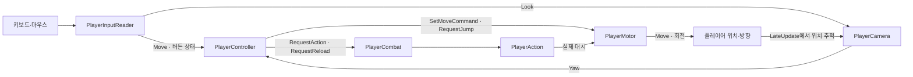

# ProjectU 플레이어 조작 구현 문서

최신 시작 HP 기준은 **2026-11-02**입니다. 플레이어의 시작 HP는 Inspector의 `PlayerStat > Max Health`에서 조절합니다. PlayerStat은 Mortal을 필수로 요구하고 Awake(-150)에서 `Mortal.TryInitializeHealth(MaxHealth)`를 한 번 호출합니다. SampleScene 기본값은 100이며 Mortal의 저장된 시작 HP보다 PlayerStat 설정이 우선합니다. 현재 HP·피해·사망은 Mortal이 담당합니다. 오브젝트/컴포넌트를 껐다 켜거나 실행 중 MaxHealth를 바꿔도 현재 HP가 회복되거나 사망 상태가 초기화되지 않습니다. 런타임 최대 HP 증감에 따른 현재 HP 보정·회복·부활은 후속 작업입니다. 아래 과거 날짜의 최대 체력 미연결 기록은 변경 전 상태입니다.

이번 시작 HP 연결은 Unity 6000.3.25f1에서 PlayerAttackValidation **58개**(기존 50개 + HP 연결 8개), PlayerStaminaValidation, MortalValidation을 직접 실행해 모두 종료 코드 0으로 통과했습니다. 새 HP 검사는 씬 기본값, Mortal 필수 연결, Mortal의 저장값 17보다 PlayerStat.MaxHealth 250이 우선 적용되는지, 초기화 시 무적·이벤트 유지, 피해 후 최대값 유지, 오브젝트/컴포넌트 재활성화와 실행 중 MaxHealth 변경 시 회복 방지, 사망 후 부활·중복 사망 방지를 확인합니다. 최종 .NET 런타임·에디터 빌드는 경고·오류 0이며 git diff --check도 통과했습니다. 로그·종료 코드는 `Logs/PlayerHealth_20261102/`의 검증별 `.log`, `Results.json`, `DotnetBuild.log`에 있습니다. 앞선 적 능력치 검증과 별도이며 실제 키·마우스 수동 플레이·이미지 렌더링과 다른 독립 검증은 이번에 수행하지 않았습니다.

최신 공통 액션 기준은 **2026-11-01**입니다. PlayerAction은 새 ActionBase를 상속하며 공통 시간·접지·이동 제한·취소·이벤트를 재사용합니다. 플레이어 슬롯·선입력·홀딩·실행 순서는 PlayerAction 계열이 유지합니다. SampleScene에 캡슐 근접 적 TempEnemy 5기와 NavMesh가 연결되어 실제 플레이어 피해와 적 처치가 가능합니다. 적의 사망은 즉시 Destroy이며 플레이어 사망 시 이동 중단·연출은 후속 작업입니다. 적 구조와 생성 방법은 [Enemy.md](Enemy.md), 공통 이관은 [PlayerAction 설계](PlayerAction%20설계.md)를 참고합니다.

최신 공통 행동 조건 기준은 **2026-10-31**입니다. PlayerAction의 Requires Grounded로 지면 전용 여부를, Can Move(기본 true)로 선딜·실행·후딜 중 일반 이동·점프 허용 여부를 설정합니다. SampleScene에서 F는 지면 전용·이동 허용, Q는 공중 사용 가능·이동 금지이며, 두 액션 모두 선딜 0.5초 뒤 실행 로그를 출력하고 후딜 1초를 적용합니다. 실제 스킬 효과와 애니메이션은 후속 작업이며 이번 검증은 [PlayerAction 설계](PlayerAction%20설계.md) 11절을 참고합니다.

최신 전투 액션 구조 기준은 **2026-10-30, PlayerAction 구현**입니다. 공통 부모와 Soilder 접두사의 일곱 액션이 요청 타이밍·반복·행동 제한을 담당합니다. Attack은 동기 효과 실행기이며 상세 API·저장값·검증 기록은 [PlayerAction 설계](PlayerAction%20설계.md), 최신 입력 규칙은 [EnhancedInput.md](EnhancedInput.md)를 참고합니다. 아래 날짜별 검증·예전 Attack API 기록은 해당 작업 당시 상태입니다.

최신 선입력 수신 기준은 **2026-10-30**입니다. 입력을 누른 순간 딜레이 외 실행 조건을 만족한 행동만 예약합니다. 공중 대시·자원 부족·쿨타임·탄약·장전·구성 실패 입력은 기존 예약도 교체·연장하지 않습니다. 이번 선입력 85개 및 회귀 검증 결과는 34절과 [EnhancedInput.md](EnhancedInput.md) 9절을 참고합니다. 아래 접지 조건 변경과 날짜별 검증은 앞선 작업 당시 기록입니다.

최신 대시 조건·검증 기준은 **2026-10-30**입니다. 대시는 접지 중에만 시작하며 공중 입력은 스태미나를 소모하지 않습니다. 이번에 대시 70개·선입력 53개·행동 제한 110개를 직접 검증해 통과했습니다. 상세 변경·검증 범위와 남은 작업은 33절 및 [EnhancedInput.md](EnhancedInput.md) 8절을 참고합니다. 아래 첫 선입력 검증과 날짜별 기록은 해당 작업 당시 결과입니다.

2026-10-30 직접 검증: 선입력 51개·행동 제한 110개·대시 63개·장전 40개·공격 50개와 애니메이션 17발·스태미나 검증이 모두 종료 코드 0으로 통과했습니다. 최종 C# 빌드 경고/오류 0, 원본/복사본 Assets 191개 SHA256 일치를 확인했습니다. 로그는 `Logs/EnhancedInput_20261030/`, 상세 결과와 중간 실패·제약은 [EnhancedInput.md](EnhancedInput.md) 6절에 있습니다. 이번에는 실제 키·마우스 수동 플레이와 이미지 렌더링을 수행하지 않았습니다.

> 2026-10-30 입력 구조 갱신: PlayerController가 선입력 한 개·최대 유지 시간·대시 최우선·홀딩/빈 탄창 재시도와 모든 행동 선택을 담당합니다. PlayerCombat는 선택된 한 프레임 명령을 LateUpdate에서 소비합니다. 최신 클래스 책임·상세 규칙은 [EnhancedInput.md](EnhancedInput.md)를 참고합니다. 날짜별 과거 기록의 단발 비예약 설명은 변경 전 동작입니다.

작성 기준: 2026-10-30. PlayerStat의 9개 능력치와 PlayerStamina, 대시 이동·행동 제한, 기본 발사 탄창·실제 장전과 Soldier 애니메이션을 반영했습니다. 이동 임포트·플레이어 forward 기준 상체 보정·총구 조준·양팔 IK를 유지합니다. 공통 공격은 좌클릭 히트스캔 30·우클릭 Bullet 50·E Grenade 폭발 100입니다. 기본 발사에만 30발 탄창을 사용하고 R 수동·0발 지속 자동 장전을 제공합니다. 자세한 공격·장전 규칙은 [공격 구현 가이드](공격%20구현%20가이드.md)를 참고합니다.
이 문서는 현재 구현된 조작 방법, 클래스 간 책임, 각 메서드와 프로퍼티를 설명합니다.
2026-10-29 공격 선딜·후딜 중 다른 공격·대시·재장전을 차단하고 이동·점프·시점을 유지하도록 연결했습니다. 점프는 공격 선딜·후딜과 대시 후딜에 허용하며 실제 대시 이동 중에는 거절합니다. 현재 수류탄 후딜 1초·쿨타임 6초를 보존했으며 쿨타임만 남으면 다른 행동을 허용합니다. 공통 제한은 30절, 점프 예외와 이번 검증은 31절을 참고합니다.
Inspector 항목은 C# 프로퍼티가 아니라 `[SerializeField]`가 지정된 비공개 필드입니다.

## 플레이어 조작 프로토타입

`Assets/Scenes/SampleScene.unity`를 열고 Play를 누릅니다. 40×40m 평면,
경계 벽, X Bot 플레이어와 임시 소총이 연결되어 있습니다. 기존 캡슐 렌더러와 전방 표시는
숨겼으며 CharacterController는 기존 크기와 위치를 유지합니다.

2026-10-15 사용자 확인으로 Soldier 이동 관련 문제 해결과 대기·전후좌우 이동·점프·사격·재장전의
기본 애니메이션 작업을 완료했습니다. 2026-10-24 Skill1(E)의 Toss Grenade를 추가 연결했으며 남은 Soldier 애니메이션은 **Dash·Skill2·Ultimate**입니다.
기본 애니메이션의 이전 현황은 17절, 투척 연결은 26절에 기록했습니다. 스태미나 소모·회복은 18절, 대시 이동·후딜레이·행동 제한은 27절, 대시 시각 이벤트는 28절, 탄창·장전과 대시 거리 이전은 29절을 참고합니다. Skill2·궁극기 효과는 미구현입니다.

| 입력 | 동작 |
|---|---|
| WASD | 카메라 수평 방향 기준 이동, 옆걸음·뒷걸음 |
| 마우스 | 시점 회전, 캐릭터 수평 방향 회전 |
| Space | 지상에서 점프, Jump Up/Loop/Down 애니메이션. 공격 선딜·후딜·대시 후딜에 허용하며 대시 이동 중 거절 |
| Q | Ultimate 검증용 액션. 선딜 0.5초 후 실행 로그·후딜 1초; 사용 중 일반 이동·점프 금지, 공중 사용 가능 |
| R | 덜 찬 기본 발사 탄창 장전, 완료 시 가득 채움; 시작 이벤트로 상체 애니메이션 재생 |
| 왼쪽·오른쪽 Shift | 접지 중에만 스태미나 25 소모 후 입력 이동 방향 또는 무입력 시 전방으로 대시; 대시 중 일반 이동·점프 차단, 후딜 중 이동·점프 허용. 두 구간 모두 공격·장전·재대시 금지 |
| E | TempGrenade 실행 성공으로 상체 Toss Grenade 재생; 기존 시점·Muzzle 원점에서 발사, 2.5초 후 기본 폭발 피해 100 |
| F | Skill2 검증용 액션. 접지 중에만 수신·실행, 선딜 0.5초 후 실행 로그·후딜 1초; 이동 허용 |
| 마우스 좌클릭 / 우클릭 | TempPrimaryFire 히트스캔 30 / TempSecondaryFire Bullet 50, 짧은 누름·홀딩 반복 발사·상체 사격 |
| Esc | 커서 잠금 해제, 조작 입력 중단 |
| Game 뷰에서 좌클릭 | 커서 잠금 및 조작 재개 |

Inspector 조정 항목:

- **Player → Player Stat**: Attack Multiplier, Max Health, Max Stamina, Attack Speed, Move Speed, Max Magazine, Reload Duration(기본 3.3초), Reload Speed Multiplier(기본 1), Dash Distance(기본 5m).
- **Player → Player Stamina**: Current(시작·현재량), Recovery Delay(초), Recovery Rate(초당 회복량).
- **Player → Player Motor**: Jump Height(m), Gravity(m/s²), Dash Duration(초). 이동속도·대시 거리는 Player Stat에서 가져옵니다.
- **Player → 각 Soilder 액션**: Requires Grounded, Can Move, Windup Time, Recovery Time, Cooldown, Repeat While Held. 지면 전용 조건은 PlayerAction에서 검사합니다.
- **Main Camera → Player Camera Controller**: Mouse Sensitivity(도/픽셀), Invert Y,
  Minimum/Maximum Pitch, Initial Pitch, Target Height, Distance, Shoulder Offset,
  Collision Radius, Obstruction Mask.
- **Player → Character Controller**: 경사 제한, 계단 높이, 충돌체 크기.
- **Player → Player Controller**: Max Input Buffer Time(기본 1초). 입력 로그 설정은 제거했습니다.
- **Player → Soilder…Action**: Windup Time, Recovery Time, Cooldown, Repeat While Held. Dash Action의 Stamina Cost는 25, Recovery Time은 0.3초입니다. 공격 액션에는 Attack을 연결하고, 기본 Origin은 해당 Attack 컴포넌트에 연결합니다. 액션·바인딩의 Origin 프로퍼티는 Attack의 참조를 조회합니다.

Play 중 변경한 값은 Play 종료 시 복원됩니다. 지속할 값은 Edit 모드에서 설정합니다.
기본값은 이동 속도 6m/s, 점프 높이 1.5m, 중력 25m/s²입니다.

입력은 `PlayerInputReader`의 독립 InputActionMap에서 관리합니다.
기존 템플릿 `InputSystem_Actions` 에셋은 사용하지 않습니다.
Input Action 이름과 로그의 액션명·상태명은 PascalCase(`Dash`, `Skill1`, `PrimaryFire`, `Pressed`)로
통일합니다. C# 비공개 필드와 지역 변수는 camelCase(`dash`, `skill1`, `primaryFire`)를 사용합니다.
이동·시점은 매 프레임 Vector2로, 모든 게임플레이 버튼은 `ButtonInputState`의
`Pressed`(이번 프레임 누름), `Held`(현재 누르는 중), `Released`(이번 프레임 해제)로 제공합니다.
`Jump`, `Ultimate`, `Reload`, `Dash`, `Skill1`, `Skill2`, `PrimaryFire`, `SecondaryFire`에
동일한 상태 형식을 사용합니다. 이동은 WASD 홀딩 중 계속되고 점프는 `Jump.Pressed`만
사용하므로 Space를 계속 눌러도 착지 후 자동으로 다시 점프하지 않습니다.
2026-10-31 버튼 누름(`Pressed`)·홀딩(`Held`)·해제(`Released`) 로그를 모두 제거했습니다. Controller의 Log Input·Held Log Interval 설정과 전용 타이머·Handle 처리도 제거했습니다. 입력 스냅샷과 Skill2·Ultimate 실행 로그는 유지합니다.
`PlayerController`는 카메라 기준 입력을 월드 이동 방향으로 변환해
`PlayerMotor.SetMoveCommand()`, `RequestJump()`를 호출하고 전투 슬롯은 PlayerCombat으로 전달합니다.
`PlayerMotor`는 입력·카메라 참조 없이 이동, 회전, 중력, 점프, 충돌과 실제 대시 이동을 처리합니다. 대시 후딜은 SoilderDashAction에 있습니다.
명령은 한 프레임만 유효하므로 Controller를 끄면 이전 이동·점프 명령이 남지 않으며,
Motor가 켜져 있으면 중력 처리는 계속됩니다. 실행 순서는 Reader → Camera → Controller → Motor입니다.
누름·홀딩·해제 로그는 출력하지 않으며 버튼 상태는 매 프레임 제공합니다. 포커스 상실·커서 해제·일시정지 시 입력 상태를 초기화합니다.
커서 재잠금에 사용한 좌클릭은 버튼을 놓을 때까지 PrimaryFire에서 제외합니다.
카메라 충돌 검사는 Default 레이어를 대상으로 하며, 플레이어는 Ignore Raycast
레이어를 사용합니다. 새 장애물은 Default 레이어와 Collider를 지정합니다.

Q/F는 검증용 액션의 선딜 후 실행 로그를 출력하며 E는 수류탄 공격을 요청합니다. Shift는 스태미나 소모 후 대시를 요청합니다. R은 실제 장전을 시작하고 0발 자동 장전은 가능한 상태가 될 때까지 매 프레임 시도합니다. 장전 중 기본·보조 발사는 금지하고 대시 성공·스킬 수락은 장전을 취소합니다. 대시 이동 중에는 일반 이동·점프를 막고 후딜 중에는 WASD·점프·시점 조작을 허용합니다. 공격·장전·추가 대시는 두 구간 모두 금지합니다.
좌클릭은 TempPrimaryFire 히트스캔 30, 우클릭은 TempSecondaryFire Bullet 50, E는 TempGrenade의 폭발 피해 100에 연결되어 있습니다. PlayerStat 공격력 배율을 반영하며 기본 배율은 1입니다. 좌·우클릭 총기는 실행 성공 후 상체 사격을 재생합니다. 임시 크로스헤어는 제거했습니다.
궁극기 효과와 우클릭 정밀 조준, 탄약 HUD는 아직 구현하지 않았습니다.
대시는 Skill1·Skill2와 별도의 이동기이며, **스태미나(Stamina)를 소모하고 쿨타임 없이 사용하는 것**이
구현 기준입니다. Controller가 유효한 Dash 입력을 선택하고 SoilderDashAction이 접지·자원·제한을 재검사해 이동과 소모를 확정합니다. 대시·후딜 중 유효한 새 누름은 선입력 규칙으로 처리하며 홀딩 반복은 하지 않습니다.
시작·최대 100, 소모 25, 회복 대기 1초, 초당 회복 20을 시험값으로 사용합니다. 성공한 소모마다 대기를
갱신하고 게임 시간 기준으로 자동 회복합니다. 대시 이동·후딜·행동 제한은 구현했고 무적·전용 애니메이션과 최종 밸런스는 후속 작업입니다.
Soldier의 Skill1(E)은 수류탄 투척에 연결했으며, Skill2(F)의 효과는 아직 정하지 않았습니다.
투사체 클래스, 풀 관리, 프리팹 설정과 검증 방법은 [공격 구현 가이드](공격%20구현%20가이드.md)를 참고합니다.

이전 검증: Unity 6000.3.25f1 배치 실행에서 스크립트 컴파일, 저장된 씬의
컴포넌트·참조 연결, 누락 스크립트 유무, 플레이어 아래 바닥 충돌체를 확인했습니다.
실제 마우스·키보드 플레이 감각은 Game 뷰에서 확인합니다.

## 1. 구조와 프레임 실행 순서

| 구성 | 책임 | 부착 위치 |
|---|---|---|
| `ButtonInputState` | 버튼의 누름·홀딩·해제 상태를 담는 읽기 전용 값 형식 | 컴포넌트가 아닌 구조체 |
| `PlayerInputReader` | Input Action 생성, 입력 상태 수집, 커서 잠금 관리 | Player |
| `PlayerStat` | 9개 능력치 보관·변경, 스태미나·이동·대시 거리·탄창·장전 설정 원본 | Player |
| `PlayerStamina` | 현재 스태미나·소모 검증·소모·지연 자동 회복·변경 알림 | Player |
| `PlayerController` | 이동·점프 명령, 선입력 한 개·만료·대시 우선·전투 선택·반복/자동 장전·로그 | Player |
| `PlayerMotor` | 실제 이동·회전·중력·점프·충돌·대시 이동 | Player |
| `PlayerAnimation` | Motor로 이동·점프 갱신, 공격·대시·장전 시작/완료 이벤트와 장전 배속으로 상체 동작 실행 | Player |
| `PlayerAim` | 상체 회전·소총 조준·양팔 IK, 가까운 조준점에서 소총 후퇴 | Player |
| `PlayerActionBinding` | 슬롯과 PlayerAction 연결. 직렬화 클래스 | PlayerCombat 배열 |
| `PlayerAction` / `PlayerAttackAction` | 행동 타이밍·조건·제한·취소 / 공격 어댑터 | Soilder 액션의 부모 |
| `Soilder…Action` | 기본·보조 발사·스킬·궁극기·대시·장전 | Player |
| `PlayerCombat` | 한 프레임 명령 소비, 최신 조준·능력치·공격 요청·실행 이벤트, 기본 발사 탄창·장전·취소·이벤트 | Player |
| `PlayerCamera` | 마우스 시점 회전, 플레이어 추적, 장애물에 따른 카메라 위치 조정 | Main Camera |



`Update()` 실행 순서는 클래스의 `DefaultExecutionOrder`를 기준으로 다음과 같습니다.
Unity의 Script Execution Order 설정에서 별도로 덮어쓰지 않은 경우를 전제로 합니다.

| 순서 | 클래스 | 실행 값 | 처리 |
|---|---|---|---|
| 1 | `PlayerInputReader` | -200 | 이번 프레임의 입력 스냅샷 갱신 |
| 2 | `PlayerCamera` | -100 | Look으로 Yaw와 pitch 갱신 |
| 3 | `PlayerStamina` | -75 | 최대량·현재량 동기화, 게임 시간 기준 회복 대기·자동 회복 |
| 4 | `PlayerController` | -50 | 이동·점프 명령, 예약 만료·새 입력 교체·대시 우선 선택·자원 확인, 공격/장전 명령·반복 재시도 |
| 5 | `PlayerMotor` | 기본값 0 | 명령을 소비하고 실제 이동 처리 |
| 6 | `PlayerAnimation` | 50 | 실제 속도·접지·수직 속도로 Animator 파라미터 갱신 |
| 이후 | `PlayerCamera.LateUpdate()` | 모든 Update 이후 | 이동이 끝난 플레이어 위치를 기준으로 카메라 배치 |
| 이후 | `PlayerAim.LateUpdate()` | 75 | Animator와 카메라 갱신 후 상체·양손·소총 조준 |
| 이후 | `PlayerCombat.LateUpdate()` | 100 | 최신 조준·배율 준비, 전달된 한 프레임 명령의 공격/장전 최종 검사·소비와 장전 진행 |
| 이후 | `Attack.LateUpdate()` | 110 | 선딜 완료 시 총구 위치 읽기·캐릭터~총구 벽 검사·원점 보정·방향 재계산 후 실제 공격 실행 |

실제 카메라 Transform은 LateUpdate에서 갱신되므로 Controller는 카메라 Transform 대신
같은 프레임에 계산된 `Yaw`를 사용합니다. 이렇게 해야 마우스로 회전하며 움직일 때 이전 프레임의 방향을 사용하지 않습니다.

## 2. ButtonInputState

소스: `Assets/Scripts/Player/ButtonInputState.cs`

`readonly struct`로, 버튼 상태를 값으로 전달합니다. 여러 컴포넌트가 읽어도 입력이 소비되거나 변경되지 않습니다.
`default(ButtonInputState)`는 모든 상태가 false입니다.

### 프로퍼티

| 이름 | 형식 | 역할 |
|---|---|---|
| `Pressed` | `bool`, 읽기 전용 | 이번 입력 프레임에 버튼이 눌렸는지 표시합니다. 점프처럼 한 번 실행할 동작에 사용합니다. |
| `Held` | `bool`, 읽기 전용 | 버튼이 현재 눌린 상태인지 표시합니다. 연사·차징 등의 지속 입력에 사용할 수 있습니다. |
| `Released` | `bool`, 읽기 전용 | 이번 입력 프레임에 버튼이 해제됐는지 표시합니다. 차징 종료 등에 사용할 수 있습니다. |

이 세 값은 서로 배타적인 상태 열거형이 아닙니다. 일반적으로 누른 프레임에는 Pressed와 Held가 함께 true이며,
한 입력 프레임 안에서 빠르게 눌렀다 놓으면 Pressed와 Released가 함께 true일 수도 있습니다.

### 생성자와 메서드

| 선언 | 역할 |
|---|---|
| `private ButtonInputState(bool pressed, bool held, bool released)` | 전달받은 세 값을 프로퍼티에 저장합니다. 외부에서는 직접 호출하지 않습니다. |
| `public static ButtonInputState Read(InputAction action)` | `WasPressedThisFrame()`, `IsPressed()`, `WasReleasedThisFrame()`을 읽어 스냅샷을 반환합니다. 활성 입력 액션을 전달하는 사용을 전제로 하며 null 검사는 하지 않습니다. |

## 3. PlayerInputReader

소스: `Assets/Scripts/Player/PlayerInputReader.cs`

입력 상태를 수집하는 클래스입니다. 이동 실행과 입력 로그는 담당하지 않습니다.
`Awake()`에서 `PlayerControls`라는 InputActionMap을 직접 생성합니다.

### 공개 프로퍼티와 액션 매핑

모든 프로퍼티는 외부에서 읽을 수 있고, 값 변경은 Reader 내부에서만 가능합니다(`get; private set;`).

| 프로퍼티 | 형식 | 액션명 / 바인딩 | 역할 |
|---|---|---|---|
| `Move` | `Vector2` | Move / WASD의 2DVector 합성 입력 | x는 좌우, y는 전후 입력입니다. 길이를 최대 1로 제한합니다. |
| `Look` | `Vector2` | Look / `<Mouse>/delta` | 이번 프레임의 마우스 이동량입니다. 커서 전환 직후에는 한 번 무시합니다. |
| `Jump` | `ButtonInputState` | Jump / Space | 점프 버튼 상태를 제공합니다. |
| `Ultimate` | `ButtonInputState` | Ultimate / Q | 궁극기 입력 상태를 제공합니다. 실제 궁극기는 미구현입니다. |
| `Reload` | `ButtonInputState` | Reload / R | PlayerCombat가 Pressed에서 덜 찬 기본 발사 탄창의 실제 장전을 시도합니다. |
| `Dash` | `ButtonInputState` | Dash / 좌·우 Shift | 대시 입력 상태를 제공합니다. Controller가 Pressed에서 행동 가능 여부 확인·스태미나 소모 후 Motor.TryDash를 요청합니다. |
| `Skill1` | `ButtonInputState` | Skill1 / E | 첫 번째 스킬 입력 상태를 제공합니다. TempGrenade의 ProjectileAttack을 요청하며 폭발 기본 피해는 100입니다. |
| `Skill2` | `ButtonInputState` | Skill2 / F | 두 번째 스킬 입력 상태를 제공합니다. 현재 로그만 출력하며 효과는 미정입니다. |
| `PrimaryFire` | `ButtonInputState` | PrimaryFire / 마우스 좌클릭 | 기본 사격 입력 상태입니다. 커서 재잠금에 쓰인 클릭은 제외합니다. |
| `SecondaryFire` | `ButtonInputState` | SecondaryFire / 마우스 우클릭 | Launcher에서 TempSecondaryFire Bullet을 요청합니다. PrimaryFire와 함께 Pressed 또는 Held일 때 반복 요청합니다. |

`ReleaseCursor`(Esc)와 `CaptureCursor`(좌클릭)는 Reader 내부에서만 사용하는 액션이며 공개 프로퍼티는 없습니다.
Move와 Look은 Value 액션, 나머지는 Button 액션입니다.

### 메서드

| 선언 | 역할 |
|---|---|
| `private void Awake()` | 액션 맵과 모든 키 바인딩을 생성합니다. 게임플레이 액션에 `wantsInitialStateCheck = true`를 설정해 맵 재활성화 시 이미 누른 입력도 확인합니다. 커서 관리 액션은 그 뒤 생성되므로 이 설정의 대상이 아닙니다. |
| `private void OnEnable()` | 액션 맵을 활성화하고 커서를 잠급니다. |
| `private void Update()` | 먼저 공개 입력을 초기화합니다. 앱 포커스와 일시정지 상태를 확인하고 커서 잠금·해제를 처리한 뒤, 커서가 잠겨 있으면 이동·시점·버튼 상태를 읽습니다. |
| `private void SetCursorCaptured(bool captured)` | true이면 커서를 잠그고 숨기며, false이면 해제하고 표시합니다. `skipLook`을 켜서 다음 유효 입력 프레임의 시점 튐을 방지합니다. |
| `private void ClearInput()` | Move와 Look을 0으로, 모든 버튼 스냅샷을 default로 초기화합니다. 실제 키를 해제하거나 InputActionMap을 비활성화하는 메서드는 아닙니다. |
| `private void OnApplicationFocus(bool focused)` | 포커스를 잃으면 입력을 초기화하고 커서를 해제합니다. 포커스 복귀만으로 다시 잠그지는 않습니다. |
| `private void OnDisable()` | 액션 맵을 비활성화하고 입력 초기화 및 커서 해제를 수행합니다. |
| `private void OnDestroy()` | 생성한 액션 맵의 리소스를 `Dispose()`로 해제합니다. |

### 내부 상태와 입력 차단

`actions`는 액션 맵, `move`·`look`·`jump` 등의 InputAction 필드는 각 입력의 참조입니다.
`skipLook`은 커서 전환 후 첫 마우스 델타를 무시하기 위한 플래그이고,
`suppressPrimaryFire`는 커서 재잠금 클릭이 사격까지 실행하지 않도록 막는 플래그입니다.

- 포커스가 없거나 `Time.timeScale == 0`이면 공개 입력은 초기화된 상태로 남습니다.
- 커서가 풀려 있으면 게임플레이 입력을 읽지 않습니다.
- 재잠금 클릭은 누르고 있는 동안과 해제되는 프레임까지 PrimaryFire에 전달하지 않습니다. 이후 새 클릭부터 전달합니다.
- 차단 시 모든 버튼 상태를 false로 초기화하므로 별도의 Released 이벤트를 만들어 주지는 않습니다.
  추후 진행 중인 사격·차징을 취소할 때에는 별도의 행동 취소 처리가 필요합니다.

## 4. PlayerController

소스: `Assets/Scripts/Player/PlayerController.cs`

이동·점프 명령과 전투 행동 선택을 담당합니다. Inspector는 playerCamera·maxInputBufferTime이며 대시 소모량은 SoilderDashAction으로 옮겼습니다. BufferedAction(PlayerActionSlot)과 BufferRemaining은 읽기 전용 진단 값입니다. 입력 로그 설정은 제거했습니다.

Update는 카메라 Yaw 기준 이동 명령을 만들고 액션에 현재 이동 방향을 준비합니다. 활성 액션에 버튼 해제·유지 상태를 전달한 뒤 유효한 Pressed·예약·반복·0발 자동 장전을 선택합니다. 예약은 한 개이며 최대 유지 시간은 현재 1초입니다.

Controller는 PlayerCombat.CanBuffer/CanStart와 슬롯별 딜레이 조회를 사용합니다. 대시와 공격의 세부 자원·쿨타임을 직접 관리하지 않습니다. 대시는 Motor 이전에 실행하고, 공격·장전 명령은 전달 프레임에 한 번 소비합니다.

점프는 별도 CanJump로 즉시 처리하며 예약하지 않습니다. 정지·커서·포커스·비활성화·사망은 예약·명령과 유지형 입력 상태를 정리합니다. 버튼 상태 로그는 출력하지 않으며 실제 스킬 실행 로그는 해당 액션이 담당합니다. 상세 우선순위·폐기 규칙은 [EnhancedInput.md](EnhancedInput.md)를 기준으로 합니다.

## 5. PlayerMotor

소스: `Assets/Scripts/Player/PlayerMotor.cs`

실제 캐릭터 이동을 담당하며 `CharacterController`와 `PlayerStat`을 필수 컴포넌트로 요구합니다.
Input System, Reader, 카메라를 참조하지 않습니다.

### 읽기 전용 프로퍼티

| 이름 | 역할 |
|---|---|
| `IsGrounded` | CharacterController의 현재 접지 상태입니다. |
| `VerticalSpeed` | 점프·중력·충돌 보정 후 수직 속도입니다. |
| `MoveSpeed` | PlayerStat.MoveSpeed에서 가져온 최대 수평 이동 속도입니다. |
| `HorizontalVelocity` | Move 전후 실제 위치 변화에서 계산한 수평 속도입니다. 애니메이션이 벽에 막힌 이동도 반영합니다. 일시정지·비활성화 시 0입니다. |
| `IsDashing` | 고정 방향의 대시 이동 시간이 남아 있는지 나타냅니다. |
| `IsDashPostDelay` | 대시 이동은 끝났지만 후딜레이가 남아 있는지 나타냅니다. |
| `IsDashActionLocked` | 대시·후딜레이 및 해당 시간의 마지막 프레임에 true입니다. 공격 제한과 분리해 대시 전용 취소·시각 처리가 사용합니다. |
| `CanPerformActions` | Combatant가 집계한 액션 딜레이 잠금을 조회합니다. 실제 새 행동은 PlayerCombat의 슬롯별 검사도 받습니다. 이동·점프는 별도 규칙입니다. |
| `CanJump` | 활성 Motor·CharacterController와 게임 시간 진행, !IsDashing을 확인하는 점프 요청 가능 상태입니다. 공격 선딜·후딜·대시 후딜을 허용하며 실제 지상 여부는 Motor.Update에서 검사합니다. |
| `CanDash` | 활성 Motor·CharacterController, 지면 접지, 게임 시간 진행, 유효한 대시 설정과 행동 가능 상태를 확인합니다. 접지·스태미나·제한은 SoilderDashAction.CanStart를 통해 검사합니다. |
| 내부 `CanDashIgnoringActionLock` | 공격·대시 딜레이만 제외한 대시 조건입니다. SoilderDashAction이 이 이동 구성과 접지 조건을 자원 조건과 함께 검사합니다. |

공개 이벤트 `OnDashExecuted`는 인자 없는 `Action`입니다. TryDash가 대시 방향·시간·행동 제한
상태를 초기화한 직후 한 번 발생합니다. 거절된 요청·홀딩·후딜 중 추가 입력에는 발생하지 않습니다.

### Inspector 필드

| 필드 | 코드 기본값 | 역할 |
|---|---|---|
| `jumpHeight` | 1.5m | 점프 초기 속도를 계산할 목표 높이입니다. 프레임 단위 적분과 충돌에 따라 실제 도달 높이는 조금 달라질 수 있습니다. |
| `gravity` | 25m/s² | 아래 방향 가속도의 양수 크기입니다. 수직 속도에서 이 값을 빼는 방식으로 적용합니다. |
| `PlayerStat.DashDistance` | 5m | PlayerStat의 dashDistance에서 읽는 대시 거리입니다. 최소 0.01m입니다. |
| `dashDuration` | 0.2초 | 이 시간 동안 거리를 이동합니다. 속력은 dashDistance / dashDuration이며 최소 0.01초입니다. |
| `SoilderDashAction.recoveryTime` | 0.3초 | 대시 종료 후 후딜입니다. Motor의 필드가 아닙니다. |

### 내부 필드와 상수

| 이름 | 역할 |
|---|---|
| `GroundStickSpeed` | -2m/s 상수. 지면에서 약한 하강 속도를 유지해 접지 상태를 유지하는 데 사용합니다. |
| `controller` | 실제 이동과 충돌을 처리하는 CharacterController 참조입니다. |
| `verticalSpeed` | 프레임 사이에 유지되는 수직 속도입니다. 점프와 중력이 갱신합니다. |
| `moveDirection` | 다음 Motor 업데이트에서 사용할 월드 수평 이동 방향 및 입력 크기입니다. |
| `facingYaw` | 명령으로 전달받은 수평 바라보기 각도입니다. |
| `hasMoveCommand` | 이번 업데이트에 적용할 이동·회전 명령이 있는지 나타냅니다. |
| `jumpRequested` | 다음 업데이트에서 지상 점프를 시도할지 나타냅니다. |
| `dashDirection`, `dashSpeed` | 대시 시작 시 고정한 수평 방향과 속력입니다. |
| `dashRemaining` | Motor가 처리할 실제 대시 이동의 남은 시간입니다. 후딜은 액션이 관리합니다. |
| 액션의 프레임 잠금 | 마지막 이동·후딜 프레임의 행동 제한은 PlayerAction이 관리합니다. |

### 메서드

| 선언 | 역할 |
|---|---|
| `private void Awake()` | 같은 오브젝트의 CharacterController·PlayerStat·Combatant를 가져옵니다. |
| `public void SetMoveCommand(Vector3 worldDirection, float yaw)` | 월드 이동 방향과 바라볼 수평 각도를 받습니다. 방향의 y를 0으로 만들고 길이를 최대 1로 제한한 뒤 저장합니다. Motor가 비활성 상태이면 무시합니다. |
| `public void RequestJump()` | CanJump이면 점프 요청을 저장합니다. 즉시 실행하거나 접지를 검사하지 않으며 한 Motor.Update에서 소비합니다. |
| `public bool TryDash(Vector3 worldDirection)` | SoilderDashAction에 요청하는 파사드입니다. 접지·스태미나·행동 제한을 동일하게 검사하고 이동·소모 확정 후 성공 이벤트를 알립니다. |
| `private void Update()` | 명령을 소비하고 대시 시간의 변위와 나머지 시간의 일반 이동을 합칩니다. 실제 이동 종료 시각을 액션에 알리고 회전·접지·점프·중력·충돌·실제 속도를 처리합니다. deltaTime이 0 이하이면 타이머와 이동을 멈춥니다. |
| `private void ClearCommands()` | 이동 방향을 0으로 하고 이동·점프 요청 플래그를 해제합니다. 수직 속도와 facingYaw는 초기화하지 않습니다. |
| `private void OnDisable()` | 수직 속도·대시·후딜레이·행동 제한과 대기 중인 명령을 지웁니다. |
| `private void OnValidate()` | 점프 높이·중력·대시 이동 시간을 유효한 범위로 보정합니다. |

### 이동 계산과 명령 수명

수평 속도는 `moveDirection × PlayerStat.MoveSpeed`입니다. 지상에서 점프 요청을 받으면 수직 속도를
`sqrt(2 × gravity × jumpHeight)`로 설정하고, 매 프레임 `gravity × deltaTime`을 뺍니다.
최종 변위는 수평·수직 속도를 합친 뒤 deltaTime을 곱해 `CharacterController.Move()`에 전달합니다.
상승 중 천장에 닿으면 수직 속도를 0으로, 하강 중 바닥에 닿으면 GroundStickSpeed로 바꿉니다.

대시 중에는 일반 수평 이동을 대체해 `dashDistance / dashDuration` 속력으로 고정 방향을 이동합니다.
대시 종료 프레임은 실제 남은 대시 시간만 적용해 거리를 초과하지 않으며, 나머지 시간부터 WASD 이동과
후딜레이를 처리합니다. 벽 충돌 시 실제 거리는 짧아지고 중력은 계속 적용합니다. 대시는 지면에 접지 중일 때만 시작할 수 있습니다.

이동과 점프 명령은 다음 Motor.Update 한 번에 소비됩니다. 계속 이동하려면 Controller가 매 프레임 명령을 보내야 합니다.
같은 업데이트 전에 SetMoveCommand를 여러 번 호출하면 마지막 요청이 남고, RequestJump를 여러 번 호출해도 한 번의 요청입니다.
공중에서 보낸 점프 요청은 착지까지 보관하지 않습니다. 현재 점프 버퍼나 코요테 타임은 없습니다.

이동 명령이 없으면 수평 이동과 새 회전 명령은 적용하지 않지만, Motor가 활성화돼 있으면 중력은 계속 계산됩니다.
현재는 가속·감속이나 수평 관성을 두지 않아 수평 이동이 즉시 시작·정지하며 공중에서도 방향을 바꿀 수 있습니다.

## 6. PlayerCamera

소스: `Assets/Scripts/Player/PlayerCamera.cs`

어깨 뒤 카메라를 제어하며 Camera 컴포넌트를 필수로 요구합니다.

### 프로퍼티

| 이름 | 형식 | 역할 |
|---|---|---|
| `Yaw` | `float`, 외부 읽기 전용 | 현재 수평 시점 각도입니다. Update에서 0 이상 360 미만으로 순환시키며 Controller가 이동 기준으로 사용합니다. |

수직 시점 각도는 공개 프로퍼티가 아닌 비공개 `pitch` 필드로 보관합니다.

### Inspector 필드

| 필드 | 코드 기본값 | 역할 |
|---|---|---|
| `target` | 참조 지정 필요 | 추적할 플레이어 Transform입니다. |
| `input` | 참조 지정 필요 | Look을 읽을 PlayerInputReader입니다. |
| `mouseSensitivity` | 0.12도/픽셀 | 마우스 델타를 회전 각도로 바꾸는 감도입니다. |
| `invertY` | false | true이면 마우스 상하 조작 방향을 반전합니다. |
| `minimumPitch` | -40도 | 위를 바라보는 쪽의 수직 회전 한계입니다. |
| `maximumPitch` | 70도 | 아래를 바라보는 쪽의 수직 회전 한계입니다. |
| `initialPitch` | 15도 | 시작 수직 각도이며 Awake에서 상하 한계에 맞게 제한됩니다. |
| `targetHeight` | 0.65m | target.position에서 월드 위쪽으로 더하는 카메라 기준점 높이입니다. 캡슐 바닥 기준 높이는 아닙니다. |
| `distance` | 4.5m | 회전된 기준 좌표에서 카메라를 뒤로 배치할 거리입니다. |
| `shoulderOffset` | 0.65m | 회전된 기준 좌표의 좌우 오프셋입니다. 양수면 오른쪽입니다. |
| `collisionRadius` | 0.25m | 카메라 장애물 검사에 사용하는 구의 반지름입니다. |
| `obstructionMask` | 1(Default 레이어) | 카메라를 가리는 장애물의 검사 레이어입니다. |

### 메서드

| 선언 | 역할 |
|---|---|
| `private void Awake()` | target과 input 참조를 검사합니다. 없으면 오류를 출력하고 비활성화합니다. 유효하면 target의 수평 각도로 Yaw를, initialPitch로 pitch를 초기화합니다. |
| `private void Update()` | Look.x로 Yaw를, Look.y로 pitch를 갱신합니다. 감도·상하 반전을 적용하고 pitch를 제한합니다. 마우스 델타는 프레임 동안 누적된 이동량이므로 deltaTime을 다시 곱하지 않습니다. |
| `private void LateUpdate()` | target 위치와 높이로 기준점을 만들고 회전·어깨 오프셋·거리로 카메라 목표 위치를 계산합니다. 해당 경로에 SphereCast를 수행해 장애물이 있으면 충돌 거리보다 0.05m 앞까지 오프셋을 줄인 후 카메라 위치와 회전을 설정합니다. |

장애물 검사에서 Trigger는 무시합니다. 현재 플레이어는 Ignore Raycast 레이어이므로 기본 Default 검사 대상에서 제외됩니다.
현재 추적과 장애물 거리 조정은 보간 없이 즉시 적용됩니다. 카메라 흔들림, 반동, 정밀 조준 전환은 아직 없습니다.

## 7. 씬 연결과 확장 경계

`Player`에는 CharacterController, PlayerInputReader, PlayerController, PlayerMotor,
PlayerAnimation, PlayerAim, PlayerCombat, PlayerStat, PlayerStamina, Mortal, Combatant, HitscanAttack 1개와 ProjectileAttack 2개가 붙어 있습니다.
PlayerController의 playerCamera는 Main Camera의 PlayerCamera를 참조하고,
PlayerCamera의 target과 input은 각각 Player의 Transform과 PlayerInputReader를 참조합니다.

Inspector의 이동속도는 PlayerStat, 점프·중력은 Motor, 스태미나 현재량·회복은 PlayerStamina,
카메라 수치는 PlayerCamera, 로그·Shift 소모량은 Controller에 둡니다.
코드 기본값과 씬에 저장된 값은 별개이므로 조작감을 조정할 때에는 해당 씬의 Inspector 값을 확인합니다.

현재 기절·속박·넉백·강제 이동은 구현하지 않았습니다. 추후 기절 시 Controller에서 명령 전달을 제한하면
Motor의 중력·충돌 처리는 유지할 수 있습니다. 넉백과 강제 이동은 Motor 쪽에 별도로 구현해야 합니다.
여러 시스템이 각각 CharacterController.Move를 호출하기보다 Motor에서 최종 이동을 계산하도록 확장하는 방향입니다.

앞서 사용한 PlayerPrototypeSetup과 PlayerInputValidation은 삭제된 개발 도구입니다.
이 문서 앞부분의 검증 기록은 당시 수행한 결과이며, 현재 저장소에서 그 도구를 다시 실행할 수 있다는 의미는 아닙니다.
2026-10-03 문서 작성에서는 소스와 문서의 일치 여부를 확인했으며 새 플레이 테스트를 실행하지 않았습니다.

## 8. 공통 체력·피해·사망 기반 클래스

`Assets/Scripts/Mortal.cs`의 `ProjectU.Mortal`은 플레이어와 적이 상속하거나 같은 GameObject에
컴포넌트로 추가할 수 있는 공통 기반 클래스입니다. 시작 HP는 Inspector의 `hp` 필드로 설정하며
기본값은 100입니다. SampleScene의 Player에는 Mortal과 Combatant(Player)를 연결했습니다.

| 멤버 | 의미 |
|---|---|
| `int HP` | 현재 HP. 외부에서는 읽기만 가능하며 피해로 0 미만이 되지 않습니다. |
| `bool isDead` | 사망 여부. 사용자 요청대로 소문자 이름을 사용하며 외부에서는 읽기만 가능합니다. |
| `bool IsInvincible` | 피해 무시 여부. 외부에서 설정할 수 있습니다. |
| `TakeDamage(int damage, GameObject attacker)` | 살아 있고 무적이 아닐 때 양수 피해를 적용합니다. 환경 피해는 attacker에 null을 전달합니다. |
| `Dead(GameObject attacker = null)` | HP를 0으로 만들고 사망 상태를 설정한 뒤 사망 이벤트를 한 번 발생시킵니다. 직접 호출은 무적 여부와 무관합니다. |
| `OnDamaged` | `Action<int, GameObject>` 이벤트. 실제 감소한 HP와 공격자를 전달합니다. 무시된 피해에서는 발생하지 않습니다. |
| `OnDead` | `Action<GameObject>` 이벤트. 사망을 일으킨 공격자를 전달합니다. |

치명 피해의 순서는 **HP 감소 → OnDamaged → Dead → OnDead**입니다.
OnDead 구독자는 HP가 0이고 isDead가 true인 상태를 읽습니다. OnDamaged 구독자가 예외를
발생시켜도 치명 피해의 Dead 처리는 수행하며 예외는 호출자에게 전달합니다.
TakeDamage와 Dead는 virtual이며 파생 클래스에서 재정의할 때 기본 구현을 호출해야 합니다.
이벤트를 구독한 쪽은 자신의 생명주기에 맞춰 구독을 해제합니다.

```csharp
Mortal target = hitCollider.GetComponentInParent<Mortal>();
if (target != null)
{
    target.TakeDamage(20, attackerGameObject);
}

// 자신의 Mortal 참조인 mortal에 구독하는 예:
// void HandleDamaged(int damage, GameObject attacker)
mortal.OnDamaged += HandleDamaged;
// void HandleDead(GameObject attacker)
mortal.OnDead += HandleDead;
```

2026-10-16 새 공통 공격의 피해 전달은 DamageResolver와 Bullet·Grenade에 구현했습니다. 실제 플레이어·적의 씬 연결, 사망 시 이동·사격 중단과 연출 연결, 객체 반환·삭제, 회복·부활은 후속 작업입니다.
`Mortal` 자체는 이 행동을 실행하지 않습니다. 기존 이동 명령과 프레임 실행 순서는 유지합니다.
검증 메뉴는 `ProjectU > Validation > Validate Mortal`이며 배치 진입점은
`ProjectU.Editor.MortalValidation.Run()`입니다. 이 검증은 임시 객체를 생성·삭제하며 씬을 저장하지 않습니다.

2026-10-08 이전 검증: 실행 중인 원본 에디터를 유지하고 `Temp/MortalValidationProject`에서
Unity 6000.3.25f1로 Mortal 및 검증 스크립트를 컴파일·실행했습니다. HP 감소·공격자 전달,
무적·0 이하 피해 무시, 치명 피해의 HP 제한·이벤트 순서, 중복 사망, null 공격자,
치명 피해 구독자의 재진입·예외 처리를 통과했고 종료 코드 0 및
`Logs/MortalValidation.log`의 `MORTAL VALIDATION PASSED`를 확인했습니다.
당시 원본 SampleScene 수동 조작과 기존 투사체 검증은 다시 실행하지 않았습니다.

## 9. 2026-10-09 입력 변경과 검증

Shift의 기존 Skill1 입력을 Dash로 변경하고 Skill1은 E, Skill2는 F로 연결했습니다.
Dash도 다른 게임플레이 버튼처럼 상태 수집·초기화·로그에 포함되며 총 8개 버튼을 사용합니다.
실제 대시 이동·스태미나 처리와 E/F 스킬 실행은 후속 작업입니다.

이번에 Unity 6000.3.25f1로 원본 프로젝트를 배치 컴파일해 종료 코드 0과
`Logs/PlayerInputCompile.log`의 컴파일 완료·정상 종료, C# 컴파일 오류 없음을 확인했습니다.
소스의 바인딩·입력 수집·초기화·로그 인덱스와 씬의 Log Input 활성 설정을 대조했고,
이전 키 매핑 제거, 문서 경로·링크와 `git diff --check`도 확인했습니다.
실제 키 입력·SampleScene 수동 플레이와 기존 투사체·체력 검증은 이번에 실행하지 않았습니다.

후속 수동 확인은 Game 뷰에서 다음 항목을 확인합니다.

- 좌·우 Shift: `Dash (Shift)`의 Pressed·Held·Released 로그.
- E: `Skill1 (E)`의 Pressed·Held·Released 로그.
- F: `Skill2 (F)`의 Pressed·Held·Released 로그.
- Shift/E/F를 동시에 누를 때 각 버튼의 로그와 홀딩 간격이 독립적으로 유지되는지.
- Esc·포커스 상실·일시정지 시 새 버튼의 입력 상태가 초기화되는지.

## 10. 2026-10-10 임시 Soldier 에셋 임포트

최초 작업에서 사용자가 제공한 Mixamo FBX 8개를 아래 경로에 임포트했습니다.
같은 날 점프 3종을 추가해 현재는 모델 1개와 애니메이션 10개가 있습니다.
임포트 단계에서는 SampleScene의 파란 캡슐에 모델·애니메이션을 연결하지 않았고
Animator Controller, Blend Tree, 상체 Avatar Mask와 제어 컴포넌트도 추가하지 않았습니다.
후속 씬 적용 결과는 아래 13절을 참고합니다.

- 모델: `Assets/Characters/Soldier/Models/X Bot.fbx`
- 애니메이션: `Assets/Characters/Soldier/Animations/`

모델은 `Humanoid / Create From This Model`로 유효한 Avatar를 생성하고
`Import Animation`을 껐습니다. 스킨드 메시와 URP/Lit 머티리얼이 각각 2개입니다.
애니메이션은 동일한 65개 Mixamo 본 구조를 확인한 뒤
`Humanoid / Copy From Other Avatar`로 X Bot의 Avatar를 참조하게 설정했습니다.
현재 10개 클립 모두 60 FPS이며 Animation Compression은 Off입니다.
다운로드된 루트 이동 데이터는 보정하지 않고 유지했습니다.

| FBX 파일 | 클립 길이 | Loop Time |
|---|---|---|
| `X Bot@Firing Rifle.fbx` | 0.250초 | 끔 |
| `X Bot@Reloading.fbx` | 3.300초 | 끔 |
| `X Bot@Rifle Idle.fbx` | 8.567초 | 켬 |
| `X Bot@Rifle Run.fbx` | 0.717초 | 켬 |
| `X Bot@Run Backward.fbx` | 0.500초 | 켬 |
| `X Bot@Run Left.fbx` | 0.500초 | 켬 |
| `X Bot@Run Right.fbx` | 0.500초 | 켬 |
| `X Bot@Jump Up.fbx` | 0.533초 | 끔 |
| `X Bot@Jump Loop.fbx` | 1.000초 | 켬 |
| `X Bot@Jump Down.fbx` | 0.667초 | 끔 |

최초 임포트한 `Run Backwards`는 한 주기 동안 루트가 약 1.47m 이동했습니다.
같은 날 후속 작업에서 새 `Run Backward`로 교체해 큰 누적 이동이 없는 것을 확인했습니다.
현재 표는 후진 교체와 점프 추가 후 파일 기준입니다. 후진의 상세 측정값은 아래 11절,
점프 임포트와 샘플 재생 결과는 12절에 기록했습니다.
무기 모델·손 IK와 상체 분리, 점프·대시·투척·사망 동작도 후속 연결 작업입니다.
에셋 임포트나 Humanoid 변환 성공이 이동 사격·재장전 기능의 완성을 의미하지 않습니다.

최초 임포트에서 직접 실행한 검증:

- 원본과 복사된 FBX 8개 모두 SHA256 일치.
- Unity 6000.3.25f1 원본 프로젝트 배치 컴파일·임포트와 종료 코드 0.
- 유효한 Humanoid Avatar, 실제 스킨드 메시·머티리얼, 동일한 본 구조.
- 7개 Humanoid 클립의 프레임률·길이와 임시 Preview Scene에서 한 주기당 60회 샘플 재생.
  각 클립에서 실제 포즈 변화와 유한한 근육 값을 확인하고 루트 이동량을 기록했습니다.
- `Logs/SoldierAssetImport.log`의 `SOLDIER ASSET IMPORT PASSED`,
  `Logs/SoldierAssetImportReport.json`의 상세 결과.
- SampleScene의 작업 전후 SHA256 일치, 기존 씬·프리팹·런타임 코드·설정 변경 없음,
  문서 참조와 `git diff --check`.

검사에 사용한 임시 에디터 스크립트는 제거했습니다.
SampleScene 수동 플레이·시각 외형·상하체 블렌딩·손과 총의 정렬은 아직 확인하지 않았고,
기존 투사체·체력 검증도 이번 작업에서 다시 실행하지 않았습니다.

## 11. 2026-10-10 후진 애니메이션 교체와 루트 이동 검사

기존 `X Bot@Run Backwards.fbx`와 같은 이름의 meta 경로를 제거하고,
사용자가 다시 제공한 `X Bot@Run Backward.fbx`를 Animations 폴더에 임포트했습니다.
기존 GUID `ada47a42138fc6b4db963358410f33f4`와 클립 내부 ID를 유지했으며,
클립 이름은 `Run Backward`, 새 프레임 범위는 0~30입니다.
Humanoid, X Bot Avatar 참조, Loop Time 켬과 압축 Off 설정을 유지했습니다.

이 검사는 실제 다운로드 데이터의 루트 이동을 확인하기 위한 것으로,
Root Transform Position(XZ)의 Bake Into Pose 등 루트 이동을 제거하는 보정을 적용하지 않았습니다.
임시 Preview Scene의 X Bot에서 `Apply Root Motion`을 켜고
5주기를 주기당 60회, 총 300회 샘플링했습니다.

| 확인 항목 | 결과 |
|---|---|
| 클립 길이 / FPS | 0.500초 / 60 FPS |
| 스켈레톤 / Humanoid | 기존 모델과 동일한 65개 본 / 정상 |
| 한 주기 종료 시 수평 변위 | 약 0.0034mm |
| 5주기 종료 시 수평 변위 | 약 0.0175mm |
| 한 주기 중 최대 수평 편차 | 약 2.43cm |
| 한 주기 / 5주기 종료 시 루트 회전 차이 | 측정값 0도 |

이전처럼 반복할수록 크게 이동하는 후진 루트 이동은 해소됐습니다.
다만 주기 중 작은 루트 흔들림은 있으므로 루트 이동이 완전히 0인 클립은 아닙니다.
실제 PlayerMotor에 연결할 때는 이동을 코드에서 처리하고 Animator의 Apply Root Motion을 끄는
현재 설계 방향을 따릅니다. 이번 작업에서는 플레이어 연결을 수행하지 않았습니다.

이번에 직접 실행한 검증은 Unity 6000.3.25f1 배치 컴파일·임포트·샘플 재생과 종료 코드 0,
`Logs/SoldierBackwardImport.log`의 `SOLDIER BACKWARD IMPORT PASSED`,
`Logs/SoldierBackwardImportReport.json`의 상세 측정값입니다.
새 원본·복사본의 SHA256 일치, 이전 파일 경로 삭제, 기존 GUID·클립 내부 ID 보존,
모델·다른 클립·씬·코드·설정 등 81개 기존 파일의 작업 전후 SHA256 일치를 확인했습니다.
임시 에디터 검사 스크립트를 제거하고 문서 경로·링크와 `git diff --check`도 확인했습니다.
수동 시각 검증, SampleScene 플레이와 기존 투사체·체력 검증은 이번 작업에서 수행하지 않았습니다.

## 12. 2026-10-10 점프 애니메이션 3종 추가 임포트

사용자가 제공한 `X Bot@Jump Up.fbx`, `X Bot@Jump Loop.fbx`, `X Bot@Jump Down.fbx`를
`Assets/Characters/Soldier/Animations/`에 추가했습니다. 기존 애니메이션과 같이
`Humanoid / Copy From Other Avatar`로 X Bot Avatar를 참조하며 압축은 Off입니다.
Loop Time은 `Jump Loop`만 켰고, 세 클립 모두 Loop Pose와 루트 Bake Into Pose를 껐습니다.

| 클립 | 프레임 범위 | 길이 / FPS | Loop Time |
|---|---|---|---|
| Jump Up | 0~32 | 약 0.533초 / 60 FPS | 끔 |
| Jump Loop | 0~60 | 1.000초 / 60 FPS | 켬 |
| Jump Down | 0~40 | 약 0.667초 / 60 FPS | 끔 |

원본 루트 이동을 유지한 상태에서 임시 Preview Scene의 X Bot에 `Apply Root Motion`을 켜고
Up·Down은 각각 한 주기 120회, Loop는 5주기 총 600회 샘플 재생했습니다.
Up·Down의 한 주기 종료 수평 변위는 각각 약 8.52cm이며 루트의 수직 이동도 남아 있습니다.
Loop의 5주기 종료 수평 변위는 약 0.0134mm, 검사 중 최대 수평 편차는 약 4.07mm였습니다.
따라서 원본 클립에 루트 이동이 없다고 해석하지 않습니다. 실제 플레이어 연결 시
PlayerMotor의 이동·점프와 시각 애니메이션을 함께 조정하고, Animator의 Apply Root Motion을
끄는 기존 설계 방향을 따릅니다. 이 임포트 단계에서는 점프 상태 전환과 타이밍 조정을 구현하지 않았으며,
후속 씬 적용 결과는 아래 13절에 기록했습니다.

이번 작업에서 직접 실행한 검증:

- FBX 3개의 원본·복사본 SHA256 일치.
- Unity 6000.3.25f1 배치 컴파일·임포트와 종료 코드 0.
- 기존 모델과 동일한 65개 Mixamo 본 구조와 X Bot Avatar 참조.
- 세 Humanoid 클립의 실제 포즈 변화, 유한한 근육·본 Transform 값과 저장된 반복 설정.
- `Logs/SoldierJumpImport.log`의 `SOLDIER JUMP IMPORT PASSED`,
  `Logs/SoldierJumpImportReport.json`의 상세 결과.
- 기존 Assets·Packages·ProjectSettings의 131개 파일 SHA256 일치,
  문서 경로·링크와 `git diff --check`.

검사에 사용한 임시 에디터 스크립트와 meta는 제거했습니다.
이번 작업에서 씬·Animator 연결, 수동 시각 검증, SampleScene 플레이와 기존 투사체·체력 검증은
수행하지 않았습니다.

## 13. 2026-10-10 Soldier 애니메이션 적용과 상체·총구 조준

SampleScene의 Player 아래 `Soldier Visual`에 X Bot 모델과 Humanoid Animator를 연결했습니다.
모델의 로컬 위치는 `(0, -1, 0)`이고 기존 CharacterController와 이동·카메라 설정은 유지합니다.
Animator는 `Assets/Characters/Soldier/Animator/Soldier.controller`를 사용하며 Apply Root Motion은
끕니다. 플레이어의 실제 위치는 Motor가 변경합니다.

| Animator 구성 | 동작 |
|---|---|
| Base Layer의 Locomotion | MoveX·MoveZ의 2D Simple Directional Blend Tree; Rifle Idle과 전후좌우 달리기 |
| Jump Up | 비접지·양수 수직 속도로 상승 상태 진입, 임시 재생 속도 1.5배 |
| Jump Loop | 상승 종료·공중 상태, 반복 재생 |
| Jump Down | 실제 접지 후 착지 상태, 임시 재생 속도 1.4배; 재점프 시 상승으로 전환 |
| Upper Body | SoldierUpperBody.mask로 몸통·머리·팔·손가락만 덮어쓰기; Root와 다리는 제외 |
| Rifle Aim / Firing Rifle / Reloading | 소총 대기, 성공한 발사 이벤트의 사격, R의 재장전 동작 |

`PlayerAnimationController.Update()`는 Motor의 실제 수평 속도를 플레이어 로컬 방향으로
변환해 MoveX·MoveZ를 갱신합니다. 보간 시간은 0.08초입니다. 접지와 수직 속도로 점프 상태를
전환하며, `AttackExecuted(slot)` 중 PrimaryFire·SecondaryFire 성공으로 Fire 트리거를 설정합니다. 사격 동작은 발사 후 다음 Animator
평가에서 시작하지만 실제 총구 정렬과 Bullet 발사는 같은 프레임에 처리합니다.

R은 약 3.3초의 재장전 시각 동작이며 탄약을 변경하거나 사격을 막지 않습니다.
재장전 중 실제 발사가 성공하면 재장전 상태를 중단하고 사격으로 전환합니다.
Time.timeScale이 0이면 Animator 평가와 Aim 보정을 함께 멈춥니다. Animator 상태를 유지하도록
설정해 재개할 때 재장전도 멈춘 지점부터 이어갑니다.

2026-10-15 애니메이션 블렌드 가중치 로그와 전용 LateUpdate·버퍼·타이머·Inspector 설정을 제거했습니다.
이동·점프·사격·재장전 애니메이션 실행 코드는 유지했습니다. 이번 로그 제거 후 원본 C# 프로젝트의
직접 컴파일은 경고 0·오류 0으로 통과했고, Assets의 관련 로그 참조 없음과 `git diff --check`를 확인했습니다.
아래 자동 플레이 기록은 이전 실행 결과이며 이번 로그 제거 작업에서 Unity 자동·수동 플레이를 다시 실행하지 않았습니다.

`PlayerAimController.LateUpdate()`는 카메라의 최종 위치가 정해진 뒤
Launcher의 `GetAimPoint()`로 화면 중앙의 최근접 충돌점 또는 100m 지점을 얻습니다.
플레이어 수평 회전은 기존 Controller·Motor가 담당하며, Aim은 플레이어의 `transform.forward`에서
조준점 방향까지의 회전을 척추와 가슴에 분배합니다. 원본 소총 자세의 몸통 비틀림을 유지합니다.
Inspector의 Spine Weight는 0.35, Maximum Body Angle은 80도입니다.
그 후 소총을 오른손 위치에 배치하고 총열의 +Z가 같은 조준점을 향하도록 회전합니다.
양팔의 두 관절 IK로 손 위치와 잡는 방향을 유지하며, 재장전 중에는 왼손 IK를 풀어 원본 동작을
재생합니다. 조준점이 총열 길이보다 가까우면 소총을 뒤로 당겨 총구가 조준점을 지나치지 않게 합니다.

별도 무기 모델이 없어 기본 도형과 URP/Lit 머티리얼 2개로 `Prototype Rifle`을 만들었습니다.
총구는 이 오브젝트 아래 `Muzzle`, 왼손 목표는 `Left Grip`입니다. 총구는 소총 로컬 +Z 위에 두어야
정확한 조준이 유지됩니다. 실제 무기 에셋으로 교체할 때 총열 축과 손 목표·회전 오프셋을 조정합니다.
손가락별 IK는 아직 구현하지 않았습니다. 2026-10-24 수류탄 투척 애니메이션만 추가 연결했으며 자세한 내용은 26절을 참고합니다.

| 공개 멤버 | 용도 |
|---|---|
| `PlayerAnimationController.IsReloading` | 재장전 시각 동작의 진행 상태 |
| `PlayerAnimationController.IsThrowingGrenade` | 상체 Toss Grenade 상태·진입·복귀 전환 중 여부. 해당 구간에서 상체 보정·양팔 IK를 풀고 원본 투척 동작 재생 |
| `PlayerMotor.OnDashExecuted` | 대시 시작 성공 후 알림. AnimationController가 상체 동작 정리와 기존 소총 대기 전환을 구독 |
| `PlayerAimController.AimPoint` | 해당 프레임에 사용하는 월드 조준점 |
| `PlayerAimController.Muzzle` | 소총 자세·양팔 IK에서 사용하는 시각 총구 Transform |
| `PlayerAttackController.GetAimPoint()` | 상체·총구 조준과 발사가 공유하는 카메라 중앙 목표 |
| `PlayerAttackController.GetBinding(slot)` | 해당 슬롯의 Attack·Origin 연결 조회. 미연결 슬롯은 null. 반복 설정은 Attack.Data.RepeatWhileHeld |
| `PlayerAttackController.AttackExecuted(slot)` | 슬롯별 실제 실행 성공. Soldier 애니메이션은 PrimaryFire·SecondaryFire 성공으로 사격, Skill1 성공으로 투척 재생 |

이번에 직접 실행한 검증은 Unity 6000.3.25f1 컴파일과
`ProjectU.Editor.PlayerAnimationValidation.Run()`의 자동 플레이입니다. 전후좌우·대각 이동,
카메라 기준 회전, 점프 3상태, 12개 Yaw/pitch 조합과 점프 중 발사, 재장전의 실제 사격 상태 전환,
일시정지·재장전 재개, 총구 앞 장애물·가까운 벽, 급격한 시점 변경과 같은 프레임의 이동 사격을 검사했습니다.
총 17발을 검사했고 총구·투사체 방향 최대 오차는 약 0.028도, 왼손 목표와의 최대 거리는 약 0.415mm였습니다.
종료 코드 0, `Logs/PlayerAnimationValidation.log`의 `PLAYER ANIMATION VALIDATION PASSED`와
`Logs/PlayerAnimationValidationReport.json`을 기록했습니다.
Game·관찰 카메라의 PNG 12개를 `Logs/PlayerAnimationScreenshots/`에 렌더링하고 이미지로 자세를
확인했습니다. 기존 투사체 검증도 다시 실행해 종료 코드 0과
`Logs/ProjectileAnimationRegression.log`의 `PROJECTILE VALIDATION PASSED`를 확인했습니다.

에디터 메뉴는 `ProjectU > Validation > Validate Player Animation`입니다. 배치 실행은
`-executeMethod ProjectU.Editor.PlayerAnimationValidation.Run`을 사용합니다. `-nographics`를
추가하면 이미지 렌더링만 건너뛰며 플레이 검사는 계속합니다. 검증은 씬을 저장하지 않고
배치 실행에서 자체 종료하므로 `-quit`을 추가하지 않습니다.
검사는 입력 상태를 자동 주입하므로 실제 키보드·마우스, 커서·포커스 동작과 조작 감각의 수동 검증은
이번 작업에서 수행하지 않았습니다. 기존 Mortal 검증도 다시 실행하지 않았습니다.

## 14. 2026-10-12 이동 클립 방향 정렬과 몸통 자세 기준 조준

이 절은 2026-10-12 작업 기록입니다. Loop Pose·Bake Into Pose와 Original 기준은 유지하며,
아래 표의 Rotation Offset 정렬값은 16절의 후속 변경으로 모두 0이 되었습니다.
당시 적용한 실제 몸통 방향 기준 상체 보정은 15절의 2026-10-14 변경으로 대체했습니다.

FBX 미리보기에서 확인된 반복 회전·이동과, 실제 게임에서 클립마다 달랐던 몸통 방향을
구분해 수정했습니다. Soldier Visual의 Rotation을 공통 값으로 변경하지 않고 대기·이동
5개 클립의 기준 방향을 측정해 맞췄습니다.

해당 클립은 Loop Time·Loop Pose와 Root Transform Rotation·Position(Y/XZ)의
Bake Into Pose를 켰습니다. Rotation과 XZ는 Original 기준입니다. 골반 좌우 관절선으로
전방을 계산하고, 한 주기를 120회 샘플링한 Yaw의 원형 평균이 0도가 되도록 Rotation Offset을
맞췄습니다. 자세의 주기적인 골반 흔들림과 다리 움직임은 유지합니다.

| 클립 | Rotation Offset | 정렬 후 평균 골반 Yaw |
|---|---:|---:|
| Rifle Idle | 5.205837도 | 약 -0.000033도 |
| Rifle Run | 8.991416도 | 약 -0.000147도 |
| Run Backward | 25.31567도 | 약 -0.000011도 |
| Run Left | 58.597797도 | 약 +0.000006도 |
| Run Right | 67.369255도 | 약 -0.000017도 |

표의 Offset은 당시 Original 기준으로 측정한 과거 정렬값이며 현재 사용하지 않습니다.
기존 Body Orientation 기준의 메시 각도와 직접 비교하지 않습니다.
Humanoid·X Bot Avatar·60 FPS·압축 Off, FBX와 클립 GUID·ID,
프레임 범위와 Blend Tree 슬롯은 유지했습니다. 점프·사격·재장전 클립의 임포트 설정은 기존 값입니다.

당시 `PlayerAimController`에는 `transform.forward` 대신, 양쪽 UpperArm 위치 차이와
Chest→Neck 축의 외적으로 얻은 몸통 전방을 사용했습니다. 이 전방에서 공유 조준점으로 향하는
보정을 Spine·Chest에 분배해 실제 몸통 자체를 정렬했습니다. 해당 방식은 15절에서 복원했습니다.
80도 제한·Spine Weight와 총구 +Z 조준·양팔 IK·재장전 및 일시정지 정책은 이어서 유지합니다.

2026-10-12에 직접 수행한 검증은 별도 복사본에서 Unity 6000.3.25f1 컴파일·임포트·자동 플레이입니다.
5개 클립 각각 Apply Root Motion을 켜고 60주기를 연속 평가해 위치·회전 누적 0을 확인했습니다.
`PlayerAnimationValidation.Run()`은 이동·점프·17발 사격·재장전 중단·일시정지·장애물·가까운 벽·
급회전을 통과했습니다. 먼 전방 조준점의 실제 몸통 방향 검사도 추가했으며 몸통·총구 최대 오차는
각각 약 0.028도, 왼손 목표 최대 거리는 약 0.416mm였습니다. 전진·우측 이동은 조준 보정 On/Off
각각 60주기씩 추가 검사해 플레이어·Visual 회전과 Visual·메시 Transform 로컬 위치의 누적 변화 0을
확인했습니다. Game·관찰 PNG 12개를 렌더링했고 상하 조준·점프·재장전·가까운 벽 자세를 이미지로
확인했습니다. 실제 키보드·마우스 수동 플레이와 투사체·Mortal 독립 검증은 이번에 실행하지 않았습니다.

검증 기록은 `Logs/SoldierAlignment_20261012/LocomotionAlignmentReport.json`,
`PlayerAnimationValidationReport.json`, `AfterSceneDriftReport.json`, `PlayerAnimationScreenshots/`와
같은 디렉터리의 Unity 로그에 있습니다. 원본 meta의 설정은 검증 복사본과 대조했습니다.

## 15. 2026-10-14 플레이어 forward 기준 상체 보정 복원

상체 보정 기준을 플레이어의 `transform.forward`로 되돌렸습니다. 어깨·목 자세로 몸통 전방을
계산하던 코드와 Neck 본 의존성을 제거했습니다. 원본 소총 자세의 몸통 비틀림을 유지하면서
플레이어 전방에서 조준점 방향까지의 회전을 Spine·Chest에 분배합니다. 실제 총구 +Z는 별도의
`LookRotation`과 양손 IK로 공유 조준점에 맞춥니다. 재장전 중에는 원본 동작을 재생합니다.

몸통 자체가 조준점을 정면으로 바라볼 것을 요구하던 검증과 `maximumTorsoAimAngle` 기록을
제거했습니다. 총구·투사체 방향과 양손 위치, 이동·점프·재장전·일시정지 검증은 유지합니다.
이전 CS0108 경고를 해결한 `animationController` 필드 이름도 유지합니다.

상체 보정을 복원한 당시에는 5개 클립의 Rotation Offset·Original 기준·Bake Into Pose·Loop Pose를
유지했습니다. 이후 Rotation Offset으로 기본 골반 방향을 맞추던 보정만 16절에서 제거했습니다.
현재 Bake Into Pose는 해당 축의 루트 누적을 고정하고 Loop Pose는 시작·끝의 상대 포즈 차이를
보정합니다. 이 설정들은 프레임별 상체 보정 기준과 별도로 사용합니다.

이번에 직접 수행한 검증은 원본 C# 프로젝트의 컴파일과 별도 복사본의 Unity 6000.3.25f1
`PlayerAnimationValidation.Run()` 자동 플레이입니다. 컴파일은 경고 0·오류 0이며 자동 플레이는
종료 코드 0과 17발 사격·이동·점프·재장전 중단·일시정지·장애물·급회전을 통과했습니다.
총구 최대 오차는 약 0.028도, 투사체 방향 오차는 0도, 왼손 목표 최대 거리는 약 0.262mm였습니다.
5개 이동 클립 meta·씬·Controller·기존 블렌딩 로그는 작업 전후 SHA256으로 대조했습니다.
로그와 JSON은 `Logs/PlayerRootAim_20261014/`에 보존했습니다. 14절의 임포트 60주기 반복 검사·
이미지 렌더링·실제 키 입력 수동 플레이·투사체·Mortal 독립 검증은 이번에는 다시 실행하지 않았습니다.

## 16. 2026-10-14 Rotation Offset 정렬 제거

사용자 요청에 따라 Rifle Idle·Rifle Run·Run Backward·Run Left·Run Right의 Rotation Offset을
모두 0으로 되돌렸습니다. 기본 골반 방향의 평균을 전방에 맞추던 보정을 제거한 것입니다.
Loop Time·Loop Pose, Rotation·Position(Y/XZ)의 Bake Into Pose, Rotation·XZ의 Original 기준은
유지합니다. 상체 보정 코드도 15절의 플레이어 `transform.forward` 기준을 사용합니다.

클립별 기본 골반 방향은 다시 달라집니다. 14절의 정렬 후 평균 0도 측정값은 현재 설정의
검증 결과로 사용하지 않습니다. 루트 누적과 반복 경계 보정은 계속 적용합니다.

이번에 직접 수행한 검증은 별도 복사본의 Unity 6000.3.25f1 임포트·컴파일과
`PlayerAnimationValidation.Run()` 자동 플레이입니다. 종료 코드 0과 이동·점프·17발 사격·
재장전 중단·일시정지·장애물·급회전을 통과했습니다. 총구 최대 오차는 약 0.028도,
투사체 방향 최대 오차는 약 0.020도, 왼손 목표 최대 거리는 약 0.408mm였습니다.
5개 meta는 Offset 이외의 전체 텍스트가 작업 전 값과 동일함을 대조했고, 나머지 프로젝트
파일 148개는 SHA256이 일치했습니다. 원본 meta와 Unity로 검증한 복사본 meta도 일치합니다.
로그와 JSON은 `Logs/SoldierOffsetRollback_20261014/`에 보존했습니다. 루트 60주기 반복 검사·
이미지 렌더링·실제 키 입력 수동 플레이·투사체·Mortal 독립 검증은 이번에 다시 실행하지 않았습니다.

## 17. 2026-10-15 Soldier 기본 애니메이션 완료와 후속 작업

사용자가 Soldier 이동 관련 문제가 해결되어 작업을 완료했다고 확인했습니다.
대기·전후좌우 이동·점프·사격·재장전의 기본 애니메이션 적용은 완료 상태로 기록합니다.
남은 Soldier 애니메이션 작업은 다음 4개입니다.

| 애니메이션 | 입력 | 현재 기능과 후속 작업 |
|---|---|---|
| Dash | 좌·우 Shift | 애니메이션 추가; 실제 대시 이동·스태미나 소모·회복 연결 필요 |
| Skill1 | E | 애니메이션 추가; 수류탄 스킬 실행·실제 범위 피해 연결 필요 |
| Skill2 | F | 애니메이션 추가; 효과 설계·실행 기능 필요 |
| Ultimate | Q | 애니메이션 추가; 효과·발동 조건 설계·실행 기능 필요 |

이 문서 갱신 당시 네 입력은 코드상 입력 상태와 로그만 제공했습니다. 이후 Shift 자원 연결은 18절에 기록했습니다. 애니메이션 작업 완료 여부와 실제 행동·
자원·피해 기능의 완성 여부를 구분합니다. 좌클릭의 물리 Bullet과 우클릭 Grenade,
탄약 처리가 없는 R의 시각 재장전은 기존 프로토타입 연결입니다.

이동 5개 클립은 Loop Pose·Bake Into Pose와 Rotation Offset 0을 사용하고, 상체 보정은 플레이어의
`transform.forward`를 기준으로 총구·양손 IK와 함께 조준점을 따릅니다. 이전 14~16절은 설정 변경과
당시 자동 검증 기록이며, 이번 완료 판정은 2026-10-15 사용자 확인을 근거로 합니다.

이번 작업은 문서 갱신입니다. 에이전트는 현재 코드·Animator 연결·임포트 설정과 문서의 경로·링크,
`git diff --check` 및 코드·씬·에셋의 작업 전후 SHA256을 대조했습니다. Unity 컴파일·자동 검증과
새 수동 플레이는 이번에 실행하지 않았습니다.

## 18. 2026-10-15 PlayerStat·PlayerStamina와 Shift 소모 시험

`Assets/Scripts/Player/PlayerStat.cs`와 `PlayerStamina.cs`를 SampleScene의 Player에 추가했습니다.
실제 대시 이동·무적·대시 애니메이션은 구현하지 않았습니다. 이동속도는 기존 6m/s를 PlayerStat으로
옮겼고 Motor.MoveSpeed 및 애니메이션 정규화가 이 값을 사용합니다.

### PlayerStat

모든 능력치는 Inspector의 직렬화된 필드와 아래 읽기·쓰기 프로퍼티로 제공합니다.
음수와 유효하지 않은 실수는 최소값으로 보정합니다.

| 프로퍼티 | 형식·초기값 | 최소값·의미 |
|---|---|---|
| `AttackMultiplier` | float, 1 | 0, 기본 공격력에 곱할 배율 |
| `MaxHealth` | int, 100 | 1, 최대 체력 |
| `MaxStamina` | float, 100 | 0, 스태미나 최대량의 유일한 원본 |
| `AttackSpeed` | float, 1 | 0.01, 무기 기본 발사속도의 배율 |
| `MoveSpeed` | float, 6 | 0, Motor가 사용하는 수평 m/s |
| `MaxMagazine` | int, 30 | 1, 최대 탄창 |

2026-10-15 후속 요청으로 방어력을 제거하고 정수 공격력을 float 공격력 배율로 바꿨습니다.
공격력 배율 1은 기본 공격력 그대로, 1.5는 1.5배를 뜻합니다. Inspector의 저장값도
`attackMultiplier: 1`을 저장합니다. 음수·NaN·무한대는 0으로 보정합니다.
이 후속 변경에서 런타임·에디터 코드의 직접 컴파일은 경고 0·오류 0으로 통과했습니다.
최신 Assets를 동기화한 기존 별도 복사본에서 Unity 6000.3.25f1의 PlayerStaminaValidation을 다시 실행해
종료 코드 0과 `PLAYER STAMINA VALIDATION PASSED: six stats`를 확인했습니다.
로그는 `Logs/PlayerStamina_20261015/PlayerStatMultiplierValidation.log`에 보존했습니다.
이전 공격력·방어력의 Assets 참조 없음과 `git diff --check`를 확인했으며 새 수동 플레이는 수행하지 않았습니다.

같은 날 후속 요청으로 공개 프로퍼티를 `AttackMultiplier`, 비공개 직렬화 필드를 `attackMultiplier`로
통일했습니다. 씬·검증 코드·문서 참조를 함께 변경하고 기존 저장값을 읽는 FormerlySerializedAs를 추가했습니다.
이 이름 변경 후 런타임·에디터 코드 컴파일은 경고 0·오류 0으로 통과했고 `git diff --check`를 확인했습니다.
Unity 자동·수동 플레이는 이름 변경 작업에서 다시 실행하지 않았습니다.

공격력·공격속도 배율은 세 Attack에 전달합니다. 현재 TempPrimaryFire의 후딜은 0.25초, TempSecondaryFire의 후딜은 0.5초이며 나머지 Temp 공격 시간은 0입니다. 좌클릭 탄퍼짐은 3도입니다. 좌·우클릭 홀딩 연사는 구현했으며 Mortal의 최대 체력 동기화·탄약·실제 재장전은 아직 구현하지 않았습니다.

### PlayerStamina

`PlayerStat`을 필수로 요구합니다. Inspector에서 `current`, `recoveryDelay`, `recoveryRate`를 편집합니다.
시작량을 최대량으로 덮어쓰지 않으므로 낮은 잔량으로 시작하는 시험도 가능합니다.

| 공개 멤버 | 동작 |
|---|---|
| `Current`, `Max` | 읽기 전용 현재량과 PlayerStat.MaxStamina를 참조하는 최대량 |
| `RecoveryDelay` | 읽기·쓰기, 다음 성공한 소모에서 적용할 회복 대기 시간(초), 기본 1 |
| `RecoveryRate` | 읽기·쓰기, 초당 회복량, 기본 20 |
| `RecoveryDelayRemaining` | 읽기 전용 남은 회복 대기 시간 |
| `CanConsume(float amount)` | 양수·유한한 소모량과 잔량을 검사합니다. 값·타이머를 변경하지 않습니다. |
| `TryConsume(float amount)` | 활성 상태이고 잔량이 충분하면 차감 후 대기를 초기화하고 true를 반환합니다. 실패하면 유지합니다. |
| `Recover(float amount)` | 최대량까지 회복하고 실제 회복량을 반환합니다. 명시적 회복은 대기를 무시하지만 대기 타이머를 변경하지 않습니다. |
| `OnChanged(float current, float max)` | 현재량·최대량이 변경될 때 알립니다. HUD는 구독 시 초기값도 직접 읽습니다. |

Update 순서는 -75로 Controller(-50)보다 앞입니다. 매 프레임 현재량을 최대량에 제한한 뒤,
Time.deltaTime으로 대기를 줄이고 그 프레임에서 대기를 초과한 시간만큼 자동 회복합니다.
성공한 소모만 대기를 다시 시작하므로 부족한 잔량으로 Shift를 눌러도 회복을 계속 기다리게 하지 않습니다.
회복 대기는 사용 쿨타임이 아니며 잔량이 충분하면 즉시 다시 소모할 수 있습니다.
Time.timeScale=0이면 대기·자동 회복이 멈추고, 컴포넌트를 껐다 켜도 잔량·대기를 초기화하지 않습니다.
최대량 증가 시 현재량은 유지하며 감소 시 제한합니다. Inspector 현재량·최대량의 변경은 다음
Stamina.Update에서 동기화하고 변경 이벤트를 보냅니다. Inspector 직접 편집은 소모 요청이 아니므로 대기를 초기화하지 않습니다.

### Shift 연결과 확인 방법

Controller는 Dash.Pressed마다 TryConsume(dashStaminaCost)를 호출합니다. Log Input을 꺼도 소모하며
홀딩 중에는 반복 소모하지 않습니다. 현재는 이동·공중·재장전 여부로 제한하지 않는 자원 시험 연결입니다.
Reader의 기존 일시정지·포커스·커서 차단을 유지합니다. 실제 대시를 구현할 때는 행동 가능 상태부터
확인하고 소모 성공 후 Motor에 요청하도록 확장해야 합니다.

Game 뷰에서 Player를 선택하고 회복 시작 전 Shift를 네 번 연속 누르면 기본 잔량이 100→75→50→25→0으로 줄어듭니다.
잔량이 없을 때의 추가 입력은 무시되고 마지막 성공 소모로부터 1초 뒤 초당 20씩 회복합니다.
Play 중 Inspector에서 회복 대기·회복 속도와 현재량을 조절할 수 있으며 지속할 값은 Edit 모드에서 저장합니다.
HUD는 이번에 추가하지 않았습니다.

자동 검증 메뉴는 `ProjectU > Validation > Validate Player Stamina`, 배치 메서드는
`ProjectU.Editor.PlayerStaminaValidation.Run`입니다. 씬을 저장하지 않으며 배치 실행은 -quit 없이
검증기가 직접 종료합니다. 실행 결과와 검증 범위는 아래 후속 기록 및 AGENTS.md에 남깁니다.

이번에 열린 원본 에디터를 유지하고 `Logs/PlayerStamina_20261015/Project`의 복사본에서
Unity 6000.3.25f1 컴파일과 두 자동 플레이 검증을 직접 실행했습니다.
`PlayerStaminaValidation.Run`은 종료 코드 0과 `PLAYER STAMINA VALIDATION PASSED`를 기록했습니다.
능력치·씬 참조·두 Shift 바인딩, 합성 입력의 누름·홀딩과 대시 변위 없음, 부족·유효하지 않은 소모,
정확한 소진·직접 회복·시작량·최대량 변경·이벤트, 회복 대기 갱신·초당 회복·회복률 0·일시정지·재개를 검사했습니다.
기존 `PlayerAnimationValidation.Run`도 종료 코드 0과 `PLAYER ANIMATION VALIDATION PASSED`를 기록했고,
이동·점프 3상태·17발 사격·재장전 중단·일시정지·장애물·급회전을 통과했습니다.
총구·투사체 최대 오차는 약 0.028도였습니다. 로그는 `Logs/PlayerStamina_20261015/`에,
애니메이션 JSON 보고서는 복사본의 `Logs/PlayerAnimationValidationReport.json`에 보존했습니다.
씬 ID·GUID·참조·문서 링크·날짜, 관련 검증 소스와 원본의 SHA256 일치 및 `git diff --check`도 확인했습니다.
이 결과는 자동 입력 주입을 사용한 검증입니다. 실제 키보드·마우스 수동 플레이·이미지 렌더링과
투사체·Mortal 독립 검증은 이번에 다시 수행하지 않았습니다.

## 19. 2026-10-16 공통 공격 기반 추가

19·20절의 데이터 위치 설명은 당시 구현 기록입니다. 현재는 22절의 런타임 총구 전달 방식을 사용합니다.

플레이어·적이 공유하는 Combatant·Hitbox, ScriptableObject 데이터 3종과 Attack 파생 실행 컴포넌트 3종을 추가했습니다. 새 공격은 진영 필터·치명타·실제 피해·탄퍼짐·관통·원/부채꼴 근접·폭발 범위를 처리합니다. 책임·속성·메서드·예제 에셋과 연결 절차는 [공격 구현 가이드](공격%20구현%20가이드.md)에 정리했습니다.

이번에는 클래스와 예제 에셋을 구현했으며 SampleScene의 플레이어 입력·조준·애니메이션 참조는 유지했습니다. 현재 Launcher의 무피해 물리 Bullet·우클릭 Grenade 동작과 새 공격 기능을 구분합니다. 새 컴포넌트는 기본 LateUpdate 110에서 실행하며 입력·카메라를 직접 참조하지 않습니다. 실제 입력 연결 시 기존 발사와 중복 실행되지 않게 옮기고 PlayerStat 배율·OnExecuted 애니메이션·총구 장애물 보정을 함께 연결해야 합니다.

같은 날 후속 요청으로 공통 데이터에 AttackPosition을 추가한 뒤, 사용자의 설명에 맞춰 캐릭터 기준의 총구 오프셋으로 통일했습니다. 새 공격은 별도 총구 Transform 참조 없이 캐릭터 Transform과 데이터 좌표로 위치를 계산합니다. 소총·수류탄 예제에는 기존 Launcher의 muzzleOffset `(0.35, 0.55, 0.65)`를 입력했습니다. 기존 투사체 LaunchAngle은 조준 방향을 위로 보정하며 수류탄 예제는 12도입니다. 첫 위치·각도 검증 49개는 정정 전 기록이며 이후 오프셋 정정 검증과 구분합니다. 기존 씬 Launcher의 설정·입력 연결은 변경하지 않았습니다.

최종 오프셋 정정 후 별도 복사본에서 공격 검증 50개·종료 코드 0, 직접 C# 빌드 경고 0·오류 0을 확인했습니다. 기록은 `Logs/Attack_20261016/MuzzleOffsetValidation.log`입니다. 총구 참조가 없어도 저장된 데이터와 현재 캐릭터 자세로 발사하는 것을 검사했습니다. 이번 정정에서는 기존 독립 투사체·애니메이션 검증과 수동 플레이를 다시 실행하지 않았습니다.

열린 원본 에디터를 유지한 별도 복사본에서 공격 검증 43개 항목, 기존 ProjectileValidation과 PlayerAnimationValidation을 직접 실행해 모두 종료 코드 0을 확인했습니다. 기존 애니메이션 검증은 이동·점프·17발 발사·재장전·일시정지·장애물·급회전을 통과했습니다. 같은 복사본의 C# 런타임·에디터 빌드는 경고 0·오류 0이었습니다. 로그는 `Logs/Attack_20261016/`에 보관했습니다. 배치 시작의 Unity Search 인덱스 내부 예외는 로그에 남았으며 이후 기능 검증은 완료했습니다. 실제 키보드·마우스 수동 플레이와 새 공격 시각 연출 검수는 수행하지 않았습니다.

## 20. 2026-10-16 임시 공격 입력 연결

현재 키는 좌클릭 TempPrimaryFire 히트스캔 30, 우클릭 TempSecondaryFire Bullet 50, E TempGrenade의 2.5초 후 폭발 피해 100입니다. 기본 공격력 배율 1 기준이며 PlayerStat.AttackMultiplier·AttackSpeed를 각 Attack에 전달합니다. 임시 에셋의 선딜·후딜·쿨타임은 0입니다. 최초 입력 연결은 Pressed로 누름당 한 번이었고 같은 날 후속 변경으로 좌·우클릭 홀딩 연사를 추가했습니다. Player에는 Mortal HP 100·Combatant(Player)와 3개 공격 컴포넌트를 연결했습니다.

PlayerProjectileLauncher의 기존 직접 발사 코드는 제거하고 조준·입력 요청 어댑터로 바꿨습니다. 좌·우클릭의 WeaponFired로 상체 사격과 시각 재장전 중단을 처리하고, E는 아직 별도 투척 애니메이션이 없습니다. 실제 공격 위치는 데이터 오프셋과 공통 장애물 보정으로 계산하며 시각 총구·상체·양팔 IK는 유지합니다. 최대 체력 동기화·탄약·사망 시 이동 중단은 후속 작업입니다.

공격·피해·투사체·풀 설명은 [공격 구현 가이드](공격%20구현%20가이드.md)로 통합했고 별도 투사체 가이드는 삭제했습니다. 위의 19절까지 남아 있는 날짜별 검증은 당시 기록입니다. 이번에는 별도 복사본에서 새 입력·피해 검증 22개, 공통 공격 50개, 이동·점프·17회 히트스캔을 포함한 애니메이션, 기존 투사체·스태미나 검증을 직접 실행해 모두 종료 코드 0을 확인했습니다. C# 직접 빌드는 경고 0·오류 0이었고 로그는 `Logs/TempAttacks_20261016/`에 보관했습니다. 실제 수동 플레이는 수행하지 않았습니다.

## 21. 2026-10-16 좌·우클릭 홀딩 발사

PlayerProjectileLauncher는 PrimaryFire·SecondaryFire가 Pressed 또는 Held일 때 매 프레임 TryAttack을 요청합니다. 짧은 클릭도 발사하고 홀딩 중에는 각 Attack의 선딜·후딜·쿨타임과 공격속도 배율에 따라 반복합니다. 현재 Temp 시간은 모두 0이므로 각 공격이 프레임마다 최대 한 번 실행됩니다. 버튼을 놓으면 새 요청을 중단하고 이미 수락한 선딜은 완료할 수 있습니다. E의 Skill1은 Pressed만 사용해 계속 누르고 있어도 한 번만 투척합니다.

조준 자세와 새 시각 재장전보다 사격을 우선하는 조건에도 두 버튼의 Held를 반영했습니다. 실제 발사 성공 이벤트가 시각 재장전을 중단하는 구조는 유지합니다. 발사 간격 밸런스·탄약·실제 재장전은 후속 작업입니다.

별도 복사본에서 Unity 6000.3.25f1로 PlayerAttackValidation 31개·AttackValidation 50개·PlayerAnimationValidation의 이동·점프·17회 히트스캔·재장전·조준 검사를 직접 실행해 모두 종료 코드 0을 확인했습니다. 새 검사는 두 공격의 Held 단독 반복, 짧은 클릭, 시간 제한, 해제·일시정지·재개·사망, E 홀딩 반복 방지를 포함합니다. 런타임·에디터 C# 빌드는 경고 0·오류 0이었고 로그는 `Logs/HeldFire_20261016/`입니다. 배치 시작의 Unity Search 내부 인덱스 예외는 기능 검증 결과와 구분합니다. 실제 수동 플레이·투사체·스태미나 독립 검증은 이번에는 다시 수행하지 않았습니다.

## 22. 2026-10-16 실행 시 실제 총구 위치 전달

AttackData의 AttackPosition과 6개 공격 에셋의 위치 필드를 제거했습니다. 총구 위치는 무기의 자식 Muzzle로 표시하고 Launcher가 `attack.TryAttack(muzzle, aimPoint)`로 전달합니다. SampleScene의 기존 Prototype Rifle/Muzzle과 저장된 참조를 재사용하며 로컬 위치는 `(0, 0, 0.665)`입니다. 세 임시 공격은 모두 같은 총구를 사용합니다. 수류탄의 손 투척 지점·별도 애니메이션은 후속 작업입니다.

상체·소총·양팔 IK를 적용하는 Aim.LateUpdate(75) 이후 Launcher(100)가 요청하고, Attack(110)이 선딜 완료 시점의 Muzzle.position을 읽습니다. 캐릭터 중심축에서 총구와 같은 높이의 점부터 실제 총구까지 벽을 검사합니다. 벽이 있으면 캐릭터 쪽 표면 앞까지 원점을 보정하고 이 위치에서 조준점을 향한 방향을 다시 계산합니다. 히트스캔·투사체와 디버그 선은 이 실제 원점을 공유합니다. 데이터에 위치를 매 프레임 쓰지 않으며 공유 데이터의 원점이 섞이지 않습니다.

호출자가 이미 월드 좌표를 알고 있다면 `attack.TryAttack(worldAttackPosition, worldAimPoint)`으로 전달할 수 있습니다. 이 경우 좌표는 고정되므로 애니메이션 추적에는 Transform 경로를 사용합니다. 선딜 중 총구가 삭제되면 발사·새 쿨타임 없이 OnFailed를 발생시킵니다. 근접 OriginOffset은 판정 중심의 별도 보정으로 유지합니다.

열린 원본 에디터를 유지한 별도 복사본에서 Unity 6000.3.25f1로 AttackValidation 67개·PlayerAttackValidation 35개·PlayerAnimationValidation의 이동·점프·상체·IK·17회 히트스캔·재장전·벽·정지 검사를 직접 실행해 모두 종료 코드 0을 확인했습니다. 비차단 발사의 실제 원점~총구 거리 최대 0m, 시각 총구·발사 방향 최대 오차 약 0.028도였으며 런타임·에디터 C# 빌드는 경고 0·오류 0이었습니다. 로그는 `Logs/RuntimeAttackOrigin_20261016/`입니다. 관련 소스·에셋·씬 13개의 검증 복사본 SHA256 일치와 삭제 필드 참조 제거를 확인했습니다. Unity Search 내부 인덱스 예외는 배치 시작에 기록됐지만 기능 검증은 통과했습니다. 실제 수동 플레이·이미지 렌더링과 투사체·스태미나 독립 검증은 이번에는 다시 실행하지 않았습니다.

## 23. 2026-10-18 공격 바인딩으로 캐릭터 구성 분리

PlayerAttackBinding은 `[Serializable] class`로, 입력 슬롯·공통 Attack·Origin Transform·홀딩 반복 여부를 보관합니다. PlayerProjectileLauncher는 이 배열을 순회해 조준점·능력치를 갱신하고 슬롯 입력에 따라 요청합니다. 캐릭터별 Launcher 상속 없이 프리팹에서 구성할 수 있습니다. 슬롯은 PrimaryFire·SecondaryFire·Skill1·Skill2·Ultimate이며 필요한 슬롯만 등록합니다. Dash는 기존 이동·스태미나 경로를 유지합니다. 자세한 Inspector 설정과 제약은 [공격 구현 가이드 7절](공격%20구현%20가이드.md#7-플레이어-어댑터와-애니메이션)을 참고합니다.

Launcher의 이름·스크립트 GUID와 기존 씬의 세 공격 연결을 보존했습니다. 실제 성공 이벤트는 AttackExecuted(slot)으로 통일하고 Soldier의 사격·시각 재장전 중단은 PrimaryFire·SecondaryFire 슬롯을 구독합니다. 소총 시각 Muzzle 참조는 PlayerAimController로 옮겼으며 공격별 Origin과 별도로 관리합니다. SampleScene의 Origin은 세 슬롯 모두 기존 Muzzle입니다. 수류탄용 손 투척 지점·투척 애니메이션, F·Q 효과는 아직 미구현입니다. 현재 저장된 좌클릭 후딜 0.25초·탄퍼짐 3도와 우클릭 후딜 0.5초를 유지했습니다.

원본 프로젝트에서 Unity 6000.3.25f1의 PlayerAttackValidation 45개와 PlayerAnimationValidation의 이동·점프·양팔 IK·17회 발사·재장전·벽·일시정지 검증을 직접 실행해 모두 종료 코드 0을 확인했습니다. 후자는 런타임 데이터 복사본에서만 탄퍼짐·공격 시간을 0으로 설정해 자세·원점 정렬을 검증하며 원본 에셋을 변경하지 않습니다. 실제 총구~원점 거리 최대 0m, 시각 총구 방향 최대 오차 약 0.028도, 왼손 목표 최대 거리 약 0.402mm였습니다. 런타임·에디터 C# 직접 빌드는 경고 0·오류 0이었습니다. 로그와 최초 검증 실패의 수정 내역은 `Logs/AttackBindings_20261018/` 및 공격 구현 가이드의 이번 날짜 기록에 있습니다. 수동 플레이·이미지 렌더링과 공통 Attack·투사체·스태미나 독립 검증은 이번에는 다시 수행하지 않았습니다.

## 24. 2026-10-23 홀딩 반복 설정을 공격 SO로 이동

RepeatWhileHeld는 PlayerAttackBinding에서 제거하고 공통 AttackData SO에 통합했습니다. 바인딩은 Slot·Attack·Origin만 보관하고 Launcher는 Attack.Data.RepeatWhileHeld로 Pressed 또는 Held 반복 여부를 판단합니다. 공격 데이터는 Attack에 연결한 한 곳에서 관리합니다. 같은 SO를 공유하는 바인딩에는 같은 반복 정책이 적용됩니다. 위 23절의 반복 필드 설명은 2026-10-18 당시 구현입니다.

반복 여부는 공격 SO의 Repeat While Held에서 설정합니다. 기본 false이며 현재 TempPrimaryFire·TempSecondaryFire·SoldierRifleAttack은 true, TempGrenade·SoldierGrenadeAttack·StrikerMeleeAttack은 false입니다. SampleScene의 옛 반복 필드를 제거했으며 슬롯·공격·총구 참조와 피해·후딜·탄퍼짐·발사각은 유지했습니다. 데이터가 없는 Attack에는 Launcher가 요청하지 않습니다. 실제 선딜·후딜·쿨타임·사망 제한과 Attack.TryAttack의 직접 호출 방식은 유지됩니다.

이번에 원본 프로젝트에서 Unity 6000.3.25f1의 PlayerAttackValidation 48개와 PlayerAnimationValidation의 이동·점프·상체·양팔 IK·17회 발사·벽·재장전·정지 검사를 직접 실행해 모두 종료 코드 0을 확인했습니다. 데이터 복사본의 반복 정책만 바꾸어 같은 바인딩의 Held 반복이 멈추고 Pressed 단발이 유지되는지 추가 검사했습니다. 런타임·에디터 C# 직접 빌드는 경고 0·오류 0이었으며 로그는 `Logs/AttackRepeatPolicy_20261023/`입니다. 기존 6개 공격 에셋은 repeatWhileHeld 외 필드가 같음을 확인했습니다. 수동 플레이·이미지 렌더링과 공통 Attack·투사체·스태미나 독립 검증은 다시 수행하지 않았습니다. 손 투척 지점·추가 애니메이션·스킬 효과·탄약·실제 재장전은 후속 작업입니다.

## 25. 2026-10-23 PlayerAttackController로 이름 변경

히트스캔·투사체·근접 공격을 모두 연결하는 역할에 맞춰 PlayerProjectileLauncher의 클래스·파일 이름을 PlayerAttackController로 변경했습니다. meta 전체와 GUID를 보존하고 Aim·Animation·자동 검증 도구·SampleScene의 타입 참조를 갱신했습니다. 기존 바인딩·Origin·입력·AttackExecuted(slot) 이벤트와 LateUpdate 100 순서, 다른 조작 기능은 유지했습니다. 위 날짜별 기록의 PlayerProjectileLauncher는 변경 전 이름입니다.

aimDistance는 카메라 중앙에서 조준점을 찾는 최대 탐색 거리입니다. 기본·씬 저장값은 100m이며 맞은 대상이 없으면 레이의 해당 거리 지점을 사용합니다. 실제 공격의 사거리와는 별개이고, 히트스캔은 보정된 공격 원점에서 HitscanAttackData.MaxDistance까지 판정합니다. 물리 투사체는 속력·수명·중력·충돌에 따라 이동합니다. aimDistance의 이름·값을 유지하고 Inspector Tooltip을 추가했습니다.

열린 원본 에디터를 유지하고 별도 복사본에서 Unity 6000.3.25f1의 PlayerAttackValidation 48개와 PlayerAnimationValidation의 스크립트 누락·이동·점프·조준·양팔 IK·17회 발사·벽·재장전·정지 검사를 직접 실행해 모두 종료 코드 0을 확인했습니다. 런타임·에디터 C# 직접 빌드도 경고 0·오류 0이었으며 관련 소스·씬·meta 8개의 SHA256 일치를 확인했습니다. 로그는 `Logs/AttackControllerRename_20261023/`입니다. Unity Search 시작 시 내부 인덱스 예외와 최종 검증 통과를 구분해 공격 가이드에 기록했습니다. 수동 플레이·이미지 렌더링과 공통 Attack·투사체·스태미나 독립 검증은 다시 실행하지 않았습니다. 손 투척 지점·추가 애니메이션·스킬·탄약·실제 재장전은 후속 작업입니다.

## 26. 2026-10-24 Skill1(E) 투척 애니메이션 연결

제공된 `X Bot@Toss Grenade.fbx`를 `Assets/Characters/Soldier/Animations/`로 복사했습니다. 기존 X Bot Avatar를 공유하는 Humanoid이며 60 FPS, 원본 0~67프레임(약 1.117초), 압축 Off, 반복·Mirror Off, 루트 회전·Y·XZ Bake Into Pose로 임포트했습니다. 기존 10개 클립의 임포트 설정은 유지합니다.

Soldier.controller의 기존 Upper Body 레이어·마스크에 `Toss Grenade` 상태와 `Skill1` 트리거를 추가했습니다. `AttackExecuted(Skill1)` 성공 후 다음 Animator 평가에서 재생하고 클립 종료 후 Rifle Aim으로 돌아옵니다. 재생 중 E를 다시 눌러 실제 공격이 성공하면 시각 동작도 다시 시작할 수 있습니다. 사격·R은 기존 상체 상태 전환을 사용하며 공격을 잠그지 않습니다. 시각 재장전 중 E 성공은 재장전 시각 상태를 중단합니다.

`IsThrowingGrenade`는 현재·다음 상체 상태를 조회합니다. 해당 상태와 전환 구간에서만 상체 보정·양팔 IK를 풀어 투척 자세를 재생하고 끝나면 기존 조준을 복구합니다. 소총은 기존처럼 오른손을 따르며 무기·손 회전 오프셋을 변경하지 않았습니다. 하체 이동·점프와 Motor도 유지합니다.

사용자 요청대로 실제 공격 경로는 변경하지 않았습니다. E는 기존 입력 프레임에 기존 Muzzle에서 발사하며 선딜·후딜·쿨타임 0, Muzzle 로컬 위치 `(0, 0, 0.665)`, 발사각 12도, 수명 2.5초와 기본 폭발 피해 100을 유지합니다. 투척 프레임에 맞춘 AnimationEvent·발사 지연·손 투척 지점은 추가하지 않았습니다. 남은 Soldier 애니메이션은 Dash·Skill2·Ultimate입니다.

이번에는 원본 프로젝트에서 Unity 6000.3.25f1로 PlayerAnimationValidation과 PlayerAttackValidation 48개를 직접 실행해 통과했습니다. 기존 이동·점프·양팔 IK·17회 히트스캔·재장전·벽·급회전·정지 검사에 E의 입력 프레임 발사·기존 Muzzle 원점·설정 유지·상체 투척·이동 유지·홀딩 반복 방지·일시정지/재개·조준 복귀를 추가 확인했습니다. 총구·발사 방향 최대 오차는 약 0.028도, 일반 조준 시 왼손 목표 최대 거리는 약 0.400mm였습니다. Game·관찰 카메라 화면을 렌더링해 투척 자세도 확인했습니다. 최초 두 실행의 검증 조건은 발사 성공 직전 재장전 자세와 일시정지 중 정지 속도를 고려하도록 보완했으며 런타임 공격 코드는 변경하지 않았습니다. 로그·보고서·이미지는 `Logs/GrenadeSkillLink_20261024/`에 보관했습니다. 원본 FBX 일치와 기존 씬·공격 에셋·투사체 프리팹·임포트 설정의 SHA256 보존, `git diff --check`를 확인했습니다. 실제 키보드·마우스 수동 플레이와 다른 독립 검증은 이번에 수행하지 않았습니다.

## 27. 2026-10-26 대시 이동·후딜레이와 행동 제한

Shift.Pressed에서 PlayerController가 Motor.CanDash를 확인한 뒤 기존 스태미나를 소모하고
Motor.TryDash(worldDirection)를 호출합니다. 이동 입력이 있으면 카메라 Yaw 기준의 이동 방향,
없으면 같은 프레임 Yaw의 전방으로 대시합니다. A·S·D와 대각 입력도 해당 방향으로 이동하며
대시 시작 후 시점이나 WASD를 바꿔도 진행 방향은 바뀌지 않습니다.

설정은 Player → Player Motor의 Dash 그룹입니다. 코드와 SampleScene 저장값은 다음과 같습니다.

| Inspector 필드 | 기본값 | 의미 |
|---|---|---|
| `dashDistance` | 5m | 충돌이 없을 때 이동할 거리 |
| `dashDuration` | 0.2초 | 해당 거리를 이동할 시간; 짧을수록 빠름 |
| `dashPostDelay` | 0.3초 | 대시 종료 후 이동 외 행동을 금지할 시간 |

IsDashing → IsDashPostDelay 순서로 진행합니다. 두 구간과 그 마지막 프레임은
CanPerformActions=false이며 점프·사격·재장전·Skill1·Skill2·Ultimate·추가 대시를 막습니다.
대시 중에는 대시 수평 이동을 적용하고 후딜 중에는 일반 WASD 이동을 허용합니다. 카메라 조작·
캐릭터 수평 회전은 유지합니다. 대시 시작 시 이미 요청된 점프·공격 선딜·시각 재장전을 취소하고
상체를 기존 Rifle Aim으로 돌립니다. 이미 발사한 투사체와 실행한 공격의 후딜·쿨타임은 유지합니다.

입력 예약이나 홀딩 재대시는 없습니다. 후딜이 끝난 뒤 스태미나가 충분하면 새 Shift 누름으로
다시 사용할 수 있고 별도 쿨타임은 없습니다. 사격 홀딩은 제한 해제 뒤 다시 발사하며 단발 스킬은
새 누름이 필요합니다. 스태미나 소모량은 기존 Controller의 Dash Stamina Cost(25)를 사용하고
0으로 설정하면 소모 없이 대시합니다. 상태 제한·자원 부족으로 거절된 입력은 자원을 쓰지 않습니다.

Motor는 시작 시 방향·속력·시간·후딜을 고정하며 CharacterController.Move로 충돌을 처리합니다.
마지막 프레임의 남은 대시 시간만 이동하므로 프레임 길이 때문에 거리를 초과하지 않습니다.
벽에 막히면 실제 거리는 짧아집니다. 중력과 기존 점프의 수직 운동을 유지하며 공중 대시도 허용합니다.
Time.timeScale=0이면 대시와 후딜이 함께 멈추고 Motor 비활성화 시 대시·후딜·잠금을 지웁니다.
전용 대시 애니메이션과 무적은 추가하지 않았습니다. 기본 이동 애니메이션은 실제 수평 속도를 따릅니다.

자동 검증 메뉴는 `ProjectU > Validation > Validate Player Dash`, 배치 진입점은
`ProjectU.Editor.PlayerDashValidation.Run`입니다. 저장된 씬을 열어 합성 입력으로 동작을 검사하며
씬을 저장하지 않습니다. 기존 PlayerStaminaValidation은 런타임 설정만 짧은 대시로 바꾸어
자원 회복 시간과 분리해 검사하고, 이전의 대시 변위 없음 검사를 실제 설정 거리 검사로 변경했습니다.

2026-10-26 이번에 직접 실행한 검증: 별도 복사본 Logs/Dash_20261026/Project에서 Unity
6000.3.25f1의 PlayerDashValidation 38개, PlayerStaminaValidation, PlayerAttackValidation 48개와
PlayerAnimationValidation을 모두 종료 코드 0으로 통과했습니다. 대시 방향·거리·벽·동시 입력·
후딜 이동·자원 부족·공격/재장전 취소·홀딩 사격 재개·일시정지·비활성화를 검사했습니다.
기존 이동·점프 3상태·상체/양팔 IK·17발 사격·재장전·장애물·급회전도 통과했고 총구 방향
최대 오차는 약 0.028도, 실제 공격 원점~총구 거리는 최대 0m였습니다.

로그는 Logs/Dash_20261026/PlayerDashValidation.Final.log, PlayerStaminaRegression.log,
PlayerAttackRegression.log, PlayerAnimationRegression.log입니다. 직접 런타임·에디터 C# 빌드,
검증 복사본의 변경 소스·씬·meta 8개 SHA256 일치와 git diff --check도 확인했습니다.
Unity Search 시작 인덱스 예외는 기능 검증 통과와 구분합니다. 이 결과는 합성 입력 자동 플레이이며
실제 키보드·마우스 수동 플레이·이미지 렌더링과 공통 Attack·투사체·Mortal 독립 검증은 재실행하지 않았습니다.

## 28. 2026-10-27 OnDashExecuted로 대시 시각 처리 분리

PlayerMotor에 `public event Action OnDashExecuted`를 추가했습니다. TryDash가 성공해 방향·속력·
대시 시간·후딜·행동 제한을 초기화한 직후 한 번 발생합니다. 이동 완료 알림이 아니라 대시 시작
성공 알림이며, 홀딩·중복·후딜·비활성 상태·자원 부족으로 거절된 입력에는 발생하지 않습니다.
스태미나 소모는 기존 Controller가 담당하고 Motor의 입력·카메라 독립성과 실제 이동은 유지합니다.

PlayerAnimationController는 OnEnable에서 이 이벤트를 구독하고 OnDisable에서 해제합니다.
핸들러 OnDashExecuted는 기존 시각 재장전 시간을 0으로 만들고 Fire·Reload 트리거를 정리한 뒤
상체 레이어를 기존 Rifle Aim으로 0.05초에 전환합니다. 전용 Dash 클립이나 트리거는 추가하지
않았습니다. 추후 대시 애니메이션을 연결할 때 이 핸들러에서 실행할 수 있습니다.

기존 dashActionsBlocked 필드와 Update의 대시 자세 초기화 블록을 제거했습니다. Update는
일시정지·이동·점프 파라미터·기존 R 시각 재장전을 처리합니다. R의 시작 조건에는
motor.CanPerformActions를 유지해 대시·후딜 중 재장전 입력을 막습니다. 실제 탄약 재장전과
재장전 이벤트화는 이번 범위에 포함하지 않았습니다. 비활성 중 대시가 시작된 시각 컴포넌트는
다시 활성화할 때 현재 행동 제한을 확인해 자세를 한 번 동기화하며 Motor 이벤트를 재발행하지 않습니다.

이번에 기존 검증 복사본 Logs/Dash_20261026/Project를 최신 소스로 동기화한 뒤 Unity
6000.3.25f1 컴파일과 PlayerDashValidation 52개, PlayerAnimationValidation, PlayerAttackValidation
48개를 직접 실행해 모두 종료 코드 0을 확인했습니다. 새 검사는 성공당 이벤트 한 번·거절 시 미발생,
상태 초기화 이후 알림, 상체 복귀 후 재시작 없이 진행, 비활성 구독 해제·재활성 동기화와
일시정지 해제 프레임의 대시 이벤트를 포함합니다. 기존 이동·점프·양팔 IK·17발 사격·재장전·
장애물·일시정지도 통과했습니다. C# 컴파일 경고·오류가 없고 변경 C# 세 파일은 검증 복사본과
SHA256이 일치합니다. 로그는 Logs/DashEvent_20261027/의 PlayerDashValidation.log,
PlayerAnimationRegression.log, PlayerAttackRegression.log입니다. 2026-10-26의 38개 검사는
이전 결과입니다. 실제 키 입력 수동 플레이·이미지 렌더링·스태미나 및 공통 Attack·투사체·Mortal
독립 검증은 이번에 다시 실행하지 않았습니다.

## 29. 2026-10-28 기본 발사 탄창·장전과 대시 거리 이전

PlayerAttackController가 기본 발사 전용 잔탄·수동/자동 장전·취소를 관리합니다. 시작은 MaxMagazine만큼 채우고 PrimaryFire 실행 성공당 1발씩 차감합니다. 보조 발사·스킬·취소/실패한 선딜에는 차감하지 않습니다. 덜 찬 탄창에서 R로 장전하고 0발이면 매 LateUpdate마다 가능한 상태인지 확인해 재시도합니다. 보조 발사·스킬 사용·대시로 시작을 거절하거나 빈 탄창 장전을 취소해도 행동이 끝나면 R 없이 다시 시작합니다.

| PlayerStat 필드 / 프로퍼티 | 저장값 | 역할 |
|---|---|---|
| `maxMagazine` / `MaxMagazine` | 30 | 기본 발사 최대 탄창. 장전 완료 때 최신 최대량까지 채움 |
| `reloadDuration` / `ReloadDuration` | 3.3초 | 캐릭터별 기본 장전 시간. Inspector 설정·외부 읽기 전용 |
| `reloadSpeedMultiplier` / `ReloadSpeedMultiplier` | 1 | 강화 가능한 장전 속도 배율. 장전 시간은 duration / multiplier |
| `dashDistance` / `DashDistance` | 5m | Motor에서 이전한 거리. 대시 시작 시 현재 값을 읽어 속력 고정 |

장전 중 기본·보조 발사는 사용할 수 없습니다. 대시 성공이나 Skill1/Skill2/Ultimate 요청 수락은 장전을 즉시 취소하며 탄환 보충·완료 이벤트를 발생시키지 않습니다. R은 기본 발사 홀딩보다 우선하고 수락된 기본 발사 선딜도 취소합니다. 보조 발사·스킬의 Windup/Recovery와 수락/실행 프레임, 대시·후딜·정지·사망 상태에서는 장전을 시작하지 않습니다. 쿨타임·투사체 비행·시각 투척 클립은 사용 중 판정에 포함하지 않으므로 현재 시간이 0인 수류탄은 사용 프레임만 장전을 막습니다. F/Q의 미구현 입력 로그만으로는 취소하지 않습니다.

`OnReloadStarted`와 `OnReloadCompleted`는 PlayerAttackController의 Action 이벤트입니다. 시작 상태 갱신 후 전자, 탄창 보충·장전 해제 후 후자를 한 번 발생시킵니다. AnimationController는 입력·독립 재장전 타이머를 제거하고 이 이벤트와 실제 IsReloading을 사용합니다. Soldier.controller의 ReloadSpeedMultiplier float를 Reloading 상태의 배속에만 연결했습니다. 이동·사격·투척과 Animator 전체 속도는 이 배율을 사용하지 않습니다. 진행 중 강화도 남은 작업량과 장전 애니메이션에 함께 반영합니다. Aim은 장전 중 사격 홀딩으로 조준·양팔 IK를 덮어쓰지 않습니다.

장전·0발 상태, 남은 초는 `CurrentAmmo`, `MaxAmmo`, `IsReloading`, `ReloadRemaining`으로 읽고 `CanReload`, `TryReload()`, `CancelReload()`로 제어합니다. 대시 시간·후딜은 기존 Motor, 소모량은 Controller, 자원은 Stamina가 담당합니다. 새 컴포넌트 추가 없이 기존 씬 참조를 유지했습니다. 앞선 날짜별 시각 재장전·사격 취소 설명은 과거 기록입니다.

이번에 원본 프로젝트에서 Unity 6000.3.25f1로 새 PlayerReloadValidation 39개·공격 50개·대시 60개와 스태미나·애니메이션(17발·이동·점프·IK·장전·정지)을 직접 실행해 모두 종료 코드 0을 확인했습니다. 장전 애니메이션 배율 2배, 실제 장전 3.3/2초, 진행 중 배율 강화·최대 탄창 변경과 보조 발사 후 빈 탄창 재시도를 검사했습니다. 최종 .NET 런타임·에디터 빌드는 경고 0·오류 0이며 git diff --check를 확인했습니다. 로그는 `Logs/AmmoReload_20261028/`이고 상세 파일·중간 검사 보완 내역은 공격 가이드의 이번 날짜 기록에 있습니다.

실제 키 입력 수동 플레이·이미지 렌더링과 공통 Attack·투사체·Mortal 독립 검증은 이번에 수행하지 않았습니다. 탄약 HUD·Skill2/궁극기 효과·대시 전용 클립·적 AI·사망 이동 중단과 반복 전투 흐름은 남아 있습니다.

## 30. 2026-10-29 공격 선딜·후딜의 공통 행동 제한

Attack.BlocksActions는 활성 공격의 Windup·Recovery와 실행 프레임을 나타냅니다. Combatant.IsPerformingAttack이 같은 오브젝트의 공격을 모으고 Attack.CanAttack과 Motor.CanPerformActions가 이를 확인합니다. 선딜·후딜 중 다른 공격·점프·대시·R을 거절하고 이동·시점·수평 회전·기존 중력을 유지합니다. 대시는 스태미나 소모 전에 거절하며 이미 수락된 선딜을 취소하지 않습니다. R도 기본 발사 선딜을 취소하지 않습니다. 이전 27~29절의 취소 설명은 당시 기록입니다.

Motor.IsDashActionLocked는 대시 전용 제한입니다. AttackController의 대기 실행 취소와 AnimationController의 대시 자세 복구에는 이 값을 사용해 공격 자신의 잠금으로 선딜을 취소하지 않습니다. 기존 공격 타이머·배속·일시정지를 사용하며 쿨타임·투사체 비행·시각 클립은 다른 행동을 잠그지 않습니다. 빈 탄창 자동 장전과 홀딩 반복은 잠금이 풀리면 재시도하고 단발 입력은 예약하지 않습니다. 현재 저장값인 TempGrenade의 선딜 0초·후딜 1초·쿨타임 6초와 기존 발사각·총구·피해를 유지했습니다. 새 컴포넌트나 씬 연결 변경은 없습니다.

이번에 별도 복사본에서 Unity 6000.3.25f1의 행동 제한 99개·공통 공격 68개·플레이어 공격 50개·대시 61개·장전 40개와 스태미나·애니메이션 검증을 직접 실행해 통과했습니다. 애니메이션은 이동·점프·양손 IK·17발 사격·장전·투척·정지를 확인했고 총구 방향 최대 오차는 약 0.028도였습니다. 원본 Assets 189개와 복사본 SHA256이 일치합니다. 로그는 `Logs/AttackActionLock_20261029/`에 있으며 상세 파일과 검사 준비 보완은 공격 가이드의 이번 날짜 기록을 참고합니다. 이번에는 실제 키 입력 수동 플레이·이미지 렌더링·투사체/Mortal 독립 검증을 실행하지 않았습니다. Skill2·궁극기 효과와 남은 애니메이션·적 AI·사망 행동·반복 전투 흐름은 후속 작업입니다.

## 31. 2026-10-29 딜레이 중 점프 허용

점프 요청은 Motor.CanJump로 분리했습니다. 활성 Motor·CharacterController, 게임 시간 진행, !IsDashing을 확인하며 실제 접지 여부는 Motor.Update에서 검사합니다. Controller의 Jump.Pressed, Motor.RequestJump와 실제 실행은 이 조건을 함께 사용합니다. CanPerformActions는 공격·장전·추가 대시 제한으로 유지하며 이동·점프는 별도로 판단합니다.

| 상태 | 점프 | 공격·스킬·장전·추가 대시 |
|---|---|---|
| 실제 대시 이동 | 거절 | 거절 |
| 대시 후딜 | 지상에서 허용 | 거절 |
| 공격 선딜·후딜 | 지상에서 허용 | 거절 |

점프는 딜레이·공격을 취소하지 않고 타이머·스태미나를 변경하지 않습니다. 기존 중력·공중 재점프 방지·한 업데이트 입력 소비를 유지합니다. 대시와 점프를 동시에 누르면 대시가 우선하고 대시 중 점프는 예약하지 않습니다. 점프 입력 로그도 CanJump로 확인해 다른 행동이 잠긴 동안 허용된 점프를 표시합니다. 앞선 27~30절의 점프 차단 설명은 이번 후속 요청 전 기록입니다.

이번에 Unity 6000.3.25f1의 별도 검증 복사본에서 행동 제한 110개·대시 63개·애니메이션(17발·이동·점프·양손 IK·장전·투척·정지)을 직접 실행해 모두 종료 코드 0을 확인했습니다. 다섯 슬롯의 선딜·후딜에서 각각 실제 점프, 공중 재점프 방지, 대시 후딜 중 점프와 다른 행동 차단 유지를 검사했습니다. 최종 C# 런타임·에디터 빌드는 경고 0·오류 0이며 원본 Assets 189개와 복사본 SHA256이 일치합니다. 로그는 Logs/JumpDuringDelay_20261029/에 있습니다. 씬·프리팹·공격 데이터는 변경하지 않았습니다. 이번에는 수동 키 입력·이미지 렌더링과 공통 Attack/플레이어 공격/장전/스태미나/투사체/Mortal 독립 검증을 다시 실행하지 않았습니다. 남은 스킬 효과·추가 애니메이션·적 AI·사망 행동·반복 전투 흐름은 후속 작업입니다.

## 32. 2026-10-30 기능 컴포넌트 이름 변경

PlayerAimController → PlayerAim, PlayerAnimationController → PlayerAnimation, PlayerAttackController → PlayerCombat, PlayerCameraController → PlayerCamera로 클래스와 파일명을 변경했습니다. PlayerController는 그대로 유지합니다. meta 전체·GUID·직렬화 필드명·참조·설정·실행 순서·동작을 보존하고 RequireComponent·GetComponent·리플렉션·검증 도구·씬 타입명을 갱신했습니다. 위 날짜별 과거 기록의 이전 이름은 당시 이름입니다.

이번에는 Unity 6000.3.25f1 복사본에서 선입력 51개·플레이어 공격 50개·애니메이션 17발과 이동·점프·IK·장전·투척·정지를 직접 검증해 모두 종료 코드 0을 확인했습니다. C# 빌드 경고/오류 0, Assets 191개가 이름 치환만 한 예상 결과 및 검증 복사본과 SHA256 일치를 확인했습니다. 로그는 Logs/PlayerComponentRename_20261030/, 상세 결과와 남은 작업은 [EnhancedInput.md](EnhancedInput.md) 7절에 있습니다. 수동 플레이·이미지 렌더링과 다른 독립 검증은 이번에 다시 수행하지 않았습니다.

## 33. 2026-10-30 접지 중에만 대시 시작

PlayerMotor.CanDash가 IsGrounded를 확인하도록 변경했습니다. Controller의 스태미나 소모 전 검사와 직접 TryDash 호출에 함께 적용되며 점프 상승·낙하 중에는 대시를 거절합니다. 행동 딜레이가 끝나는 첫 실행 기회에 공중인 예약 대시는 소비·폐기하므로 착지를 기다리지 않습니다. 지상 대시의 거리·시간·자원·후딜과 점프 규칙은 유지합니다. 27절의 공중 대시 허용은 변경 전 기록입니다.

이번에 원본 프로젝트에서 Unity 6000.3.25f1의 대시 70개·선입력 53개·행동 제한 110개를 직접 실행해 모두 통과했습니다. 상승·낙하 거절과 스태미나 미소모, 착지 시 홀딩 재실행 방지·새 누름 성공, 예약 대시의 공중 실행 실패 후 폐기와 기존 방향·거리·벽 충돌·후딜·취소·정지·공격 중 이동/점프를 확인했습니다. Unity 컴파일 오류·경고 및 git diff --check 오류는 없었으며 씬·프리팹·공격 데이터·meta는 변경하지 않았습니다. 로그는 `Logs/GroundedDash_20261030/`, 상세 실행 제약은 EnhancedInput.md 8절에 있습니다. 실제 키·마우스 수동 플레이·이미지 렌더링과 다른 독립 검증은 다시 수행하지 않았습니다. 대시 전용 애니메이션·Skill2/궁극기 효과·적 AI·사망 행동·반복 전투 흐름은 후속 작업입니다.

## 34. 2026-10-30 선입력 수신 조건 검사

공중에서 공격 딜레이 중 누른 대시가 착지 후 실행되는 경로를 수정했습니다. Controller.CanAcceptAction이 입력 시점에 접지·스태미나·쿨타임·탄약·장전·활성·구성을 검사하며 공격·대시 딜레이만 기다릴 수 있습니다. 유효하지 않은 새 입력은 예약 생성·교체·유효 시간 연장을 하지 않고 실행 시 재검사도 유지합니다. Motor·PlayerCombat·Attack의 내부 자격 조회를 재사용하며 입력 선택과 예약 상태는 Controller 한 곳에 유지합니다.

이번에 Unity 6000.3.25f1에서 선입력 85개·공통 공격 68개·플레이어 공격 50개·대시 70개·장전 40개·행동 제한 110개를 직접 실행해 총 423개 및 종료 코드 0을 확인했습니다. 수정 전 공중 선입력 재현 실패와 수정 후 통과를 Logs/InputEligibility_20261030/에 보관했습니다. C# 컴파일 오류·경고는 없으며 씬·프리팹·공격 에셋·meta는 유지했습니다. 실제 키·마우스 수동 플레이·이미지 렌더링과 다른 독립 검증은 다시 수행하지 않았습니다. 조작감·대시 전용 애니메이션·Skill2/궁극기 효과·적 AI·사망 행동·반복 전투 흐름은 후속 작업이며 상세 범위는 EnhancedInput.md 9절을 참고합니다. 33절은 앞선 실행 시점 접지 검사 작업의 기록입니다.

## 35. 2026-10-30 PlayerAction과 Soilder 전투 액션 구현

이번 원본 프로젝트의 Unity **6000.3.25f1**에서 다음 9종 검증이 모두 종료 코드 0으로 통과했다. 아래 수치형 검사 **466개**와 애니메이션·스태미나 검증은 이번 직접 실행 결과다.

| 검증 | 결과 | 로그 |
|---|---|---|
| PlayerActionValidation | 43개 | PlayerActionValidation.Final.log |
| AttackValidation | 68개 | AttackValidation.Regression.log |
| PlayerAttackValidation | 50개 | PlayerAttackValidation.Final.log |
| PlayerDashValidation | 70개 | PlayerDashValidation.Final.log |
| PlayerReloadValidation | 40개 | PlayerReloadValidation.Final.log |
| PlayerActionDelayValidation | 110개 | PlayerActionDelayValidation.Regression.log |
| EnhancedInputValidation | 85개 | EnhancedInputValidation.Final.log |
| PlayerAnimationValidation | 17발·이동·점프·사격·장전·투척·양팔 IK·벽 보정·정지 | PlayerAnimationValidation.Regression.log |
| PlayerStaminaValidation | 능력치·Shift·소모·회복·정지·이벤트·이동/대시 원본 | PlayerStaminaValidation.Regression.log |

로그는 `Logs/PlayerAction_20261030/`에 있다. 최종 결과 목록은 `Results.Final.json`, C# 런타임·에디터 빌드는 `DotnetBuild.Final.log`의 경고 0·오류 0이다. 애니메이션 검증의 총구/공격 방향 최대 오차는 약 0.028도, 비차단 총구~실제 원점 거리는 0m다.

`Integrity.Final.json`에서 원본 meta 107개(바인딩 이름 이동 포함)의 SHA256 동일, 변경 대상 외 에셋 36개 동일, 여섯 공격 에셋의 네 요청 필드 외 내용 동일, 씬의 의도된 액션 추가·바인딩·필드 이동 외 내용 동일, 새 액션 설정 28개·참조·GUID 중복 없음·공통 Motor/Combat의 Soilder 구체 타입 의존 없음·구형 런타임 API 제거를 확인했다. `git diff --check`도 통과했다.

초기 선입력 실행의 옛 Attack 쿨타임 필드 접근은 검증기를 새 액션 필드로 변경해 해결했다. 최초 회귀에서 발견한 Motor 비활성화 후 대시 후딜 잠금 잔류는 의존 기능 종료 시 액션 잠금을 정리하도록 수정했고, 대시·장전·선입력·새 액션을 다시 확인했다. 기존 직접 Attack 요청을 액션 요청으로 옮기면서 장전 중 발사는 수락 전 거절하도록 기대값을 맞췄다. Initial·Regression의 중간 실패와 최종 통과를 구분한다.

실제 키·마우스 수동 플레이·이미지 렌더링·공통 Mortal/Projectile 독립 검증은 이번에 실행하지 않았다. Skill2·Ultimate 효과, 실제 줌·버프·추가 애니메이션·적 AI·사망 행동·반복 전투 흐름은 후속 작업이다.

## 2026-10-30: 기본 Origin의 Attack 이관

기본 origin 직렬화 필드를 PlayerAttackAction에서 Attack으로 옮겼습니다. Inspector에서는 액션에 Attack을, Attack 컴포넌트에 Origin을 연결합니다. PlayerAttackAction.Origin과 PlayerActionBinding.Origin은 Attack.Origin을 조회하며, SampleScene의 세 공격은 기존 Muzzle을 그대로 사용합니다. 요청별 Transform·고정 좌표 API, 선딜 후 최신 위치 조회·삭제 시 실패·벽 보정을 유지합니다. 입력 선택·선입력·탄약·장전·공격 시간의 책임은 유지합니다.

이번 원본 Unity 6000.3.25f1에서 공통 공격 75개·플레이어 공격 50개·장전 40개·선입력 85개, 총 250개와 애니메이션(17발·이동·점프·IK·장전·투척·벽·정지)을 직접 실행해 통과했습니다. .NET 런타임·에디터 빌드는 경고 0·오류 0이며 씬 변경 범위·meta 보존과 git diff --check도 확인했습니다. 이번 결과는 앞선 PlayerAction 리팩토링 검증과 별도이며 로그는 Logs/AttackOrigin_20261030/, 상세 결과·실행 제약은 [PlayerAction 설계](PlayerAction%20설계.md) 10절에 있습니다. 실제 키·마우스 수동 플레이·이미지 렌더링은 이번에 수행하지 않았습니다. Skill2·Ultimate 효과, 손 투척 지점·추가 애니메이션·적 AI·사망 행동·반복 전투 흐름은 후속 작업입니다.
