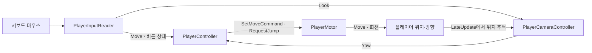

# ProjectU 플레이어 조작 구현 문서

작성 기준: 2026-10-10. `Assets/Scripts/Player`의 현재 소스와 공통 `Mortal` 클래스를 기준으로 하며 Shift 대시·E Skill1·F Skill2 입력 변경, 스태미나 기반 이동기 기획과 임시 Soldier 시각 에셋의 임포트 상태를 반영했습니다.
이 문서는 현재 구현된 조작 방법, 클래스 간 책임, 각 메서드와 프로퍼티를 설명합니다.
Inspector 항목은 C# 프로퍼티가 아니라 `[SerializeField]`가 지정된 비공개 필드입니다.

## 플레이어 조작 프로토타입

`Assets/Scenes/SampleScene.unity`를 열고 Play를 누릅니다. 40×40m 평면,
경계 벽, 전방 표시가 있는 파란 캡슐에 조작 스크립트가 연결되어 있습니다.

| 입력 | 동작 |
|---|---|
| WASD | 카메라 수평 방향 기준 이동, 옆걸음·뒷걸음 |
| 마우스 | 시점 회전, 캐릭터 수평 방향 회전 |
| Space | 지상에서 점프 |
| Q / R | Ultimate / Reload 입력 로그 |
| 왼쪽·오른쪽 Shift | Dash 입력 로그 |
| E | Skill1 입력 로그 |
| F | Skill2 입력 로그 |
| 마우스 좌클릭 / 우클릭 | Bullet 발사 / Grenade 투척(클릭당 한 발), 입력 로그 |
| Esc | 커서 잠금 해제, 조작 입력 중단 |
| Game 뷰에서 좌클릭 | 커서 잠금 및 조작 재개 |

Inspector 조정 항목:

- **Player → Player Motor**: Move Speed(m/s), Jump Height(m), Gravity(m/s²).
- **Main Camera → Player Camera Controller**: Mouse Sensitivity(도/픽셀), Invert Y,
  Minimum/Maximum Pitch, Initial Pitch, Target Height, Distance, Shoulder Offset,
  Collision Radius, Obstruction Mask.
- **Player → Character Controller**: 경사 제한, 계단 높이, 충돌체 크기.
- **Player → Player Controller**: Log Input, Held Log Interval(홀딩 로그 간격, 기본 0.5초).

Play 중 변경한 값은 Play 종료 시 복원됩니다. 지속할 값은 Edit 모드에서 설정합니다.
기본값은 이동 속도 6m/s, 점프 높이 1.5m, 중력 25m/s²입니다.

입력은 `PlayerInputReader`의 독립 InputActionMap에서 관리합니다.
기존 템플릿 `InputSystem_Actions` 에셋은 사용하지 않습니다.
Input Action 이름과 로그의 액션명·상태명은 PascalCase(`Dash`, `Skill1`, `PrimaryFire`, `Pressed`)로
통일합니다. C# 비공개 필드와 지역 변수는 camelCase(`dash`, `skill1`, `primaryFire`)를 사용합니다.
이동·시점은 매 프레임 Vector2로, 모든 게임플레이 버튼은 `ButtonInputState`의
`Pressed`(이번 프레임 누름), `Held`(현재 누르는 중), `Released`(이번 프레임 해제)로 제공합니다.
`Jump`, `Ultimate`, `Reload`, `Dash`, `Skill1`, `Skill2`, `PrimaryFire`, `SecondaryFire`에
동일한 상태 형식을 사용합니다. 이동은 WASD 홀딩 중 계속되고 점프는 `Jump.Pressed`만
사용하므로 Space를 계속 눌러도 착지 후 자동으로 다시 점프하지 않습니다.
입력 로그는 `PlayerController`에서 출력하며, Reader는 로그를 출력하지 않습니다.
`PlayerController`는 카메라 기준 입력을 월드 이동 방향으로 변환해
`PlayerMotor.SetMoveCommand()`와 `RequestJump()`를 호출합니다.
`PlayerMotor`는 입력·카메라 참조 없이 이동, 회전, 중력, 점프, 충돌을 처리합니다.
명령은 한 프레임만 유효하므로 Controller를 끄면 이전 이동·점프 명령이 남지 않으며,
Motor가 켜져 있으면 중력 처리는 계속됩니다. 실행 순서는 Reader → Camera → Controller → Motor입니다.
누름·해제는 한 번씩, 홀딩은 설정한 간격마다 출력합니다. 홀딩 상태 자체는 로그 간격과
관계없이 매 프레임 제공됩니다. 포커스 상실·커서 해제·일시정지 시 입력 상태를 초기화합니다.
커서 재잠금에 사용한 좌클릭은 버튼을 놓을 때까지 PrimaryFire에서 제외합니다.
카메라 충돌 검사는 Default 레이어를 대상으로 하며, 플레이어는 Ignore Raycast
레이어를 사용합니다. 새 장애물은 Default 레이어와 Collider를 지정합니다.

Q/E/F/R/Shift는 입력 로그만 출력합니다. 좌클릭은 Bullet 발사, 우클릭은 Grenade 투척에
연결되어 있습니다. 피해 전달 코드는 주석 상태이며 임시 크로스헤어는 제거했습니다.
재장전, 대시, 궁극기와 우클릭 정밀 조준은 아직 구현하지 않았습니다.
대시는 Skill1·Skill2와 별도의 이동기이며, **스태미나(Stamina)를 소모하고 쿨타임 없이 사용하는 것**이
구현 목표입니다. 현재는 Dash의 누름·홀딩·해제 로그만 출력하며 실제 대시 이동, 스태미나 관리와
소모·회복·부족 시 사용 제한은 구현하지 않았습니다. 스태미나 최대량·소모량·회복 방식은 미정입니다.
Soldier의 Skill1(E)은 향후 수류탄 투척에 연결하며, Skill2(F)의 효과는 아직 정하지 않았습니다.
투사체 클래스, 풀 관리, 프리팹 설정과 검증 방법은 [투사체 구현 가이드](투사체%20구현%20가이드.md)를 참고합니다.

이전 검증: Unity 6000.3.25f1 배치 실행에서 스크립트 컴파일, 저장된 씬의
컴포넌트·참조 연결, 누락 스크립트 유무, 플레이어 아래 바닥 충돌체를 확인했습니다.
실제 마우스·키보드 플레이 감각은 Game 뷰에서 확인합니다.

## 1. 구조와 프레임 실행 순서

| 구성 | 책임 | 부착 위치 |
|---|---|---|
| `ButtonInputState` | 버튼의 누름·홀딩·해제 상태를 담는 읽기 전용 값 형식 | 컴포넌트가 아닌 구조체 |
| `PlayerInputReader` | Input Action 생성, 입력 상태 수집, 커서 잠금 관리 | Player |
| `PlayerController` | 입력을 이동·점프 명령으로 변환하고 버튼 로그 출력 | Player |
| `PlayerMotor` | 명령을 받아 실제 이동·회전·중력·점프·충돌 처리 | Player |
| `PlayerCameraController` | 마우스 시점 회전, 플레이어 추적, 장애물에 따른 카메라 위치 조정 | Main Camera |



`Update()` 실행 순서는 클래스의 `DefaultExecutionOrder`를 기준으로 다음과 같습니다.
Unity의 Script Execution Order 설정에서 별도로 덮어쓰지 않은 경우를 전제로 합니다.

| 순서 | 클래스 | 실행 값 | 처리 |
|---|---|---|---|
| 1 | `PlayerInputReader` | -200 | 이번 프레임의 입력 스냅샷 갱신 |
| 2 | `PlayerCameraController` | -100 | Look으로 Yaw와 pitch 갱신 |
| 3 | `PlayerController` | -50 | 갱신된 Yaw 기준으로 이동 명령 생성 |
| 4 | `PlayerMotor` | 기본값 0 | 명령을 소비하고 실제 이동 처리 |
| 이후 | `PlayerCameraController.LateUpdate()` | 모든 Update 이후 | 이동이 끝난 플레이어 위치를 기준으로 카메라 배치 |

실제 카메라 Transform은 LateUpdate에서 갱신되므로 Controller는 카메라 Transform 대신
같은 프레임에 계산된 `Yaw`를 사용합니다. 이렇게 해야 마우스로 회전하며 움직일 때 이전 프레임의 방향을 사용하지 않습니다.

## 2. ButtonInputState

소스: `Assets/Scripts/Player/ButtonInputState.cs`

`readonly struct`로, 버튼 상태를 값으로 전달합니다. 여러 컴포넌트가 읽어도 입력이 소비되거나 변경되지 않습니다.
`default(ButtonInputState)`는 모든 상태가 false입니다.

### 프로퍼티

| 이름 | 형식 | 역할 |
|---|---|---|
| `Pressed` | `bool`, 읽기 전용 | 이번 입력 프레임에 버튼이 눌렸는지 표시합니다. 점프처럼 한 번 실행할 동작에 사용합니다. |
| `Held` | `bool`, 읽기 전용 | 버튼이 현재 눌린 상태인지 표시합니다. 연사·차징 등의 지속 입력에 사용할 수 있습니다. |
| `Released` | `bool`, 읽기 전용 | 이번 입력 프레임에 버튼이 해제됐는지 표시합니다. 차징 종료 등에 사용할 수 있습니다. |

이 세 값은 서로 배타적인 상태 열거형이 아닙니다. 일반적으로 누른 프레임에는 Pressed와 Held가 함께 true이며,
한 입력 프레임 안에서 빠르게 눌렀다 놓으면 Pressed와 Released가 함께 true일 수도 있습니다.

### 생성자와 메서드

| 선언 | 역할 |
|---|---|
| `private ButtonInputState(bool pressed, bool held, bool released)` | 전달받은 세 값을 프로퍼티에 저장합니다. 외부에서는 직접 호출하지 않습니다. |
| `public static ButtonInputState Read(InputAction action)` | `WasPressedThisFrame()`, `IsPressed()`, `WasReleasedThisFrame()`을 읽어 스냅샷을 반환합니다. 활성 입력 액션을 전달하는 사용을 전제로 하며 null 검사는 하지 않습니다. |

## 3. PlayerInputReader

소스: `Assets/Scripts/Player/PlayerInputReader.cs`

입력 상태를 수집하는 클래스입니다. 이동 실행과 입력 로그는 담당하지 않습니다.
`Awake()`에서 `PlayerControls`라는 InputActionMap을 직접 생성합니다.

### 공개 프로퍼티와 액션 매핑

모든 프로퍼티는 외부에서 읽을 수 있고, 값 변경은 Reader 내부에서만 가능합니다(`get; private set;`).

| 프로퍼티 | 형식 | 액션명 / 바인딩 | 역할 |
|---|---|---|---|
| `Move` | `Vector2` | Move / WASD의 2DVector 합성 입력 | x는 좌우, y는 전후 입력입니다. 길이를 최대 1로 제한합니다. |
| `Look` | `Vector2` | Look / `<Mouse>/delta` | 이번 프레임의 마우스 이동량입니다. 커서 전환 직후에는 한 번 무시합니다. |
| `Jump` | `ButtonInputState` | Jump / Space | 점프 버튼 상태를 제공합니다. |
| `Ultimate` | `ButtonInputState` | Ultimate / Q | 궁극기 입력 상태를 제공합니다. 실제 궁극기는 미구현입니다. |
| `Reload` | `ButtonInputState` | Reload / R | 재장전 입력 상태를 제공합니다. 실제 재장전은 미구현입니다. |
| `Dash` | `ButtonInputState` | Dash / 좌·우 Shift | 대시 입력 상태를 제공합니다. 현재 로그만 출력하며 이동·스태미나 처리는 미구현입니다. |
| `Skill1` | `ButtonInputState` | Skill1 / E | 첫 번째 스킬 입력 상태를 제공합니다. 현재 로그만 출력하며 수류탄 투척 연결은 미구현입니다. |
| `Skill2` | `ButtonInputState` | Skill2 / F | 두 번째 스킬 입력 상태를 제공합니다. 현재 로그만 출력하며 효과는 미정입니다. |
| `PrimaryFire` | `ButtonInputState` | PrimaryFire / 마우스 좌클릭 | 기본 사격 입력 상태입니다. 커서 재잠금에 쓰인 클릭은 제외합니다. |
| `SecondaryFire` | `ButtonInputState` | SecondaryFire / 마우스 우클릭 | 현재 Launcher에서 수류탄 투척에 사용하는 입력 상태입니다. |

`ReleaseCursor`(Esc)와 `CaptureCursor`(좌클릭)는 Reader 내부에서만 사용하는 액션이며 공개 프로퍼티는 없습니다.
Move와 Look은 Value 액션, 나머지는 Button 액션입니다.

### 메서드

| 선언 | 역할 |
|---|---|
| `private void Awake()` | 액션 맵과 모든 키 바인딩을 생성합니다. 게임플레이 액션에 `wantsInitialStateCheck = true`를 설정해 맵 재활성화 시 이미 누른 입력도 확인합니다. 커서 관리 액션은 그 뒤 생성되므로 이 설정의 대상이 아닙니다. |
| `private void OnEnable()` | 액션 맵을 활성화하고 커서를 잠급니다. |
| `private void Update()` | 먼저 공개 입력을 초기화합니다. 앱 포커스와 일시정지 상태를 확인하고 커서 잠금·해제를 처리한 뒤, 커서가 잠겨 있으면 이동·시점·버튼 상태를 읽습니다. |
| `private void SetCursorCaptured(bool captured)` | true이면 커서를 잠그고 숨기며, false이면 해제하고 표시합니다. `skipLook`을 켜서 다음 유효 입력 프레임의 시점 튐을 방지합니다. |
| `private void ClearInput()` | Move와 Look을 0으로, 모든 버튼 스냅샷을 default로 초기화합니다. 실제 키를 해제하거나 InputActionMap을 비활성화하는 메서드는 아닙니다. |
| `private void OnApplicationFocus(bool focused)` | 포커스를 잃으면 입력을 초기화하고 커서를 해제합니다. 포커스 복귀만으로 다시 잠그지는 않습니다. |
| `private void OnDisable()` | 액션 맵을 비활성화하고 입력 초기화 및 커서 해제를 수행합니다. |
| `private void OnDestroy()` | 생성한 액션 맵의 리소스를 `Dispose()`로 해제합니다. |

### 내부 상태와 입력 차단

`actions`는 액션 맵, `move`·`look`·`jump` 등의 InputAction 필드는 각 입력의 참조입니다.
`skipLook`은 커서 전환 후 첫 마우스 델타를 무시하기 위한 플래그이고,
`suppressPrimaryFire`는 커서 재잠금 클릭이 사격까지 실행하지 않도록 막는 플래그입니다.

- 포커스가 없거나 `Time.timeScale == 0`이면 공개 입력은 초기화된 상태로 남습니다.
- 커서가 풀려 있으면 게임플레이 입력을 읽지 않습니다.
- 재잠금 클릭은 누르고 있는 동안과 해제되는 프레임까지 PrimaryFire에 전달하지 않습니다. 이후 새 클릭부터 전달합니다.
- 차단 시 모든 버튼 상태를 false로 초기화하므로 별도의 Released 이벤트를 만들어 주지는 않습니다.
  추후 진행 중인 사격·차징을 취소할 때에는 별도의 행동 취소 처리가 필요합니다.

## 4. PlayerController

소스: `Assets/Scripts/Player/PlayerController.cs`

입력을 행동 명령으로 바꾸는 클래스입니다. `RequireComponent`로 PlayerInputReader와 PlayerMotor를 요구합니다.
공개 프로퍼티는 없습니다.

### Inspector 필드와 내부 상태

| 필드 | 코드 기본값 | 역할 |
|---|---|---|
| `playerCamera` | 참조 지정 필요 | 이동 기준이 되는 카메라의 Yaw를 읽습니다. 씬에서는 Main Camera의 PlayerCameraController를 연결합니다. |
| `logInput` | true | 버튼 로그 출력 여부입니다. false여도 이동·점프 명령 전달은 계속됩니다. |
| `heldLogInterval` | 0.5초 | 버튼별 홀딩 로그 간격입니다. Inspector의 최소값은 0.1초입니다. |

`input`과 `motor`는 같은 오브젝트의 컴포넌트 참조를 저장합니다.
`nextHeldLog`는 8개 버튼의 다음 홀딩 로그 출력 시각을 저장합니다.
배열 순서는 Jump, Ultimate, Reload, Dash, Skill1, Skill2, PrimaryFire, SecondaryFire입니다.
Shift는 `[Player Input] Dash (Shift): Pressed`, E는 `Skill1 (E): Pressed`,
F는 `Skill2 (F): Pressed`로 출력합니다. Held·Released도 같은 액션명과 키 표기를 사용합니다.
홀딩 로그 간격은 로그 출력 빈도이며 대시나 스킬의 쿨타임을 의미하지 않습니다.

### 메서드

| 선언 | 역할 |
|---|---|
| `private void Awake()` | Reader와 Motor를 가져옵니다. 카메라 참조가 없으면 오류를 출력하고 이 컴포넌트를 비활성화합니다. |
| `private void Update()` | Yaw로 수평 회전을 만들고 Move를 월드 방향으로 변환해 `SetMoveCommand()`를 호출합니다. Jump.Pressed이면 `RequestJump()`를 호출합니다. 이후 로그가 활성화돼 있으면 각 버튼을 Handle에 전달합니다. |
| `private void Handle(ButtonInputState state, string label, int index)` | 버튼 스냅샷, 로그용 이름, 타이머 인덱스를 받아 누름·홀딩·해제 로그를 출력합니다. 현재 실제 무기나 스킬을 실행하는 메서드는 아닙니다. |

Handle은 Pressed일 때 즉시 로그를 출력하고 다음 홀딩 로그 시각을 예약합니다.
Held 중에는 `Time.unscaledTime`으로 간격을 계산합니다. Released일 때 즉시 로그를 출력하고,
Held가 false이면 해당 타이머를 0으로 정리합니다. 로그 타이머와 관계없이 Reader의 Held는 매 프레임 갱신됩니다.

## 5. PlayerMotor

소스: `Assets/Scripts/Player/PlayerMotor.cs`

실제 캐릭터 이동을 담당하며 `CharacterController`만 필수 컴포넌트로 요구합니다.
Input System, Reader, 카메라를 참조하지 않습니다. 공개 프로퍼티는 없습니다.

### Inspector 필드

| 필드 | 코드 기본값 | 역할 |
|---|---|---|
| `moveSpeed` | 6m/s | 입력 크기에 곱하는 수평 이동 속도입니다. |
| `jumpHeight` | 1.5m | 점프 초기 속도를 계산할 목표 높이입니다. 프레임 단위 적분과 충돌에 따라 실제 도달 높이는 조금 달라질 수 있습니다. |
| `gravity` | 25m/s² | 아래 방향 가속도의 양수 크기입니다. 수직 속도에서 이 값을 빼는 방식으로 적용합니다. |

### 내부 필드와 상수

| 이름 | 역할 |
|---|---|
| `GroundStickSpeed` | -2m/s 상수. 지면에서 약한 하강 속도를 유지해 접지 상태를 유지하는 데 사용합니다. |
| `controller` | 실제 이동과 충돌을 처리하는 CharacterController 참조입니다. |
| `verticalSpeed` | 프레임 사이에 유지되는 수직 속도입니다. 점프와 중력이 갱신합니다. |
| `moveDirection` | 다음 Motor 업데이트에서 사용할 월드 수평 이동 방향 및 입력 크기입니다. |
| `facingYaw` | 명령으로 전달받은 수평 바라보기 각도입니다. |
| `hasMoveCommand` | 이번 업데이트에 적용할 이동·회전 명령이 있는지 나타냅니다. |
| `jumpRequested` | 다음 업데이트에서 지상 점프를 시도할지 나타냅니다. |

### 메서드

| 선언 | 역할 |
|---|---|
| `private void Awake()` | 같은 오브젝트의 CharacterController를 가져옵니다. |
| `public void SetMoveCommand(Vector3 worldDirection, float yaw)` | 월드 이동 방향과 바라볼 수평 각도를 받습니다. 방향의 y를 0으로 만들고 길이를 최대 1로 제한한 뒤 저장합니다. Motor가 비활성 상태이면 무시합니다. |
| `public void RequestJump()` | Motor가 활성화돼 있으면 점프 요청을 저장합니다. 이 메서드 자체가 점프를 즉시 실행하거나 접지를 검사하지는 않습니다. |
| `private void Update()` | 저장된 명령을 지역 변수로 옮기고 소비합니다. 회전, 접지, 점프, 중력, CharacterController.Move, 위·아래 충돌에 따른 수직 속도 보정을 수행합니다. deltaTime이 0 이하이면 명령 소비 후 이동 계산을 중단합니다. |
| `private void ClearCommands()` | 이동 방향을 0으로 하고 이동·점프 요청 플래그를 해제합니다. 수직 속도와 facingYaw는 초기화하지 않습니다. |
| `private void OnDisable()` | 수직 속도를 0으로 하고 대기 중인 명령을 지웁니다. |
| `private void OnValidate()` | Inspector 값이 변경될 때 이동 속도·점프 높이를 0 이상, 중력을 0.1 이상으로 보정합니다. |

### 이동 계산과 명령 수명

수평 속도는 `moveDirection × moveSpeed`입니다. 지상에서 점프 요청을 받으면 수직 속도를
`sqrt(2 × gravity × jumpHeight)`로 설정하고, 매 프레임 `gravity × deltaTime`을 뺍니다.
최종 변위는 수평·수직 속도를 합친 뒤 deltaTime을 곱해 `CharacterController.Move()`에 전달합니다.
상승 중 천장에 닿으면 수직 속도를 0으로, 하강 중 바닥에 닿으면 GroundStickSpeed로 바꿉니다.

이동과 점프 명령은 다음 Motor.Update 한 번에 소비됩니다. 계속 이동하려면 Controller가 매 프레임 명령을 보내야 합니다.
같은 업데이트 전에 SetMoveCommand를 여러 번 호출하면 마지막 요청이 남고, RequestJump를 여러 번 호출해도 한 번의 요청입니다.
공중에서 보낸 점프 요청은 착지까지 보관하지 않습니다. 현재 점프 버퍼나 코요테 타임은 없습니다.

이동 명령이 없으면 수평 이동과 새 회전 명령은 적용하지 않지만, Motor가 활성화돼 있으면 중력은 계속 계산됩니다.
현재는 가속·감속이나 수평 관성을 두지 않아 수평 이동이 즉시 시작·정지하며 공중에서도 방향을 바꿀 수 있습니다.

## 6. PlayerCameraController

소스: `Assets/Scripts/Player/PlayerCameraController.cs`

어깨 뒤 카메라를 제어하며 Camera 컴포넌트를 필수로 요구합니다.

### 프로퍼티

| 이름 | 형식 | 역할 |
|---|---|---|
| `Yaw` | `float`, 외부 읽기 전용 | 현재 수평 시점 각도입니다. Update에서 0 이상 360 미만으로 순환시키며 Controller가 이동 기준으로 사용합니다. |

수직 시점 각도는 공개 프로퍼티가 아닌 비공개 `pitch` 필드로 보관합니다.

### Inspector 필드

| 필드 | 코드 기본값 | 역할 |
|---|---|---|
| `target` | 참조 지정 필요 | 추적할 플레이어 Transform입니다. |
| `input` | 참조 지정 필요 | Look을 읽을 PlayerInputReader입니다. |
| `mouseSensitivity` | 0.12도/픽셀 | 마우스 델타를 회전 각도로 바꾸는 감도입니다. |
| `invertY` | false | true이면 마우스 상하 조작 방향을 반전합니다. |
| `minimumPitch` | -40도 | 위를 바라보는 쪽의 수직 회전 한계입니다. |
| `maximumPitch` | 70도 | 아래를 바라보는 쪽의 수직 회전 한계입니다. |
| `initialPitch` | 15도 | 시작 수직 각도이며 Awake에서 상하 한계에 맞게 제한됩니다. |
| `targetHeight` | 0.65m | target.position에서 월드 위쪽으로 더하는 카메라 기준점 높이입니다. 캡슐 바닥 기준 높이는 아닙니다. |
| `distance` | 4.5m | 회전된 기준 좌표에서 카메라를 뒤로 배치할 거리입니다. |
| `shoulderOffset` | 0.65m | 회전된 기준 좌표의 좌우 오프셋입니다. 양수면 오른쪽입니다. |
| `collisionRadius` | 0.25m | 카메라 장애물 검사에 사용하는 구의 반지름입니다. |
| `obstructionMask` | 1(Default 레이어) | 카메라를 가리는 장애물의 검사 레이어입니다. |

### 메서드

| 선언 | 역할 |
|---|---|
| `private void Awake()` | target과 input 참조를 검사합니다. 없으면 오류를 출력하고 비활성화합니다. 유효하면 target의 수평 각도로 Yaw를, initialPitch로 pitch를 초기화합니다. |
| `private void Update()` | Look.x로 Yaw를, Look.y로 pitch를 갱신합니다. 감도·상하 반전을 적용하고 pitch를 제한합니다. 마우스 델타는 프레임 동안 누적된 이동량이므로 deltaTime을 다시 곱하지 않습니다. |
| `private void LateUpdate()` | target 위치와 높이로 기준점을 만들고 회전·어깨 오프셋·거리로 카메라 목표 위치를 계산합니다. 해당 경로에 SphereCast를 수행해 장애물이 있으면 충돌 거리보다 0.05m 앞까지 오프셋을 줄인 후 카메라 위치와 회전을 설정합니다. |

장애물 검사에서 Trigger는 무시합니다. 현재 플레이어는 Ignore Raycast 레이어이므로 기본 Default 검사 대상에서 제외됩니다.
현재 추적과 장애물 거리 조정은 보간 없이 즉시 적용됩니다. 카메라 흔들림, 반동, 정밀 조준 전환은 아직 없습니다.

## 7. 씬 연결과 확장 경계

`Player`에는 CharacterController, PlayerInputReader, PlayerController, PlayerMotor가 붙어 있습니다.
PlayerController의 playerCamera는 Main Camera의 PlayerCameraController를 참조하고,
PlayerCameraController의 target과 input은 각각 Player의 Transform과 PlayerInputReader를 참조합니다.

Inspector의 이동 수치는 Motor에, 카메라 수치는 CameraController에, 로그 설정은 Controller에 둡니다.
코드 기본값과 씬에 저장된 값은 별개이므로 조작감을 조정할 때에는 해당 씬의 Inspector 값을 확인합니다.

현재 기절·속박·넉백·강제 이동은 구현하지 않았습니다. 추후 기절 시 Controller에서 명령 전달을 제한하면
Motor의 중력·충돌 처리는 유지할 수 있습니다. 넉백과 강제 이동은 Motor 쪽에 별도로 구현해야 합니다.
여러 시스템이 각각 CharacterController.Move를 호출하기보다 Motor에서 최종 이동을 계산하도록 확장하는 방향입니다.

앞서 사용한 PlayerPrototypeSetup과 PlayerInputValidation은 삭제된 개발 도구입니다.
이 문서 앞부분의 검증 기록은 당시 수행한 결과이며, 현재 저장소에서 그 도구를 다시 실행할 수 있다는 의미는 아닙니다.
2026-10-03 문서 작성에서는 소스와 문서의 일치 여부를 확인했으며 새 플레이 테스트를 실행하지 않았습니다.

## 8. 공통 체력·피해·사망 기반 클래스

`Assets/Scripts/Mortal.cs`의 `ProjectU.Mortal`은 플레이어와 적이 상속하거나 같은 GameObject에
컴포넌트로 추가할 수 있는 공통 기반 클래스입니다. 시작 HP는 Inspector의 `hp` 필드로 설정하며
기본값은 100입니다. 기존 SampleScene의 Player에는 아직 연결하지 않았습니다.

| 멤버 | 의미 |
|---|---|
| `int HP` | 현재 HP. 외부에서는 읽기만 가능하며 피해로 0 미만이 되지 않습니다. |
| `bool isDead` | 사망 여부. 사용자 요청대로 소문자 이름을 사용하며 외부에서는 읽기만 가능합니다. |
| `bool IsInvincible` | 피해 무시 여부. 외부에서 설정할 수 있습니다. |
| `TakeDamage(int damage, GameObject attacker)` | 살아 있고 무적이 아닐 때 양수 피해를 적용합니다. 환경 피해는 attacker에 null을 전달합니다. |
| `Dead(GameObject attacker = null)` | HP를 0으로 만들고 사망 상태를 설정한 뒤 사망 이벤트를 한 번 발생시킵니다. 직접 호출은 무적 여부와 무관합니다. |
| `OnDamaged` | `Action<int, GameObject>` 이벤트. 실제 감소한 HP와 공격자를 전달합니다. 무시된 피해에서는 발생하지 않습니다. |
| `OnDead` | `Action<GameObject>` 이벤트. 사망을 일으킨 공격자를 전달합니다. |

치명 피해의 순서는 **HP 감소 → OnDamaged → Dead → OnDead**입니다.
OnDead 구독자는 HP가 0이고 isDead가 true인 상태를 읽습니다. OnDamaged 구독자가 예외를
발생시켜도 치명 피해의 Dead 처리는 수행하며 예외는 호출자에게 전달합니다.
TakeDamage와 Dead는 virtual이며 파생 클래스에서 재정의할 때 기본 구현을 호출해야 합니다.
이벤트를 구독한 쪽은 자신의 생명주기에 맞춰 구독을 해제합니다.

```csharp
Mortal target = hitCollider.GetComponentInParent<Mortal>();
if (target != null)
{
    target.TakeDamage(20, attackerGameObject);
}

// 자신의 Mortal 참조인 mortal에 구독하는 예:
// void HandleDamaged(int damage, GameObject attacker)
mortal.OnDamaged += HandleDamaged;
// void HandleDead(GameObject attacker)
mortal.OnDead += HandleDead;
```

실제 공격의 피해 전달, 사망 시 이동·사격 중단, 애니메이션, 객체 반환·삭제, 회복·부활은 후속 작업입니다.
`Mortal` 자체는 이 행동을 실행하지 않습니다. 기존 이동 명령과 프레임 실행 순서는 유지합니다.
검증 메뉴는 `ProjectU > Validation > Validate Mortal`이며 배치 진입점은
`ProjectU.Editor.MortalValidation.Run()`입니다. 이 검증은 임시 객체를 생성·삭제하며 씬을 저장하지 않습니다.

2026-10-08 이전 검증: 실행 중인 원본 에디터를 유지하고 `Temp/MortalValidationProject`에서
Unity 6000.3.25f1로 Mortal 및 검증 스크립트를 컴파일·실행했습니다. HP 감소·공격자 전달,
무적·0 이하 피해 무시, 치명 피해의 HP 제한·이벤트 순서, 중복 사망, null 공격자,
치명 피해 구독자의 재진입·예외 처리를 통과했고 종료 코드 0 및
`Logs/MortalValidation.log`의 `MORTAL VALIDATION PASSED`를 확인했습니다.
당시 원본 SampleScene 수동 조작과 기존 투사체 검증은 다시 실행하지 않았습니다.

## 9. 2026-10-09 입력 변경과 검증

Shift의 기존 Skill1 입력을 Dash로 변경하고 Skill1은 E, Skill2는 F로 연결했습니다.
Dash도 다른 게임플레이 버튼처럼 상태 수집·초기화·로그에 포함되며 총 8개 버튼을 사용합니다.
실제 대시 이동·스태미나 처리와 E/F 스킬 실행은 후속 작업입니다.

이번에 Unity 6000.3.25f1로 원본 프로젝트를 배치 컴파일해 종료 코드 0과
`Logs/PlayerInputCompile.log`의 컴파일 완료·정상 종료, C# 컴파일 오류 없음을 확인했습니다.
소스의 바인딩·입력 수집·초기화·로그 인덱스와 씬의 Log Input 활성 설정을 대조했고,
이전 키 매핑 제거, 문서 경로·링크와 `git diff --check`도 확인했습니다.
실제 키 입력·SampleScene 수동 플레이와 기존 투사체·체력 검증은 이번에 실행하지 않았습니다.

후속 수동 확인은 Game 뷰에서 다음 항목을 확인합니다.

- 좌·우 Shift: `Dash (Shift)`의 Pressed·Held·Released 로그.
- E: `Skill1 (E)`의 Pressed·Held·Released 로그.
- F: `Skill2 (F)`의 Pressed·Held·Released 로그.
- Shift/E/F를 동시에 누를 때 각 버튼의 로그와 홀딩 간격이 독립적으로 유지되는지.
- Esc·포커스 상실·일시정지 시 새 버튼의 입력 상태가 초기화되는지.

## 10. 2026-10-10 임시 Soldier 에셋 임포트

사용자가 제공한 Mixamo FBX 8개를 아래 경로에 임포트했습니다.
현재 SampleScene의 플레이어는 파란 캡슐이며 새 모델·애니메이션은 연결하지 않았습니다.
Animator Controller, Blend Tree, 상체 Avatar Mask와 애니메이션 제어 컴포넌트는 추가하지 않았습니다.

- 모델: `Assets/Characters/Soldier/Models/X Bot.fbx`
- 애니메이션: `Assets/Characters/Soldier/Animations/`

모델은 `Humanoid / Create From This Model`로 유효한 Avatar를 생성하고
`Import Animation`을 껐습니다. 스킨드 메시와 URP/Lit 머티리얼이 각각 2개입니다.
애니메이션은 동일한 65개 Mixamo 본 구조를 확인한 뒤
`Humanoid / Copy From Other Avatar`로 X Bot의 Avatar를 참조하게 설정했습니다.
7개 클립 모두 60 FPS이며 Animation Compression은 Off입니다.
다운로드된 루트 이동 데이터는 보정하지 않고 유지했습니다.

| FBX 파일 | 클립 길이 | Loop Time |
|---|---|---|
| `X Bot@Firing Rifle.fbx` | 0.250초 | 끔 |
| `X Bot@Reloading.fbx` | 3.300초 | 끔 |
| `X Bot@Rifle Idle.fbx` | 8.567초 | 켬 |
| `X Bot@Rifle Run.fbx` | 0.717초 | 켬 |
| `X Bot@Run Backward.fbx` | 0.500초 | 켬 |
| `X Bot@Run Left.fbx` | 0.500초 | 켬 |
| `X Bot@Run Right.fbx` | 0.500초 | 켬 |

최초 임포트한 `Run Backwards`는 한 주기 동안 루트가 약 1.47m 이동했습니다.
같은 날 후속 작업에서 새 `Run Backward`로 교체해 큰 누적 이동이 없는 것을 확인했습니다.
현재 표는 교체 후 파일 기준이며, 새 클립의 상세 측정값은 아래 11절에 기록했습니다.
무기 모델·손 IK와 상체 분리, 점프·대시·투척·사망 동작도 후속 연결 작업입니다.
에셋 임포트나 Humanoid 변환 성공이 이동 사격·재장전 기능의 완성을 의미하지 않습니다.

최초 임포트에서 직접 실행한 검증:

- 원본과 복사된 FBX 8개 모두 SHA256 일치.
- Unity 6000.3.25f1 원본 프로젝트 배치 컴파일·임포트와 종료 코드 0.
- 유효한 Humanoid Avatar, 실제 스킨드 메시·머티리얼, 동일한 본 구조.
- 7개 Humanoid 클립의 프레임률·길이와 임시 Preview Scene에서 한 주기당 60회 샘플 재생.
  각 클립에서 실제 포즈 변화와 유한한 근육 값을 확인하고 루트 이동량을 기록했습니다.
- `Logs/SoldierAssetImport.log`의 `SOLDIER ASSET IMPORT PASSED`,
  `Logs/SoldierAssetImportReport.json`의 상세 결과.
- SampleScene의 작업 전후 SHA256 일치, 기존 씬·프리팹·런타임 코드·설정 변경 없음,
  문서 참조와 `git diff --check`.

검사에 사용한 임시 에디터 스크립트는 제거했습니다.
SampleScene 수동 플레이·시각 외형·상하체 블렌딩·손과 총의 정렬은 아직 확인하지 않았고,
기존 투사체·체력 검증도 이번 작업에서 다시 실행하지 않았습니다.

## 11. 2026-10-10 후진 애니메이션 교체와 루트 이동 검사

기존 `X Bot@Run Backwards.fbx`와 같은 이름의 meta 경로를 제거하고,
사용자가 다시 제공한 `X Bot@Run Backward.fbx`를 Animations 폴더에 임포트했습니다.
기존 GUID `ada47a42138fc6b4db963358410f33f4`와 클립 내부 ID를 유지했으며,
클립 이름은 `Run Backward`, 새 프레임 범위는 0~30입니다.
Humanoid, X Bot Avatar 참조, Loop Time 켬과 압축 Off 설정을 유지했습니다.

이 검사는 실제 다운로드 데이터의 루트 이동을 확인하기 위한 것으로,
Root Transform Position(XZ)의 Bake Into Pose 등 루트 이동을 제거하는 보정을 적용하지 않았습니다.
임시 Preview Scene의 X Bot에서 `Apply Root Motion`을 켜고
5주기를 주기당 60회, 총 300회 샘플링했습니다.

| 확인 항목 | 결과 |
|---|---|
| 클립 길이 / FPS | 0.500초 / 60 FPS |
| 스켈레톤 / Humanoid | 기존 모델과 동일한 65개 본 / 정상 |
| 한 주기 종료 시 수평 변위 | 약 0.0034mm |
| 5주기 종료 시 수평 변위 | 약 0.0175mm |
| 한 주기 중 최대 수평 편차 | 약 2.43cm |
| 한 주기 / 5주기 종료 시 루트 회전 차이 | 측정값 0도 |

이전처럼 반복할수록 크게 이동하는 후진 루트 이동은 해소됐습니다.
다만 주기 중 작은 루트 흔들림은 있으므로 루트 이동이 완전히 0인 클립은 아닙니다.
실제 PlayerMotor에 연결할 때는 이동을 코드에서 처리하고 Animator의 Apply Root Motion을 끄는
현재 설계 방향을 따릅니다. 이번 작업에서는 플레이어 연결을 수행하지 않았습니다.

이번에 직접 실행한 검증은 Unity 6000.3.25f1 배치 컴파일·임포트·샘플 재생과 종료 코드 0,
`Logs/SoldierBackwardImport.log`의 `SOLDIER BACKWARD IMPORT PASSED`,
`Logs/SoldierBackwardImportReport.json`의 상세 측정값입니다.
새 원본·복사본의 SHA256 일치, 이전 파일 경로 삭제, 기존 GUID·클립 내부 ID 보존,
모델·다른 클립·씬·코드·설정 등 81개 기존 파일의 작업 전후 SHA256 일치를 확인했습니다.
임시 에디터 검사 스크립트를 제거하고 문서 경로·링크와 `git diff --check`도 확인했습니다.
수동 시각 검증, SampleScene 플레이와 기존 투사체·체력 검증은 이번 작업에서 수행하지 않았습니다.
